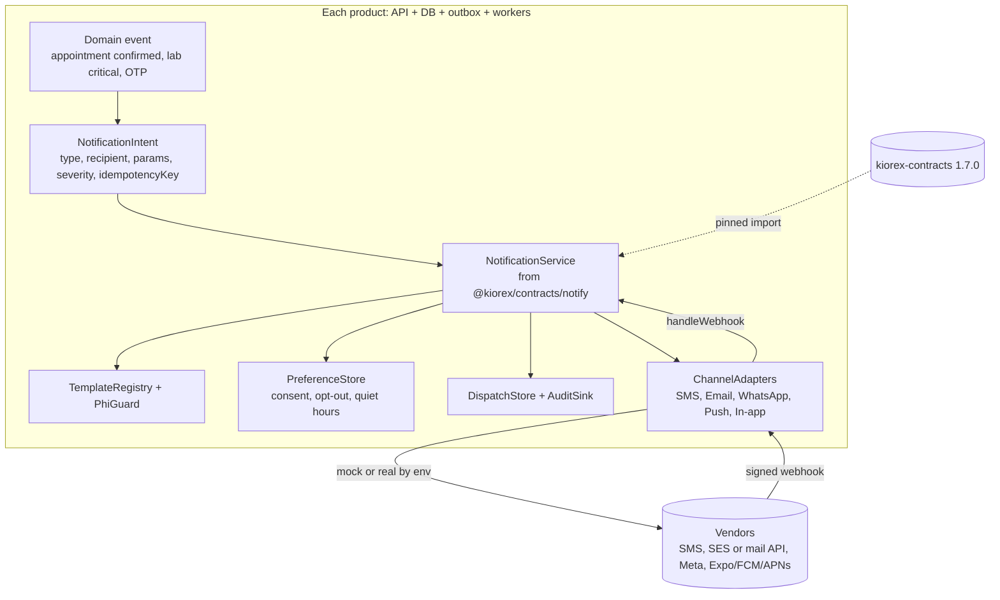
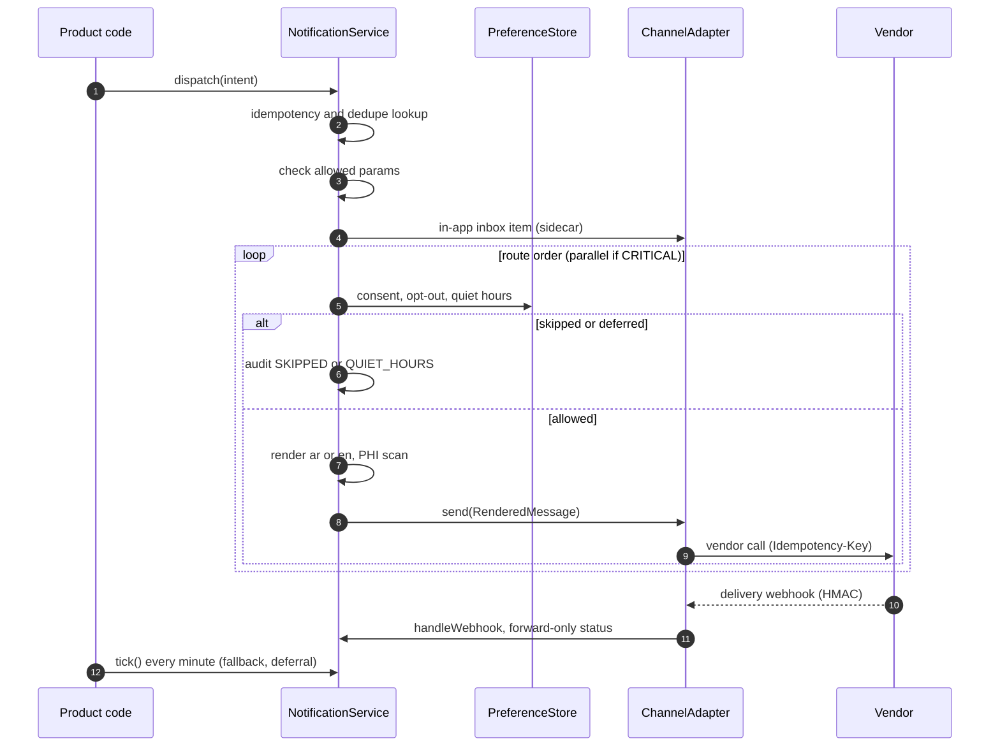
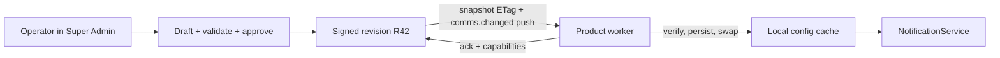

# KX24 — Notifications & Messaging Architecture

Revision: Rev 2.3 · Reference Edition, updated 23 November 2026 (new volume in this set; owner: Chief Software Architect; supersedes: none in this folder. A Drive draft of this volume dated 22 Nov 2026 is labelled "Rev 2.4" and numbers its main decision ADR-033; this Markdown reconciles it with what is built, see §02 and §13; Growth update 24 Nov 2026 added at the end, status-labelled)

Subtitle: Email, SMS, push, WhatsApp and the in-app inbox across Kiorex, Kiorly Clinic (and the Nurse edition), Kiorly Pharmacy and Kiorly Lab: one shared notification layer, per-product adapters, mock by default, real by configuration.

Tags: Notification layer · Channel adapters · Consent and PHI guard · Provider go-live · Target control plane (Proposed)

> **Note** How to read this volume. §01 to §09 describe what is **built and verified on 23 Nov 2026** (shared package `@kiorex/contracts/notify` 1.7.0, per-repo provider adapters). §10 is the **target** control-plane design preserved from the Drive draft of 22 Nov and is **Proposed, not built**. §11 to §14 are the migration plan, risks, open items and decision log. Status words: Done, Open, Planned, Blocked. Nothing here has run against a live vendor.

| Field | Value |
|---|---|
| DOCUMENT | KX-24 |
| REVISION | Rev 2.3 · Reference Edition (updated 23 November 2026) |
| STATUS | Built layer: Done in kiorex-platform; Planned elsewhere. Control plane: Proposed |
| OWNER ROLE | Chief Software Architect |
| AUDIENCE | Engineering, build agents, operations, DPO / CMO reviewers, technical due diligence |
| RELATED | KX-01 ADR-034, ADR-035; KX-04 KA-02; KX-08 §12; KX-09 §08; KX-10 §08; KX-16; KX-17; `_docs/PROVIDER_GO_LIVE.md`; `kiorex-contracts/docs/NOTIFICATION_LAYER.md` |

## Key numbers (verified 23 Nov 2026)
- **1** shared layer, **0** new services: a TypeScript package, no network hop, no shared database (ADR-034).
- **5** channels: SMS, Email, WhatsApp, Push, in-app inbox. **3** severities: ROUTINE, IMPORTANT, CRITICAL. **6** normalized delivery statuses: QUEUED, SENT, DELIVERED, READ, FAILED, SKIPPED.
- **60** unit tests on `src/notify`, 100 % statements, branches, functions and lines (contracts 1.7.0 CHANGELOG).
- **8** provider kinds with a port and a mock/real pair somewhere in the suite: SMS, EMAIL, WHATSAPP, PAYMENT, PUSH, STORAGE, CONSENT, AI (not every kind in every repo; matrix in §07).
- **1** product migrated (kiorex-platform); **4** planned in a fixed order: Passport, Lab, Pharmacy, Clinic.
- **0** real vendors contacted. Real adapters were tested against a local fake server only.

## 01 Goals and non-goals
Goals:
1. One decision point for "may we send this, to whom, on which channel, in which words", identical in every product.
2. Patient-safety messages (critical lab value, SOS, home-visit safety) reach people by more than one channel and are never silenced by quiet hours.
3. No PHI in SMS, push or WhatsApp bodies, enforced by the layer and not by each caller.
4. Mock first: every provider runs on a mock adapter until the go-live pass; going live is configuration (URL, key, secret), not code (FD-04).
5. Each Kiorly product keeps working when Kiorex is down (principle P1): the layer is a library inside each product, never a service they call.

Non-goals (this revision): a central notification service (rejected, see §13); runtime-editable templates and a Super Admin communications console (Proposed, §10); marketing campaigns; new channels (RCS, Telegram).

## 02 Reconciliation with the Drive draft (22 Nov 2026)
A Drive draft of KX-24 (labelled Rev 2.4, status "target architecture") was read before writing this volume. Its core ideas are kept. Where the build diverged, the build wins for what exists and the draft stays as the Proposed target.

| # | Topic | Drive draft (22 Nov) | Built on 23 Nov | Treatment here |
|---|---|---|---|---|
| 1 | Delivery boundary | Product-owned workers plus a shared package plus a central config control plane (option C) | Product-owned adapters plus a shared package; no control plane | Same direction. Package is `@kiorex/contracts/notify`, not `@kiorly/messaging` (§03) |
| 2 | Package name and home | New `@kiorly/messaging` from `clinics-management/packages/` | Subpath of the contracts package, since 1.7.0 | Built name used; the draft name is retired unless the founder wants adapters split from contracts (§12, OQ-6) |
| 3 | Decision number | "ADR-033" | ADR-033 is already the mobile-app decision (Proposed, 20 Nov) | Renumbered **ADR-034** (layer) and **ADR-035** (provider adapter contract) in KX-01 (OQ-1) |
| 4 | Templates | Versioned per locale in a control plane, approvals, Meta sync | Code registry per product (`TemplateRegistry`, ar/en, per channel, `validate()` in CI) | Built registry is the source today; control plane Proposed (§10) |
| 5 | Provider selection | Signed revision, runtime switch without restart (conflict C1) | Environment: `<KIND>_MODE`, URL, key, secret; fail-fast at startup | Env stays the go-live mechanism (ADR-035). Runtime switching Proposed |
| 6 | Push | Direct FCM HTTP v1 plus APNs key, Web Push for the PWA, no SNS | Expo-compatible HTTP push adapter in lab and pharmacy; mock in clinic and platform; staff and patient apps register Expo tokens (mock token when no EAS project id) | Direction (native tokens) kept as target; today Expo gateway shape (§05, OQ-5) |
| 7 | SMS vendor | Infobip first, Twilio second, qualification pending | Neutral HTTP adapter plus one mapping file per kind, vendor not chosen | Vendor stays an open decision (OD-1) |
| 8 | Duplicate prevention for marketplace bookings | Patient-delivery owner derived from `bookingSource`; Kiorly suppresses its patient messages for Kiorex bookings | Not built (clinic not migrated) | Kept as design rule (§08), status Planned |
| 9 | Delivery records | Notification plus DeliveryAttempt tables, SKIP LOCKED claims | One `AuditRecord` shape; `DispatchStore` interface with an in-memory store bundled; product tables not yet created except in platform | §07 |
| 10 | Access gap noted by the draft | "kiorex-platform, contracts, account, pharmacy, lab not found on GitHub" | All exist in the local workspace (cloned under the founder's account, private) | Draft finding superseded; not re-verified against GitHub |

> **Decision** Founder decision recorded in `NOTIFICATION_LAYER.md` (23 Nov 2026): the notification layer is a **package, not a service**. A central service may be reconsidered only if cross-product operations justify it (KX-01 §04 already says "no service until cross-product operations justify it").

## 03 Architecture

Rules: the layer performs no I/O; each product injects adapters, preference store, audit sink, dispatch store and clock; products share a package and schemas, never a service or a database. No product calls another product to send a message (cross-product facts travel as HMAC webhooks, KX-09).

| Layer | Owns | Does not own |
|---|---|---|
| Notification layer (package) | intent, templates and allowed params, PHI guard, routing and fallback, consent / opt-out / quiet-hours / WhatsApp-window gate, idempotency and dedupe, normalized status, audit shape | sending, vendor wire formats, queues, tables |
| Channel adapters (per repo) | the HTTP call to the vendor, vendor webhook signature, mock mode, retries and timeouts | deciding whether or when to send |
| Product | preference tables, audit table, the schedule that calls `tick()`, mapping domain events to intents | rendering rules |

## 04 Intent, template, routing, consent and status model
**Intent.** `type` (template code), `recipient {id, phone?, email?, deviceIds?, locale ar|en}`, `params` (only keys the template declares), `severity`, `idempotencyKey`, optional `dedupe {key, windowMs}` (default 24 h), optional `channels` restriction, PHI-free `metadata`.

**Template.** One definition per type: `purpose` (TRANSACTIONAL, REMINDER, MARKETING, SECURITY, selects the consent asked), `allowedParams`, `requiredParams`, `quietBypass`, per-channel renderers (SMS text with segment count, email subject/html/text, WhatsApp approved template name plus variables or free text, push title/body/data with deep link, in-app title/body/deep link). `simpleTemplate` builds all channels from one ar/en pair. A channel without a renderer is SKIPPED (`NO_TEMPLATE`). SMS over the segment limit (default 4) fails with `SMS_TOO_LONG`. `registry.validate()` renders every channel in both locales and is run in each product's unit tests.

**Routing** (per severity, overridable per product):

| Severity | Default route | Behaviour |
|---|---|---|
| ROUTINE | In-app, Push, Email | sequential; fall back after 15 min without a delivery receipt |
| IMPORTANT | In-app, Push, WhatsApp, SMS | sequential; fall back after 5 min |
| CRITICAL | In-app, Push, WhatsApp, SMS, Email | all at once; quiet hours bypassed |

The in-app inbox is a sidecar: written first, never counts as "reached the person", never stops the chain. A SKIPPED or FAILED attempt moves to the next channel at once; a SENT attempt waits for a receipt; the package has no timers, `tick()` (called every minute by the product's job runner) performs due fallbacks and quiet-hours resumptions from stored due times.

**Gate, in this order, per channel:** consent for the purpose, channel opt-out, quiet hours (not applied to in-app, CRITICAL, or `quietBypass`; consent and opt-out still apply to CRITICAL), address present, WhatsApp 24 h window (free text only inside the window, otherwise the approved template; a text-only renderer is SKIPPED `WHATSAPP_WINDOW`).

**PHI guard** (fail closed): (1) undeclared params are rejected before rendering (`PARAM_NOT_ALLOWED`, `PARAM_MISSING`); (2) after rendering, SMS, push and WhatsApp bodies are scanned for national id (14 digits), MRN, lab values with units, diagnosis terms (en and ar), prescription wording. A hit fails the attempt `PHI_BLOCKED`. Email and in-app are authenticated surfaces and are not scanned, which is why clinical detail belongs there and a push only says "open the app". The audit record never holds a body, a param or a raw address.

**Status.** QUEUED, SENT, DELIVERED, READ, FAILED, SKIPPED. `mergeStatus` is forward-only (a late "sent" never overwrites "delivered"; FAILED and SKIPPED are terminal), so retries and out-of-order webhooks are idempotent. Per-channel normalizers map vendor words to the model; an unknown word is dropped, never guessed. Dispatch phases: IN_PROGRESS, DEFERRED, DELIVERED, EXHAUSTED, SUPPRESSED.

**Audit.** One `AuditRecord` shape for all products, written per channel attempt and per status change, PHI-free by construction (reasons: CONSENT, OPT_OUT, NO_ADDRESS, WHATSAPP_WINDOW, NO_TEMPLATE, NO_ADAPTER, DEDUPED, QUIET_HOURS, PHI_BLOCKED, SMS_TOO_LONG, PARAM_NOT_ALLOWED, PARAM_MISSING, RENDER_ERROR, SEND_FAILED, ADAPTER_ERROR, DELIVERY_FAILED, TIMEOUT, UNKNOWN_TYPE).

## 05 Channel adapters and provider contract
Every product wraps its existing provider client as a `ChannelAdapter` (`send`, `parseWebhook`, `verify`); push with several devices is sent once per device and succeeds if any device accepts. Below the adapter, each kind follows the same provider contract (ADR-035): port plus `mock` plus `real`, timeouts, retries with backoff on network, timeout, 429 and 5xx (never 4xx), the same `Idempotency-Key` on every retry, error mapping without vendor body, URL, key or recipient, HMAC-SHA256 webhooks over the raw body with 5 min timestamp tolerance, de-duplication, forward-only statuses, fail-fast startup validation (names only), dev-only simulators that answer 404 in production and in real mode, and one mapping file per kind as the only vendor-specific code.

Environment contract (full table in `_docs/PROVIDER_GO_LIVE.md`): `<KIND>_MODE` (`mock` default | `real`), `<KIND>_API_URL`, `<KIND>_API_KEY`, `<KIND>_WEBHOOK_SECRET`, SMS `SMS_SENDER_ID`, EMAIL `EMAIL_FROM`, WhatsApp `WHATSAPP_SENDER_ID` and optional `WHATSAPP_TEMPLATE_MAP`, tuning `<KIND>_TIMEOUT_MS` (default 8000 or 10000), `<KIND>_MAX_RETRIES` (2), `<KIND>_BACKOFF_MS` (300). Legacy switches (`MESSAGING_MODE`, `PSP_MODE`, `MOBILE_PUSH_MODE`, `KIORLY_PROVIDER_MODE_<KIND>`) still work as defaults.

## 06 Provider table per channel
| Channel | Vendor (decision) | Adapter status | What is needed to go live | Status |
|---|---|---|---|---|
| SMS | Not chosen. Drive draft proposes Infobip first, Twilio second after carrier tests | Neutral HTTP adapter and mapping file in platform, Passport, clinic (branch kiorex), pharmacy, lab; tested against a local fake server | Vendor contract, alphanumeric sender id registration with Egyptian carriers, URL, key, webhook secret | Blocked (human) |
| Email | Amazon SES in eu-central-1 (clinic `EMAIL_TRANSPORT=ses`) or any HTTP mail API (`EMAIL_TRANSPORT=http`) | Adapter built in clinic, platform, pharmacy, lab | SES production access and DKIM/SPF/DMARC on `mail.kiorly.com` (NH016), a Kiorex mail identity, egress | Blocked (human) |
| WhatsApp | Meta WhatsApp Cloud API direct (clinic `WHATSAPP_PROVIDER=meta_cloud`) or HTTP gateway | Adapter built in clinic, platform, Passport, pharmacy, lab; template map env in platform and Passport | Meta business verification, template approvals (NH003 to NH015), approved names in the template definition (`TODO_NEEDS_HUMAN_*` placeholders today), sender id | Blocked (human) |
| Push | Expo-compatible gateway today; native FCM HTTP v1 and APNs is the target (OQ-5) | HTTP adapter in lab and pharmacy (`PUSH_MODE`, `PUSH_API_URL`); clinic and platform stay mock (no HTTP provider); both Expo apps register tokens, route taps and upload tokens | EAS project id, APNs key, FCM v1 service account, `PUSH_MODE=real` | Blocked (human). Real delivery never observed |
| Payment (PSP) | Paymob, Fawry, InstaPay behind one neutral adapter (`sandbox-fake` mock) | Checkout, refund, pay-link and signed webhooks built in platform, clinic, pharmacy, lab | PSP onboarding, URL, key, webhook secret; map the wire format in `payment.mapping.ts` | Blocked (human) |
| Storage | Local disk mock; HTTP object store | Lab and pharmacy adapters (signed URLs in pharmacy) | `STORAGE_API_URL`, key | Open |
| Consent registry | Pharmacy only; registry wire format is an assumption (`POST /consents`, `GET /consents`, `POST /consents/{id}/revoke`, `POST /consents/introspect`) | Adapter built, consent grant and revoke block dispensing in mock | Real service and its wire format; adapt `consent.mapping.ts` | Open |
| AI | Pharmacy only; token and daily-budget guards | Adapter built; budget counted per API instance | Vendor URL and key; a shared counter before scaling out | Open |
| In-app inbox | Own table | Built in platform (`Message` rows, `GET /inbox`); other products not assessed for this volume | none | Done (platform) |

## 07 Per-repository status (23 Nov 2026)
| Repo | Provider kinds with real adapter | Layer adopted | Notes |
|---|---|---|---|
| kiorex-contracts | n/a | Provides `@kiorex/contracts/notify` 1.7.0 | Pure TypeScript, no I/O |
| kiorex-platform | SMS, Email, WhatsApp, Payment | Done | `EngagementService.deliver()` dispatches a single-channel intent; 25 `NotifyKind` templates in a registry; no table or migration added; `smsMaxSegments: 20` so no legacy SMS is newly rejected; PHI hit now fails the attempt instead of sending; on-call safety paging is a separate adapter (`SAFETY_DELIVERY_MODE`) |
| kiorex-account (Passport) | SMS, WhatsApp (OTP: WhatsApp first, SMS fallback when both real) | Planned (step 2) | OTP code never logged in real mode; the Cognito Lambda reads secrets from env and needs a deploy-time injection route |
| kiorly-lab | SMS, Email, WhatsApp, Payment, Push, Storage | Planned (step 3) | Critical-value alert is the CRITICAL fan-out case |
| kiorly-pharmacy | SMS, Email, WhatsApp, Payment, Push, Storage, Consent, AI | Planned (step 4) | Existing consent registry becomes the `PreferenceStore` |
| clinics-management (branch kiorex) | SMS, Email, WhatsApp, Payment | Planned (step 5) | Largest surface: appointment outbox, reminder scheduler, email outbox, digests, WhatsApp replies; migrate one flow at a time |

## 08 Event-to-notification rules
Preserved from the Drive draft; implementation Planned except where stated.
1. **Delivery owner.** For appointments Kiorly produces the lifecycle events (KX-09 §04). The patient-delivery owner is derived from `bookingSource`: `KIOREX_MARKETPLACE` or `KIOREX_WHATSAPP` means Kiorex Engagement messages the patient; anything else means Kiorly. Staff messages are always Kiorly's. Kiorly suppresses its patient reminders for Kiorex-sourced bookings once Kiorex engagement is live for the market (today the clinic scheduler does not filter by booking source, a known duplicate risk).
2. **Stale reminders.** Re-check appointment state and start time immediately before each attempt; supersede reminders on reschedule or cancel; unique reminder key on appointment, start time and offset. Not built in the clinic yet.
3. **Severity mapping.** OTP and recovery: SECURITY purpose, quiet-hours bypass, WhatsApp then SMS. Critical lab value and home-visit safety: CRITICAL fan-out. Result ready and order ready: IMPORTANT, with an app-only push. Reminders: ROUTINE or IMPORTANT per product.
4. **Suppression.** Bounces, complaints, STOP and invalid tokens are product data (always current) and feed the `PreferenceStore`.
5. **Family and visit status.** The public family visit-status link carries no PHI beyond a status timeline, ETA and provider name; share messages go over WhatsApp or SMS through the platform hub.

## 09 Privacy, security and observability
- Generic bodies: "open the app" pushes, no diagnosis, drug, test name or value in SMS, push or WhatsApp. Authenticated link for detail. Document-header WhatsApp templates (prescription or lab PDF) stay out of production until DPO, CMO and product sign-off (Drive OD-02).
- Webhooks: HMAC-SHA256 over the raw body, 5 min tolerance, de-duplicated, statuses only forward. In kiorex-platform, real mode stores no body and no raw recipient in the message log (masked recipient only).
- Secrets: never in code, logs or audit; startup refuses `MODE=real` with a missing variable and names the variable, not the value. Secret injection on AWS (Secrets Manager or SSM) is documented per repo and not created.
- Consent withdrawal and the PHI guard are safety controls and never flags (ADR-025). Kiorex-side channel kill-switches (`comms.*` flags in the Drive draft) are Proposed.
- Monitoring targets from the draft (Proposed): outbox lag over 2 min, decision to accepted p95 per channel, failure rate over 5 % for 15 min, fallback and duplicate rates, spend per country and channel.

## 10 Target: communications control plane (Proposed, not built)
Preserved from the Drive draft so the intent is not lost. None of it exists in code on 23 Nov 2026.
- **Super Admin "Communications" area** in the Kiorex ops console beside the flag control plane: channels enabled per environment, country, product and tenant; provider priority; sender identities (SES domains, SMS sender ids, WhatsApp numbers, Firebase apps); routing per notification type; credentials by reference only (secret ARN, never the value); preview of the effective settings.
- **Templates as data**: versioned per locale (ar-EG, ar, en), approvals (author is not approver), WhatsApp binding to approved template name and language with status sync, SMS segment estimator, email RTL previews, push deep links from an allow-listed route registry.
- **Signed revisions** distributed over the existing flag snapshot mechanism (pull with ETag every 30 s plus HMAC `comms.changed` push), verified and cached by product workers, fail-static when the control plane is unreachable, acknowledgements back with a capability report.
- **Emergency kill-switches** `comms.email|sms|push|whatsapp` as flags (global, market, org), never applied to safety alerts.
- **Pilot rule** (Drive DL-20): the Egypt pilot runs on a bootstrap configuration from the market pack if the control plane is not live; general availability would require the revision path.
- Proposed schemas in contracts (`comms/revision`, `comms/template-version`, `comms/ack`, `notifications/<type>`) and routes (`GET /control/v1/comms/snapshot`, `POST /control/v1/comms/ack`, `/admin/v1/comms/*`).

> **Open question** Is the control plane still wanted now that the layer exists, or is code-registered templates plus environment configuration enough until a second market? See OQ-3.

## 11 Migration plan
Do not migrate several products at once; each step is one repo, behind unchanged public behaviour, tests green before the next.

| # | Repo | Work | Status |
|---|---|---|---|
| 1 | kiorex-platform | Hub adapters, 25 templates, Prisma-backed preference store, inbox as a channel, status normalization in the webhook handler | Done |
| 2 | kiorex-account (Passport) | One SECURITY template (code never audited, `quietBypass`), adapters wrapping `provider.ts`, `DeliveryStatus.handleWebhook` becomes `svc.handleWebhook` | Planned |
| 3 | kiorly-lab | Critical lab alert as CRITICAL intent; result-ready as IMPORTANT with app-only push | Planned |
| 4 | kiorly-pharmacy | REMINDER and TRANSACTIONAL templates; consent registry wired into `PreferenceStore` | Planned |
| 5 | clinics-management | One flow at a time behind the outbox: appointment reminders, then transactional email, then instalment reminders and digests; keep the `OutboundMessage` worker as the scheduler that calls `tick()` | Planned |

Per-repo checklist: implement `ChannelAdapter` over the existing client; port templates with explicit `allowedParams`; implement `PreferenceStore` over consent and opt-out tables; persist `DispatchStore` and `AuditSink` (one table each); call `tick()` from the job runner; run `registry.validate()` in unit tests; vendor `@kiorex/contracts` 1.7.0 or newer. Staging checks before real mode: one SMS and one push with a PHI-looking parameter is rejected (`PHI_BLOCKED`), a quiet-hours send is deferred, an opted-out channel is skipped with its reason.

## 12 Risks
| ID | Risk | Mitigation | Status |
|---|---|---|---|
| NR-1 | The in-memory `DispatchStore` is used in production, so fallbacks and receipts are lost on restart | Persist `DispatchStore` and `AuditSink` per repo before real mode | Open |
| NR-2 | Duplicate patient messages for marketplace bookings (Kiorly and Kiorex both send) | Delivery-owner rule (§08) before Kiorex beta | Planned |
| NR-3 | Reminder sent after reschedule or cancel | Pre-send state check and superseding | Planned |
| NR-4 | PHI leaks in a push or SMS through a free-text param | Declared params plus pattern scan; email and in-app carry detail | Done (layer). Pattern list needs DPO review (Open) |
| NR-5 | Real push never delivered or silently dropped (iOS best effort, user disabled notifications) | Server escalation chains and SMS or dispatcher fallback stay; in-app banner; never claim the app is the only channel (mobile risk R8) | Open, unverified |
| NR-6 | Wire formats assumed (consent registry, vendor webhooks) differ from real vendors | One mapping file per kind; staging pass against real sandboxes | Open |
| NR-7 | `AI_DAILY_TOKEN_BUDGET` counted per instance | Shared counter before scaling out | Open |
| NR-8 | Secrets on AWS: the Passport Cognito Lambda reads env; no injection route; tfvars hold `TODO_NEEDS_HUMAN` | Define injection (Secrets Manager or SSM) at deploy time | Open |
| NR-9 | SMS sender id and WhatsApp templates take weeks to approve | Start registration early; templates are a pilot dependency | Blocked (human) |
| NR-10 | Two documents disagree on the decision number (Drive draft vs repo) | KX-01 renumbering and OQ-1 | Open |

## 13 Decision log
| ID | Decision | Status |
|---|---|---|
| DL-01 | Product-owned delivery on each product's outbox and workers; reuse Kiorly's pipeline | Accepted (ADR-034) |
| DL-02 | Layer is a package, not a service | Accepted (ADR-034) |
| DL-03 | Provider adapters share one contract: port, mock, real, env, retries, idempotency, HMAC webhooks, fail-fast | Proposed (ADR-035), implemented in five backends |
| DL-04 | Consent, preferences, suppression and history stay product-local | Accepted (carried from the draft, matches ADR-013) |
| DL-05 | Env selects mock or real (go-live is configuration); runtime selection by revision is Proposed | Accepted for env; Proposed for runtime |
| DL-06 | Patient-delivery owner derived from `bookingSource` | Proposed (draft DL-02), Planned |
| DL-07 | Safety alerts are exempt from any kill-switch and quiet hours | Accepted (ADR-025 extension) |
| DL-08 | WhatsApp direct to Meta Cloud API; separate Kiorex and Kiorly business senders | Proposed (draft DL-07) |
| DL-09 | Push: native FCM and APNs tokens as target; Expo gateway shape today | Proposed (OQ-5) |
| DL-10 | Document-header WhatsApp templates blocked until DPO + CMO + product sign-off | Proposed (draft OD-02) |

Open decisions carried from the draft: OD-1 Egyptian SMS vendor (Infobip, Twilio or a local aggregator) after carrier tests across Vodafone, Orange, Etisalat (e&) and WE; OD-2 clinic-owned WhatsApp numbers timing (draft recommends post-GA); OD-3 sender display name for standalone clinics on WhatsApp.

## 14 Open items
| ID | Item | Owner | Status |
|---|---|---|---|
| OQ-1 | Confirm ADR renumbering: notification layer ADR-034, provider contract ADR-035 (the Drive draft used ADR-033) | CEO / acting CTO | Open |
| OQ-2 | Revision label: Drive draft says Rev 2.4; this set is Rev 2.3 | CEO | Open |
| OQ-3 | Keep the control plane (§10) on the roadmap or defer until a second market | CEO | Open |
| OQ-4 | Persist `DispatchStore` per repo: table design and retention (DPO: 90 days for non-clinical bodies in the draft; today no bodies are stored) | Engineering + DPO | Open |
| OQ-5 | Push: stay on the Expo gateway or move to native FCM and APNs tokens | Mobile lead | Open |
| OQ-6 | Keep `@kiorex/contracts/notify` or split adapters into a separate package (`@kiorly/messaging`) | Chief Software Architect | Open |
| OQ-7 | Real provider URLs and credentials; WhatsApp template approval; PSP onboarding; SMS sender id; APNs and FCM keys with EAS project id; AWS secret injection | CEO / ops | Blocked (human), see KX-17 §01a |
| OQ-8 | First live test belongs in the pre-launch staging pass (FD-04) | CEO | Planned |

## What changed in this revision (23 Nov 2026)
- New volume. Documents the shared notification layer (`@kiorex/contracts/notify` 1.7.0, adopted in kiorex-platform) and the provider adapter contract that every backend now follows (`_docs/PROVIDER_GO_LIVE.md`).
- Preserves the Drive draft's target control plane as Proposed, renumbers its decision (ADR-034/035) because ADR-033 is the mobile-app decision, and lists every divergence in §02.
- Not verified: any live vendor delivery, real push delivery, persistence of the dispatch store in production, GitHub visibility of the repos named in the draft.

## Growth Engine update (24 Nov 2026): consent, lifecycle and the WhatsApp assistant
Labels: **As-built** (in code today), **Approved target** (Accepted ADR or FD), **Proposed** (ADR-041 to ADR-047, unsigned), **Roadmap**, **Open decision**, **Regulatory dependency**. Full legend in KX-27. Source: `_docs/growth/` reports of 24 Nov 2026. Nothing here is implemented unless marked As-built.

- **Section 01 non-goals**: "marketing campaigns" is no longer a non-goal of the programme. It stays a non-goal of the Rev 2.3 build. Proposed scope for Phase 2: campaigns, lifecycle journeys and frequency caps built on this layer, not beside it (ADR-034). Phase 1 and 2 growth messaging is sent from Kiorex Engagement only (patient-delivery owner rule); clinic recall keeps its current consent gate until clinic adoption (step 5) lands.
- **Purposes (section 04)**: As-built `TRANSACTIONAL, REMINDER, MARKETING, SECURITY`. Proposed: a `CLINICAL` purpose following severity rules (CRITICAL bypasses quiet hours; marketing never does); a template is bound to exactly one purpose and a marketing template can never be sent under another (unit test). Consent purposes in Kiorex `ConsentRecord` gain `ANALYTICS_MEASUREMENT`, `MARKETING_WHATSAPP`, `MARKETING_SMS`, `MARKETING_EMAIL`, `MARKETING_PUSH`, with a versioned wording id, source, time and a rotating `ipHash` (wording is NEEDS_HUMAN).
- **Gate order**: consent for purpose and channel, channel opt-out, **suppression list** (keyed hash of the address), quiet hours (default 21:00 to 09:00 `Africa/Cairo`, per-person override As-built), **frequency cap** (ASSUMPTION: at most 1 marketing message per day and 3 per week), WhatsApp window rule, address present, PHI guard, dedupe. Withdrawal reaches the gate within 60 s.
- **Lifecycle (Roadmap, Phase 2)**: welcome (transactional only if requested), post-visit review invite (stays transactional), non-clinical rebooking nudge, dormant re-engagement (marketing consent), abandoned-booking reminder (REMINDERS consent). Segments use non-clinical attributes only; no segment from specialty, doctor, visit reason, diagnosis, prescription, lab or pharmacy data and no ad audience from any patient list (type-level allowlist test).
- **WhatsApp assistant (Roadmap, ADR-048 reserved)**: keeps the deterministic machine as the always-available path. An orchestrator in the AI gateway may act only through a closed tool registry (`search_providers`, `get_slots`, `hold_slot`, `confirm_booking` with a button tap and `Idempotency-Key`, `cancel_booking`, `join_waitlist`, `handoff_to_human`); every fact is rendered from tool output through fixed AR/EN templates; emergency detection short-circuits; no medical advice; inbound text is data; per-conversation and daily cost caps with a circuit breaker back to the machine. Flag `kiorex.whatsapp_ai_assistant` launch-locked until the safety review. The clinic's own receptionist (MS-06) stays separate.
- **Preference centre and STOP handling (Proposed, Phase 1)**: one screen in web and app; STOP and إلغاء write a suppression record.
- **Open**: `ChannelConversation.context` retention is NOT VERIFIED; a purge job after booking completion is proposed. Meta pricing categories change cost; model messaging cost before proactive sends.
- Not verified: marketing licence and consent mechanics (Regulatory dependency).
