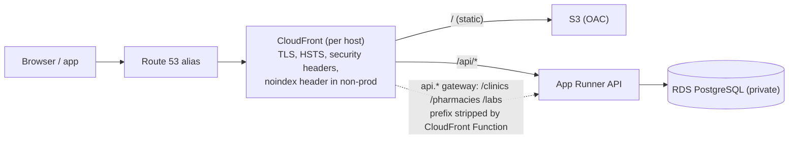

# DNS and domain architecture

ADR-059 (Proposed). Hostnames come from `../registry/service-url-registry.yaml`; this document explains how they are served, secured and operated. Costs are estimates at public list prices as understood on 27 Nov 2026: verify before committing. Nothing here was applied.

## 1. Scope

Two registrable domains: `kiorex.com` (patients, identity, platform) and `kiorly.com` (providers, plus the marketing site on the apex). Both bought at registrars the founder controls (domain.com and namecheap.com; the brief does not say which domain sits where, so the founder confirms per domain). `kiorly.link` is referenced in code (short links) and ADR-040 but is not in the brief. Agents never edit registrar records; every record change below is a founder action.

## 2. Naming rules (enforced by the validator)

- Pattern `<service>.<environment>.<domain>`; production has no environment label; an empty service label is the environment apex.
- At most two labels below the registrable domain, so one wildcard level per environment covers every host.
- A service label may not equal an environment label (`test`, `pilot`, `dev`, `staging`) and must be a single DNS label.
- Public names only; no host with `localhost`, an IP address, a port or a path.
- `ai` and any other internal service has `dns: none` (no public record). It is reachable only through the authenticated API gateway or private service discovery.
- Environment apex hosts: `test.kiorex.com` (marketplace test), `kiorex.com` (marketplace prod), `test.kiorly.com` and `kiorly.com` (marketing). `www` redirects to the apex in production and is not a registry service.

## 3. DNS hosting: Route 53 or not

| Option | Cost | Strengths | Weaknesses |
|---|---|---|---|
| A. Registrar DNS only (domain.com, Namecheap) | free | no new moving parts; fine for a handful of test records | manual edits for every host and every ACM validation CNAME (about 40 records for test alone, more at pilot); no IaC; apex alias to CloudFront needs ALIAS or ANAME support that must be verified at each registrar; two vendors with two UIs; the founder is the bottleneck for every change |
| B. Cloudflare free plan as DNS only (grey cloud) | free | API, CNAME flattening at the apex, solid free DNSSEC | a third vendor; proxying (orange cloud) in front of CloudFront would double-CDN and is not recommended; not part of existing IaC |
| C. **Route 53 hosted zones, delegated from the registrars** | about USD 0.50 per hosted zone per month plus about USD 0.40 per million standard queries; alias records to CloudFront are free of query charge | already the project standard (ADR-028, KX-21 `dns_certs` module, HB08, `infra/tofu/live/prod/global/dns` with CAA and DNSSEC); ACM validation records and all host records generated from the registry; apex alias; the founder edits only NS records | about USD 1 to 2 per month; zones live in an AWS account that must be trusted with the domain |

**Recommendation: C, introduced in two steps, because it removes the founder as the per-record bottleneck for a small cost.**
1. **Now (kx-test):** create two hosted zones for the *child* names `test.kiorex.com` and `test.kiorly.com` in the kx-test AWS account. The founder adds one NS record set named `test` at each registrar pointing to the four Route 53 name servers. Everything else at the registrars (website, mail, MX, SPF, verification records) is untouched. Blast radius: only names under `test.` can change. Estimated additional cost about USD 1 per month.
2. **Before pilot:** delegate the full apex zones `kiorex.com`, `kiorly.com` (and `kiorly.link` if kept) in the production account, with CAA and DNSSEC as already designed in `infra/tofu/live/prod/global/dns`. Then the parent zone holds an NS record for `test` pointing at the child zones (managed from the registry), so step 1 keeps working. Mail records must be copied into the new zone before the registrar NS switch, otherwise email stops. Request registrar lock and DNSSEC DS at the same time.

When the answer would be A instead: if the founder wants zero AWS dependency for DNS or does not want to give AWS control of the domain, option A works for kx-test at USD 0 with manual records. The standard stays valid because the registry can emit a record list (`--emit dns --env test`) to paste.

Verify before approval: that each registrar allows NS records on a subdomain (`test`) and lists the ALIAS capability at the apex, and whether the domains have DNSSEC enabled today (enabling DNSSEC on a delegated child requires the DS record in the parent).

## 4. Record policy

| Topic | Policy |
|---|---|
| Records for CloudFront hosts | Route 53 alias A and AAAA to the distribution; CNAME at registrar DNS in option A |
| Records for App Runner custom domains | CNAME to the service domain plus the validation CNAMEs App Runner prints (used only where a service is not behind CloudFront) |
| Wildcard DNS records (`*.test.kiorex.com`) | **Not used.** A wildcard record makes every typo resolve and widens subdomain-takeover exposure. Only explicit records generated from the registry. Wildcards are for certificates only |
| TTL | 300 seconds for non-production and for first 30 days of any new host; 3600 once stable; apex and NS 86400 |
| Dangling records | The pipeline deletes a record when its registry entry is removed; a quarterly check compares the zone to `--emit dns` |
| Mail | Existing SES identity `mail.kiorly.com` (`email_domain` in tofu) stays in the `kiorly.com` zone; never delegate a child zone that contains mail records |
| CAA | `0 issue "amazon.com"` on apex zones (already in the tofu dns module) |
| Environment records | One record set per environment and domain, in that environment's zone: a mistaken change to `test` cannot touch `kiorex.com` |

## 5. TLS certificates

- **One ACM certificate per environment and domain**, never one shared wildcard: `*.kiorex.com` does not cover `api.test.kiorex.com` and, worse, a production wildcard must not be deployable on a test host. Names per certificate: `<env>.<domain>` and `*.<env>.<domain>` (production: `<domain>` and `*.<domain>`). Generated: `node _docs/registry/validate-registry.mjs --emit certs`. The validator fails if a host is not covered by its own environment's certificate, or if the production certificate would also cover a non-production service host.
- Request in **us-east-1** for CloudFront; in eu-central-1 for any regional endpoint (ALB, API Gateway). App Runner custom domains manage their own certificate.
- DNS validation CNAMEs sit in the environment's own zone, so they renew automatically (ACM renews about 60 days before expiry as long as the CNAME exists and the certificate is in use). ACM public certificates are free; **cost USD 0**.
- Wildcard limitation, stated plainly: one label only (`*.test.kiorly.com` covers `clinics.test.kiorly.com`, not `x.clinics.test.kiorly.com`), and the wildcard covers a name before a service exists, so every certificate use must be reviewed. Private keys of ACM certificates are not exportable; do not plan on mounting them in containers.
- The pilot environment needs its own certificate (`pilot.<domain>` + `*.pilot.<domain>`) even though it runs on the production plane, so the pilot names can be retired without touching the production certificate.
- Pin nothing: no HPKP, and no hostname pinning in the mobile apps beyond the system trust store.

## 6. Edge, CDN, WAF, gateway, rate limiting, DDoS

- **CDN:** CloudFront price class 100, as today (the existing Clinic distribution). Egypt latency to a European edge is acceptable for a first launch; verify with a measurement from Cairo before pilot and move to price class 200 only if the measurement justifies the cost.
- **WAF:** AWS WAF web ACL in front of public production hosts (HB01), about USD 5 per ACL per month plus USD 1 per rule plus per-request charges (estimate). Not used in kx-test; the edge gate below is the cheaper control there. One ACL per public CloudFront distribution is the cost driver: group hosts by distribution to keep it small.
- **API gateway:** `api.<env>.kiorex.com` and `api.<env>.kiorly.com` are single hosts. For Kiorly the first path segment selects the product (`/clinics`, `/pharmacies`, `/labs`) and is stripped by a CloudFront Function before the origin, so each product keeps its existing `/api/v1` prefix. This replaces ADR-038's `api.clinic|pharmacy|lab.*` (too deep for one wildcard). It needs a per-product check (back-channel logout paths and `Set-Cookie` free responses) and is marked `planned`; until then each web serves same-origin `/api/*`, which is today's Clinic design and needs no CORS.
- **Rate limiting:** application limiters exist and share state through Postgres; add a WAF rate rule per host class (sign-in, handoff, intake) at pilot (launch guide 1.6). Non-production: application limiters only.
- **DDoS:** AWS Shield Standard is automatic on CloudFront and Route 53 at no cost. Shield Advanced (about USD 3,000 per month) is not justified for an Egypt-first launch.
- **Mutual TLS:** only for a partner who asks (founder decision D in the handoff); today partner calls are HMAC-signed.

## 7. Private DNS and service discovery

Databases, brokers, caches, observability, secrets and internal comms stay private (no public records, no public listeners). On AWS: RDS in private subnets, Secrets Manager and KMS via VPC endpoints or in-VPC access, and App Runner VPC connector for private databases (the live Clinic does this). Internal service names, if ever needed, use a private Route 53 hosted zone with a non-public suffix (for example `kx.internal`) that is never resolvable from the internet; none exists today and none is needed until services call each other privately. `ai.<env>.kiorex.com` is reserved and has no record.

## 8. Security

### 8.1 Cookies and sibling subdomains
- Rule (already ADR-038, kept): session cookies are host-only. Passport cookies are set on `passport.<env>.kiorex.com` only; **never `Domain=.kiorex.com` or `.kiorly.com` in any environment**, and never a cookie shared between `test` and `prod` hosts.
- Add the `__Host-` prefix to session and CSRF cookie names (requires `Secure`, `Path=/`, no `Domain`). A `__Host-` cookie cannot be overwritten by a `Domain=.kiorex.com` cookie planted by a sibling subdomain ("cookie tossing"), which is the realistic attack from a compromised or abandoned `test.*` host against `passport.kiorex.com`.
- `SameSite=Lax` for the SSO redirect flow, `HttpOnly`, `Secure`. Tokens go in `Authorization` headers for APIs (bearer-only, as the Clinic API already is).
- Residual risk the brief asks about: because `test.kiorex.com` and `passport.kiorex.com` share a registrable domain, a compromised non-production app could still set a *non-prefixed* cookie for the whole domain, read nothing, but cause confusion for apps that do not use `__Host-`. Mitigations: `__Host-` everywhere, no application reads an unprefixed cookie, HSTS with `includeSubDomains` only once every subdomain is HTTPS, and a CI test that fails if any `Set-Cookie` contains `Domain=`. If an audit still rejects the shared domain, move non-production to a separate registrable domain (about USD 10 to 15 per year); the registry already derives names from `domains`, so the change is one edit.
- Non-production and production never share secrets, OIDC clients, JWT keys, KMS keys, databases or buckets. `kx-test` clients have `kx-test`-only redirect URIs; the production issuer never lists a `test` redirect URI. The one deliberate overlap is pilot, which uses the production issuer on purpose and lists pilot redirect URIs (generated, see `PILOT_ENVIRONMENT_STRATEGY.md`).

### 8.2 Non-production access control and indexing
`robots.txt` and `noindex` are advisory. Real controls, cheapest first:
1. **Invitation-only accounts:** no public sign-up in `test`, `dev`, `staging`; Passport accounts created by an admin or invitation.
2. **CloudFront Function edge gate** (free tier) for non-allow-listed visitors: require a shared header or cookie token on every non-production host except health checks and the OIDC discovery and JWKS endpoints that other products must reach; otherwise answer 403. Not used on pilot or production.
3. **`X-Robots-Tag: noindex, nofollow, noarchive`** on every non-production response plus `Disallow: /` in `robots.txt`, set at the CDN from `KX_ENV`; the marketing and marketplace sitemaps are not served outside production. Pilot stays `noindex` until general availability.
4. **WAF IP allow-list or Passport-gated pages** only where a host must be public but private to a team; WAF is not bought for kx-test.
The edge gate is NOT applied to `clinics.test.kiorly.com` (and the legacy `cloudfront.net` host) while it carries the real organisation: that host stays protected by the Clinic login alone, exactly as today, so the clinic's day-to-day use cannot be broken by a gate.

### 8.3 CORS, redirect URIs, back-channel logout
Generated, never hand-typed: `node _docs/registry/validate-registry.mjs --emit cors --env test` and `--emit redirects --env test` (the second prints, for the issuer environment, every OIDC client's redirect URIs, post-logout URIs and back-channel URI). In production the list is the union of prod and pilot (same plane). `cloudfront.net` legacy hosts appear only in the environment they belong to. Exact-match comparisons only, no wildcard origins, no reflected `Origin` (Clinic `origin: true` is the one exception and is a gap, section 9 of the strategy doc). Apps keep rejecting a redirect URI not in their list.

### 8.4 Cross-domain authentication
Passport is the single IdP per plane: `kiorly.app` (Kiorly Home) and all products on `kiorly.com` sign in at `passport.<issuer env>.kiorex.com` through standard authorization code with PKCE. Cross-domain SSO works through the Passport session cookie on the Passport host only; products never share a cookie. Back-channel logout URIs are generated per client. Third-party sign-in (Apple, Google) stays behind Passport.

### 8.5 Secrets and configuration
Secrets by reference only, `/{product}/{env}/{purpose}` in Secrets Manager; the registry holds no secret and no credential. CI role per environment; kx-test may use the existing admin OIDC role, pilot and prod may not.

## 9. Hardcoded hosts found in application code (scan of 27 Nov 2026, informational)

`node _docs/registry/validate-registry.mjs --scan` lists them (runtime code only; tests, docs, infra, generated and seed files are skipped; event identifiers `https://schemas.kiorex.com/...` are skipped because they are frozen identifiers). Count: **kiorex-platform 23, clinics-management 10, kiorex-account 2, kiorly 2; kiorly-pharmacy, kiorly-lab, kiorex-contracts and kiorex-pay-contract 0.** Most are production defaults that an environment variable already overrides; they are gaps against "domains configurable, never hardcoded", not live defects. `--strict` turns them into failures once fixed.

| Repo | Where | Note |
|---|---|---|
| kiorex-platform | `common/config.ts`, `public-site/site.config.ts`, `growth/config/growth-defaults.ts` (`kiorex.com`, `book.kiorex.com`, `cdn.kiorex.com`, `kiorly.link`), `referral-code.ts`, `campaign.service.ts`, `campaigns-public.controller.ts`, `lifecycle-admin.controller.ts`, `link-landing.controller.ts`, `widget.config.ts`, `widget-policy.service.ts`, `wa-templates.ts`, `mobile/app.config.ts`, `mobile/src/lib/deepLink.ts`, `ops/.../UtmBuilder.tsx`, `web/.../LandingPage.tsx`, `apps/api/.env.example:65` | Defaults and examples; the growth defaults are versioned configuration and need a registry-driven bootstrap |
| clinics-management | `nurse/nurse-edition.ts`, `web/src/lib/edition.ts`, `auth/kiorex-oidc.port.ts:55` (`nurse.kiorly.com`), `billing/pay/pay-collections.service.ts`, `growth/growth-referral.service.ts` (`app.kiorly.com`), `provider-links/widget-settings.ts` (`book.kiorex.com`), `messaging/email-domain-auth.ts` (`mail.kiorly.com`) | `nurse.kiorly.com` matters: Nurse is detected by host |
| kiorex-account | `dev-idp/src/scim.ts:149` (`account.kiorex.com` documentation URI), `kiorly-home/src/App.tsx:15` (`www.kiorex.com` fallback) | change with ADR-059 |
| kiorly (staff app) | `app.config.ts:24`, `src/lib/deepLink.ts:26` (`www.kiorly.com`) | universal-link host, see 11 |
| Not hosts | `@kiorex.com` / `@kiorly.com` e-mail addresses in demo seeds and UIDs; `schemas.kiorex.com` | ignore |

## 10. Failover and disaster recovery

- Route 53 health checks plus failover records only for production, only where a second origin exists. Today every product has one region (Frankfurt) and a Multi-AZ database; DNS failover to another region is not designed and not needed for a first launch (ADR-015: Egypt tenants in the Frankfurt cell).
- DR for DNS itself: zones are generated from the registry, so a lost zone is recreated with `tofu apply` and the registrar NS records re-pointed (founder action, hence TTL 86400 on NS only). Keep an offline export of each zone (`aws route53 list-resource-record-sets`) in the audit bucket.
- The status page (`status.kiorex.com`) must be hosted outside our own AWS account and DNS provider path (third-party status service on a CNAME) so it works during our outage.
- The public domain name is independent of the physical hosting region: moving a market's data to another cell changes origins, not hostnames (`INTERNATIONAL_DOMAIN_ROUTING.md`).

## 11. Mobile universal links and deep links

- **Kiorly staff app** (`com.kiorly.app`, scheme `kiorly://auth/callback`): association host today `www.kiorly.com`, path `/open/*`. Standard: `app.<env>.kiorly.com` (Kiorly Home). Associated domains are compile-time, so the host must be fixed before the first store build; `www.kiorly.com/signin` 301-redirects to `app.kiorly.com/signin` during the transition. Staff app association files: `config/app-links/apple-app-site-association.json` and `assetlinks`; Apple Team ID and Android SHA-256 stay NEEDS_HUMAN.
- **Kiorex patient app** (`com.kiorex.app`, scheme `kiorex://`): host is the marketplace host of the environment (`kiorex.com` in production), with `/{locale}/{cc}/doctor/*` and the other documented paths.
- **Non-production builds:** separate bundle ids (`.test`) and schemes (`kiorly-test`, `kiorex-test`) so builds install side by side and a test build can never claim the production association. Custom schemes are not unique and can be claimed by any app; Passport relies on PKCE, and universal or app links are preferred in production.
- AASA and `assetlinks.json` are served from the host of each environment with `Content-Type: application/json`, no redirect, and cached short during rollout.
