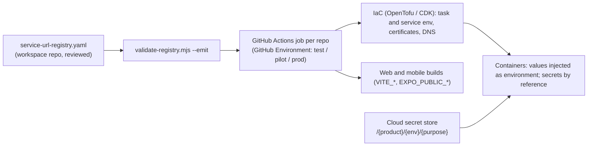

# Environment configuration standard

ADR-059 (Proposed). Every application resolves its URLs and integration endpoints through environment configuration; the values for a deployed environment are **generated from the registry** (`../registry/service-url-registry.yaml`, tool `validate-registry.mjs --emit`). Provider-agnostic: nothing below assumes AWS except where a section says so. Existing variable names are kept (no rename); this standard adds a handful of identity variables and a generation and validation discipline. Names were collected from the code on 27 Nov 2026 and the repositories remain the authority for exact semantics.

## 1. Rules

1. **No domain in application code.** Not as a default, not in a comment-adjacent constant, not in a test fixture that runs in production. `validate-registry.mjs --scan` reports violations; `--strict` is the CI gate once the repositories are clean (counts in `DNS_AND_DOMAIN_ARCHITECTURE.md` section 9). Local development uses `http://localhost:<port>` from `.env` files only (`INTEGRATION.md` ports).
2. **Fail closed in deployed environments.** When `KX_ENV` is not `local`, an app refuses to start if a required URL is missing, is not `https`, points at `localhost` or an IP, or (for web origins and issuers) is not in the generated allow-list. The existing Passport public-mode guard (`apps/dev-idp/src/public-mode.ts`) and the production CORS test in the Clinic are the model.
3. **The registry generates; humans do not type hosts.** A generated file is never edited by hand; a change goes through the registry pull request.
4. **No secret in the registry, in generated config files or in the repository.** Secrets are references (names), resolved at runtime from the cloud secret store.
5. **Build-time values (`VITE_*`, `EXPO_PUBLIC_*`) are baked per environment** from the same commit; the build records the registry hash so a bundle can be matched to a registry version. Everything else is run-time environment.
6. **Pilot uses the production issuer** (the registry emits it); apps never derive the issuer from their own host.

## 2. Configuration categories

| Category | Held in | Examples |
|---|---|---|
| Environment identity | env vars (new) | `KX_ENV` (`dev|test|staging|pilot|prod`), `KX_ENV_TAG` (`kx-test`...), `KX_PLANE`, `KX_REGISTRY_HASH` |
| App base URLs, API endpoints, CDN URL | env vars from registry | see table below |
| Passport endpoints, OAuth client ids, redirect and post-logout URIs | issuer URL in env; clients and URIs in Passport config generated from the registry | `OIDC_ISSUER`, `VITE_OIDC_AUTHORITY`, `EXPO_PUBLIC_OIDC_ISSUER`, client ids per `idp.json` |
| Webhook endpoints | env vars from registry | `KIOREX_OUTBOX_WEBHOOK_URL`, `KIOREX_WEBHOOK_URL` |
| Allowed origins | env var from registry | `CORS_ORIGINS`, `KIORLY_HOME_ORIGINS` |
| Feature flags | not environment configuration: the platform flag service (maker-checker), pushed to products (`KIOREX_FLAGS_URL`) | `clinic.provider_credit_v2`, ... |
| Country and regional configuration | `MARKET_PROFILE` versioned configuration (ADR-055), per tenant | never an env var per country |
| Provider modes | `<KIND>_MODE` and `INTEGRATION_MODES` approval | mock by default |
| Environment-specific infrastructure references | IaC outputs, secret names | database secret ARN by name, bucket names |

## 3. Logical key to existing variable (as found 27 Nov 2026)

| Logical key | Clinic | Platform API | Passport | Pharmacy | Lab | Staff app | Web builds |
|---|---|---|---|---|---|---|---|
| Public web base URL | `APP_WEB_URL`, `WEB_PUBLIC_ORIGIN` | `WEB_BASE_URL`, `PUBLIC_BASE_URL`, `PUBLIC_APP_URL` | (issuer) | `WEB_APP_URL` | `PUBLIC_BASE_URL` | `EXPO_PUBLIC_WEB_URL_*` | |
| API origin (cross-origin callers) | `KIOREX_API_BASE_URL` (towards platform) | `PUBLIC_BASE_URL` | | `PHARMACY_API_ORIGIN` | `LAB_API_ORIGIN` | `EXPO_PUBLIC_CLINIC_API`, `_PHARMACY_API`, `_LAB_API` | `VITE_API_URL` |
| OIDC issuer | `KIOREX_OIDC_ISSUER` | `OIDC_ISSUER` | `ISSUER` | `OIDC_ISSUER` | `OIDC_ISSUER`, `KIOREX_OIDC_ISSUER` | `EXPO_PUBLIC_PASSPORT_ISSUER` | `VITE_OIDC_AUTHORITY`, `VITE_PASSPORT_ISSUER`, `EXPO_PUBLIC_OIDC_ISSUER` |
| Kiorly Home origin | `KIORLY_HOME_ORIGINS` | | `KX_HOME_ORIGIN` | `KIORLY_HOME_ORIGINS` | `KIORLY_HOME_ORIGINS` | | `VITE_KIORLY_HOME_URL` |
| CORS allow-list | (reflects Origin today: gap) | `CORS_ORIGINS` | per-client redirect lists | `CORS_ORIGINS` | `CORS_ORIGINS` | | |
| Webhook to platform | `KIOREX_OUTBOX_WEBHOOK_URL` | | | `KIOREX_WEBHOOK_URL` | `KIOREX_WEBHOOK_URL` | | |
| Flags | `KIOREX_FLAGS_URL` | (owner) | | `KIOREX_FLAGS_URL` | `KIOREX_FLAGS_URL` | | |
| Platform to partner base URLs | | `KIORLY_BASE_URL`, `LAB_BASE_URL`, partner rows | | | | | |
| Widget host, canonical site host | `KIOREX_WIDGET_BASE_URL` | `WIDGET_HOST`, `SITE_CANONICAL_HOST`, `PROVIDER_LINK_BASE_URL` | | | | | |
| App-link hosts | | `EXPO_PUBLIC_LINK_HOSTS` | | | | `EXPO_PUBLIC_LINK_HOSTS` | |

The registry `env:` blocks already generate the subset needed for the first stand-up (`--emit env`). Adding a row to the registry is the only way to add a new generated variable.

## 4. Generation and delivery

- **GitHub Actions:** a reusable step `registry-env` runs the validator, then `--emit env --env $KX_ENV --service <id>` and exports the lines as job env and as IaC variables. GitHub Environments `test`, `pilot`, `prod` hold the AWS role ARN and approval rules (`pilot` and `prod` require reviewers). The existing OIDC trust (`repo:mshall/*`) works for all repositories; scope roles per environment before pilot.
- **IaC (OpenTofu, ADR-028; CDK for the live Clinic until migrated):** hostnames, alternate domain names, certificate names and DNS records are inputs derived from the registry (the existing modules already take `domain`, `zone_name`, `nurse_domain`, `env_vars`). Terraform reads the registry JSON via `--emit`, not by re-typing hosts.
- **Containers:** one image per commit; environment variables are injected by the platform (App Runner `runtimeEnvironmentVariables` and `runtimeEnvironmentSecrets`; any other container host works the same way). No image contains a host. Kubernetes is not used; the same `--emit env` output would feed a ConfigMap if it ever is.
- **Cloud secret management:** Secrets Manager (AWS) with the path convention `/{product}/{env}/{purpose}`; pilot reads the `prod` paths. Cross-product shared secrets (HMAC client secrets, webhook secrets, flags secrets) are generated once per plane and referenced by both sides. The AWS DEV plan's `kxdev/<product>` secrets rename to `/{product}/test/...`.
- **Approvals, promotion and rollback:** `ENVIRONMENT_STRATEGY.md` section 7 (same digest promoted test, pilot, prod; reviewers on pilot and prod; rollback by revision plus registry revert).
- **Environment-specific integration testing:** the post-deploy smoke job resolves every URL from the registry, checks `/health/ready`, `/.well-known/openid-configuration` (`issuer` equals the registry issuer) and a signed partner call per product pair; cross-product e2e (`e2e/`) gets its base URLs from `--emit env` instead of ports when pointed at a deployed environment.

## 5. Boot-time checks every service performs (fail closed outside `local`)

1. `KX_ENV` and `KX_ENV_TAG` agree with the registry mapping.
2. Every URL variable is `https`, has no path surprises, is not loopback or an IP.
3. `OIDC_ISSUER` equals the registry issuer for the plane; discovery document answers.
4. `CORS_ORIGINS`, redirect URIs and Home origins contain no `http:`, no wildcard and no origin of another plane (production lists contain pilot origins, never `test` ones).
5. Non-production environments emit `X-Robots-Tag: noindex` and refuse real-mode provider flags unless `INTEGRATION_MODES` approval exists.
6. A cookie writer rejects a `Domain` attribute.

## 6. Provider-agnostic note

The registry has no AWS concept except `aws_account` and `region` in `environments[]`, which an alternative cloud replaces with its own account keys. DNS and certificates are described by `--emit dns` and `--emit certs`, which any DNS provider or ACME client can consume. The pattern, the pilot-on-production-plane rule and the issuer rule do not depend on Route 53 or CloudFront.

## 7. Sample

`../registry/samples/config.sample.ts` shows an app loading its configuration with no domain literal; `../registry/samples/env.sample` shows the generated file shape. The validator scans these two files strictly.
