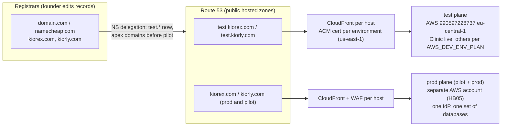
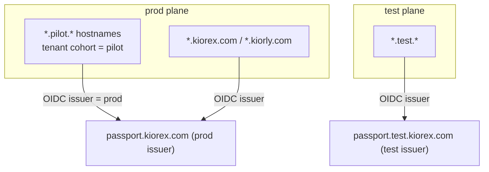

# Environment strategy (kx-test, kx-pilot, kx-pro)

Written 27 Nov 2026 as part of ADR-059 (`../adr/ADR-059-unified-environment-dns-subdomain-and-domain-routing.md`, Proposed). Source brief: `../briefs/ENV_DOMAIN_STANDARD_BRIEF.md`. Nothing in this document is deployed; no DNS, certificate, AWS or CI change was made. Hostnames are NOT repeated here as a source of truth: the canonical list is `../registry/service-url-registry.yaml` (run `node _docs/registry/validate-registry.mjs --print`). Sibling documents: `DNS_AND_DOMAIN_ARCHITECTURE.md`, `SERVICE_URL_REGISTRY.md`, `PILOT_ENVIRONMENT_STRATEGY.md`, `INTERNATIONAL_DOMAIN_ROUTING.md`, `ENVIRONMENT_CONFIGURATION_STANDARD.md`.

## 1. Environment catalogue

| Id | Founder tag | DNS label | Meaning | Data plane | Data class | Provisioned now |
|---|---|---|---|---|---|---|
| `dev` | kx-dev | `dev` | developer and CI integration | dev | synthetic only | No (reserved name) |
| `test` | **kx-test** | `test` | on-the-ground testing with a few pharmacies, labs and clinics; QA and end-to-end over AWS | test | synthetic, plus one designated real organisation (Dr Ahmed Shall, Clinic only) | **Yes: the live Clinic already exists** |
| `staging` | kx-staging | `staging` | UAT, performance, release validation | staging | synthetic only | No (reserved name) |
| `pilot` | **kx-pilot** | `pilot` | controlled onboarding of real customers, larger cohort | **prod** | real | Not yet |
| `prod` | **kx-pro** | (none) | public commercial operation | prod | real | Not yet |

Rules that follow from the table:
- The tag is the human and cloud-tag name (`EnvTag=kx-test`); the id is what appears in code (`KX_ENV=test`) and DNS. Mapping is one to one and lives in the registry (`environments[]`).
- `pilot` and `prod` share a data plane (same databases, same IdP, same encryption keys). Pilot is a hostname set and a tenant cohort, not a second stack. Why: `PILOT_ENVIRONMENT_STRATEGY.md`.
- `dev` and `staging` follow the same pattern when they are ever needed; the validator already checks their names. Do not provision them until a concrete need exists (cost).
- Egypt is the only live market. Country is configuration, not environment (`INTERNATIONAL_DOMAIN_ROUTING.md`).

## 2. Architecture

Walk-through of one booking in kx-test: patient browser at `test.kiorex.com` signs in at `passport.test.kiorex.com`, the platform API (`api.test.kiorex.com`) calls the Clinic (`clinics.test.kiorly.com` today the CloudFront default host) with HMAC, the Clinic returns events by signed webhook to `webhooks.test.kiorex.com`. Every one of those names is generated from the registry; none is typed into code.

## 3. Hostnames per environment

Registry-derived (83 names in total across five environments, 17 in test, 17 in pilot, 21 in prod, 14 each in dev and staging). Summary of roles (full table in `SERVICE_URL_REGISTRY.md`):

| Domain | Roles in every environment | Production-only shared |
|---|---|---|
| kiorex.com | marketplace (apex of the environment), `api`, `admin`, `passport`, `ai` (no DNS), `webhooks`, `cdn`, `book` (widget) | `developers`, `docs`, `status`, `support` |
| kiorly.com | marketing (apex), `app` (Kiorly Home), `clinics`, `pharmacies`, `labs`, `admin`, `api`, `nurse` (alias of `clinics`) | none |
| kiorly.link | reserved short links (open decision) | none |

AI and other internal services get no public DNS record: they are reachable only through the authenticated `api` gateway or private service discovery (`kiorex.ai` has `dns: none`, enforced by the validator).

## 4. Environment rules

| Rule | dev, staging | test | pilot | prod |
|---|---|---|---|---|
| Real patient data | never | only the designated organisation, see section 5 | yes (production controls) | yes |
| Providers | all mock | mock by default; real mode only per `INTEGRATION_MODES` approval, one at a time | per go-live runbook | per go-live runbook |
| Sign-up | closed | invitation only | invitation only, tenant cohort flag | open per product rules |
| Search indexing | `noindex` plus auth | `noindex` plus auth | `noindex` until general availability | indexable (SEO) |
| Backups, Multi-AZ, WAF, alarms | none | per cost plan | production grade (KX-21 HB01 to HB09) | production grade |
| Deploy approval | automatic | founder presses the button | required reviewers (GitHub Environment `pilot`) | required reviewers (GitHub Environment `prod`) |
| Cookie scope | host-only | host-only | host-only | host-only |
| Secrets | `/{product}/dev/*` | `/{product}/test/*` | `/{product}/prod/*` (shared with prod: same plane) | `/{product}/prod/*` |

## 5. kx-test is not purely synthetic (honest note)

The live Clinic at `https://d92iz83i79c05.cloudfront.net/` holds a real organisation (Dr Ahmed Shall Group, AWS plan section 1 and `LAUNCH_PREPARATION_GUIDE.md` row 9.2) in a Multi-AZ RDS with 35-day backups and deletion protection. The founder wants it to keep working and to be the heart of kx-test. The standard's rule is "no real patient data in non-production". Resolution used here: kx-test is registered with `data_class: synthetic-plus-designated-real-org`, which is a **declared exception, not a loophole**:
- it covers exactly one organisation, held only in the Clinic database that already has production-grade protection; no other product database and no shared RDS may hold real patient data;
- real staff identities in kx-test Passport are personal data too; the AWS DEV plan puts the Passport database in a public, SSL-only, password-protected shared RDS (plan decision D2). That is not acceptable for real identities. Either move the Passport test database to the private network (an estimated USD 4 to 6 per month for a NAT instance, USD 33 or more for a NAT gateway, verify) or keep real staff off the kx-test Passport and sign them in with the Clinic's own login until pilot;
- counsel must say whether this fits the Egyptian regime before more real clinics or any real patient are added to kx-test. Until then: ask the clinic to keep test visits to people who know it is a trial. This document gives no legal conclusion;
- the long-term answer is `PILOT_ENVIRONMENT_STRATEGY.md`: real, growing numbers of clinics belong in pilot, not test.

## 6. AWS accounts, naming, tags

- Today there is one usable account, `990597228737` (eu-central-1): it holds the live Clinic and, per the AWS DEV plan, would hold the other products' test stacks (plan decision D1). Pilot and prod belong in a separate production account (KX-21 HB05 "production account", `terraform.tfvars` placeholder `REPLACE_WITH_PROD_ACCOUNT_ID`).
- Resource names: `kx-<env>-<product>` (for example `kx-test-passport`) for everything new. The existing CDK stack name `kiorly-clinics-management` is not renamed (a CloudFormation rename replaces the stack and its database). The AWS plan's `kxdev-` prefix and `Env=dev` tag become `kx-test-` and `Env=test`, `EnvTag=kx-test`.
- Mandatory tags: `Env` (id), `EnvTag` (founder tag), `Product`, `ManagedBy` (`opentofu` or `cdk`), `CostCenter`. Existing OpenTofu already tags `Env`, `Product`, `ManagedBy`.
- Secrets Manager paths follow the existing convention `/{product}/{env}/{purpose}` (launch guide 3.5); a pilot stack reads `/…/prod/…` because it is the prod plane.

## 7. CI/CD, promotion and rollback

- Workflows today (all manual or `[skip ci]`-guarded except the Clinic `main` push deploy): per product `ci.yml`, `deploy.yml` (GitHub Environment `staging`), `drift.yml`, `infra-plan.yml`, `release.yml`; Clinic additionally `deploy-aws.yml` (push to `main`), `deploy-aws-kiorex.yml` (manual), `deploy.yml`.
- Target: GitHub Environments named `test`, `pilot`, `prod` (rename `staging` where used; add required reviewers on `pilot` and `prod`). OIDC role per environment; `GitHubAction-AssumeRole` (AdministratorAccess) is acceptable for kx-test only (AWS plan finding 1) and must be replaced by least-privilege roles before pilot.
- Promotion: build one immutable image and one web build per commit; promote the **same digest** test -> pilot -> prod. Environment differences are configuration only, generated from the registry (`ENVIRONMENT_CONFIGURATION_STANDARD.md`). Web bundles that bake URLs at build time (`VITE_*`, `EXPO_PUBLIC_*`) are rebuilt per environment from the same commit; that is the one place the artefact differs, so the build records the registry hash.
- Environment-specific integration test: after every deploy a smoke job calls the generated health and `/.well-known/openid-configuration` URLs and checks that `issuer` equals the registry issuer; the existing Clinic smoke script (`scripts/cicd-post-deploy-smoke.sh`) is the model.
- Rollback: App Runner and CloudFront keep the previous revision; database migrations are forward only, so a rollback after a migration needs the dry-run doc steps (`CLINIC_FIRST_DEPLOY_DRYRUN.md`). DNS rollback is a registry revert plus re-run; TTL for non-apex records is kept at 300 seconds until a host is stable.
- Terraform/OpenTofu: the existing `infra/tofu` layout (`live/<env>/<region>/<stack>`, state in S3 with KMS encryption) already encodes `staging` and `prod`. Add `live/test` for the test child zones and certificates; keep `staging` reserved. Kubernetes is not used and not planned; the standard stays container-on-App-Runner and provider-agnostic through the existing cloud-neutral module contracts (ADR-028).

## 8. Conflicts and gaps

| # | Finding | Evidence | Resolution in this standard |
|---|---|---|---|
| C1 | ADR-038 host table differs from the founder pattern (`account.` vs `passport.`, `clinic.` vs `clinics.`, `pharmacy.`/`lab.` vs plural, `api.<product>.` vs one `api.`, `www.kiorly.com` Home vs `app.`) | `kiorex-account/config/domains.json`, `Docs/DOMAINS.md`, `idp.json` | Registry supersedes the host table; `domains.json` is regenerated from it. Sign-in design of ADR-038 is unchanged |
| C2 | Live Clinic URL is a random CloudFront name; Passport clients, CORS and webhooks need stable hosts | AWS plan section 3.6 | Custom domain added to the same distribution; `cloudfront.net` kept as `legacy_hosts` forever until the founder retires it |
| C3 | Two-pass bootstrap and SSM `/kxdev/url/*` registry exist only because hostnames are random | AWS plan section 3.6, 5.4 | Hostnames known up front from the registry; both removed from the plan (banner added to the plan) |
| C4 | `book.kiorex.com` widget host and `kiorly.link` are not in the founder brief | ADR-040, ADR-044, `domains.json` | Kept in the registry as non-core with `book.<env>.kiorex.com`; founder confirmation open |
| C5 | `ops.kiorex.com` used for the Ops console | platform `.env.example` | Renamed to `admin.<env>.kiorex.com` (brief) |
| C6 | Kiorly `admin.*` and a Kiorly marketing site do not exist as code | KX-19 open question | Names reserved (`status: reserved`) |
| C7 | Clinic detects the Nurse edition by host `nurse.kiorly.com` | `clinics-management/apps/web/src/lib/edition.ts`, `apps/api/src/nurse/nurse-edition.ts` | `nurse` stays a registry alias of `clinics`; later detect edition from the organisation, not the host |
| C8 | Staff app universal-link host is `www.kiorly.com` in `app.config.ts` and `deepLink.ts` | `kiorly/app.config.ts:24`, `src/lib/deepLink.ts:26` | Move to `app.<env>.kiorly.com` before the first store build (associated domains are compile time) |
| C9 | The IdP in use is the dev IdP (`dev-idp`, refuses `NODE_ENV=production`); production IdP choice open | `kiorex-account/apps/dev-idp/src/public-mode.ts`, handoff section 7 | Gap G-IDP: kx-test identities may not survive into pilot; decide before pilot |
| C10 | Clinic API `enableCors({ origin: true })` reflects any Origin | `clinics-management/apps/api/src/main.ts:55` | Acceptable only because it is bearer-token with no cookies; replace by the registry-generated allow-list before pilot |
| C11 | AWS plan puts real-capable databases in a public SSL-only RDS | AWS plan D2 | Not for real identities (section 5) |
| C12 | `*.kiorex.com` cannot cover `api.test.kiorex.com` | brief section 9 | Per-environment certificates, enforced by the validator |
| C13 | Pilot clients on `passport.pilot.kiorex.com` would break the "no account migration" goal because the issuer string is part of every token and subject | OIDC | Pilot uses the production issuer (`oidc.issuer_env.pilot: prod`) |
| C14 | The Passport back-channel production URIs are `TODO_NEEDS_HUMAN` in `idp.json` | `idp.json:131,166,184` | Generated from the registry (`--emit redirects`) |
| C15 | Event type identifiers `https://schemas.kiorex.com/event/...` look like hosts | `packages/backchannel`, contracts | They are immutable identifiers and must never be changed or resolved; the scan ignores `schemas.*`. No DNS record is needed |

## 9. Required future changes by repository (none made here)

| Repo | Change |
|---|---|
| `kiorex-account` | Generate `config/domains.json`, the client blocks of `config/idp.json` and `config/app-links/*` from the registry (a build step reading the YAML); add `pilot` as an environment that resolves to the prod issuer; replace `account.kiorex.com` literals (`scim.ts:149`) and the `www.kiorex.com` default (`kiorly-home/src/App.tsx:15`) with configuration; `__Host-` cookie prefix on Passport sessions; set Passport `ISSUER` per environment; production IdP decision |
| `kiorex-platform` | Replace production default hosts in code with required configuration: `common/config.ts` (`PUBLIC_APP_URL`, `RX_VERIFY_BASE_URL`), `growth/config/growth-defaults.ts` (canonical, embed and CDN hosts, `kiorly.link`), `referral-code.ts`, `campaign.service.ts`, `campaigns-public.controller.ts`, `site.config.ts`, `widget.config.ts`, `widget-policy.service.ts`, `link-landing.controller.ts`, `wa-templates.ts`, `UtmBuilder.tsx`, `LandingPage.tsx`; mobile `APP_LINK_HOST_DEFAULT`, `deepLink.ts` default list; `ops.kiorex.com` in `.env.example`; CORS from the generated list; noindex header switch from `KX_ENV` |
| `clinics-management` | Add the custom domain to the existing CloudFront distribution via the CDK stack (the stack has no domain input today; `infra/tofu` has `domain`, `zone_name`, `nurse_domain`); Nurse edition host detection to configuration; `nurse-edition.ts`, `pay-collections.service.ts`, `growth-referral.service.ts`, `widget-settings.ts` host literals to configuration; replace reflected CORS by allow-list; push to `main` carries `[skip ci]` until the founder approves the deploy |
| `kiorly-pharmacy`, `kiorly-lab` | Configuration-only: `CORS_ORIGINS`, `OIDC_ISSUER`, `KIORLY_HOME_ORIGINS`, `WEB_APP_URL` or `PUBLIC_BASE_URL` per environment from the registry; no host literals found in runtime code; email domain and webhook URLs from the registry |
| `kiorly` (staff app) | Universal-link host `app.<env>.kiorly.com`; non-production bundle id suffix and scheme (`com.kiorly.app.test`, `kiorly-test`) so a test build cannot claim production links; `EXPO_PUBLIC_*` from the registry in EAS profiles |
| `kiorex-contracts`, `kiorex-pay-contract` | No hosts to change. Keep `schemas.kiorex.com` identifiers frozen; document in contracts README that hosts are consumer configuration |
| workspace | Registry and validator live here (done); CI job that runs `validate-registry.mjs --strict` once the repositories are clean; generators for the per-repo config files |

## 10. Cost, sequence and approvals

**Cost (estimates, verify in the AWS billing console).** Domain layer for kx-test: two Route 53 child zones about USD 1 per month, queries a few cents, ACM free, CloudFront aliases free, CloudFront Functions free tier: about USD 1 to 3 per month in total. The environment itself is unchanged from `AWS_DEV_ENV_PLAN.md` (about USD 80 to 105 per month, USD 45 to 65 if App Runner is paused outside working hours). A NAT instance for a private Passport database adds an estimated USD 4 to 6 per month. Pilot and prod costs (WAF about USD 5 to 10 per web ACL, Multi-AZ RDS, KMS keys, a second AWS account) follow KX-21 and are not changed by this ADR; they start only at pilot. Egypt-first cost levers kept: CloudFront price class 100, one region (Frankfurt), no `dev` or `staging` stacks, no per-country subdomains, no separate API hosts per product.

**Recommended sequence (each step is independent and reversible):**
1. Founder signs ADR-059 (or amends it) and answers the open items (section 11).
2. Registry stays canonical; repositories add the generator and read-only validation in CI. No infra yet.
3. Create the two Route 53 child zones for `test` (OpenTofu `live/test`, plan only); founder adds two NS record sets at the registrars. No production record changes.
4. Request ACM certificates for `test.kiorly.com` + `*.test.kiorly.com` and the same for kiorex (DNS validation CNAMEs live in the child zones, so no further registrar edits).
5. Add `clinics.test.kiorly.com` as an alternate domain name to the existing Clinic distribution. The cloudfront.net URL keeps working at every moment.
6. Stand up the other kx-test products from the AWS plan using the registry names; Passport at `passport.test.kiorex.com`.
7. Real organisation moves its bookmark to `clinics.test.kiorly.com`; nothing breaks if it does not.
8. Before pilot: decide production IdP, create the production AWS account, delegate the full apex zones, issue production and pilot certificates, WAF, backups, then the pilot hostnames.
9. GA: switch pilot customers to canonical URLs per `PILOT_ENVIRONMENT_STRATEGY.md`.

**Actions that need the founder's explicit approval (nothing was done):** (a) DNS records at domain.com and namecheap.com (NS delegation of `test`, later apex NS, DS for DNSSEC, mail records untouched); (b) requesting ACM certificates; (c) creating Route 53 zones and any provisioning, including the other products' kx-test stack and a private-network RDS; (d) adding the alternate domain name to the live Clinic distribution (a CDK or console change on the live stack, and a push to Clinic `main` deploys); (e) every deploy; (f) retiring any legacy host; (g) the pilot data-handling decision; (h) the production AWS account; (i) counsel review for real data in kx-test.

## 11. Decisions the founder owes

1. Sign or amend ADR-059.
2. `app.kiorly.com` = Kiorly Home (recommended) or clinic alias.
3. Keep `book.*` and `kiorly.link`.
4. Real identities in kx-test Passport: private network (recommended, small cost) or keep real staff off kx-test Passport.
5. Production IdP choice before pilot.
6. Counsel position on the designated real organisation in kx-test.
