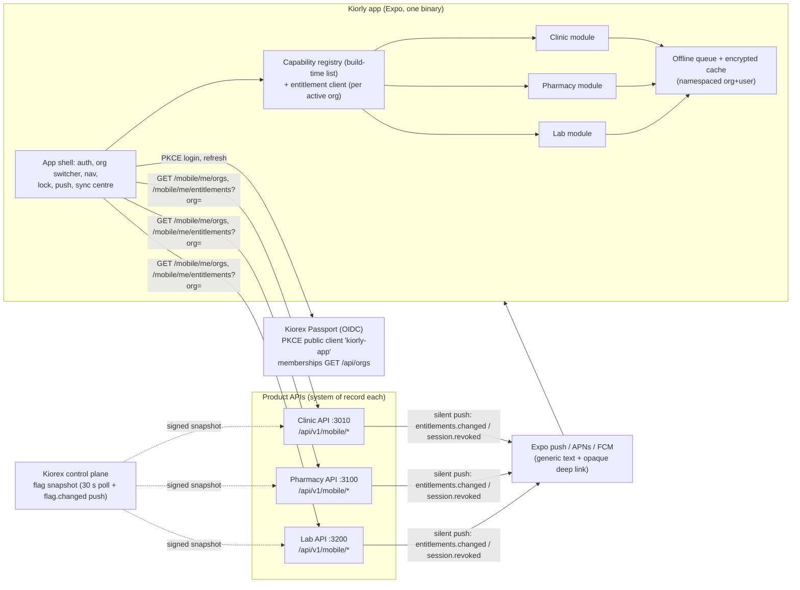
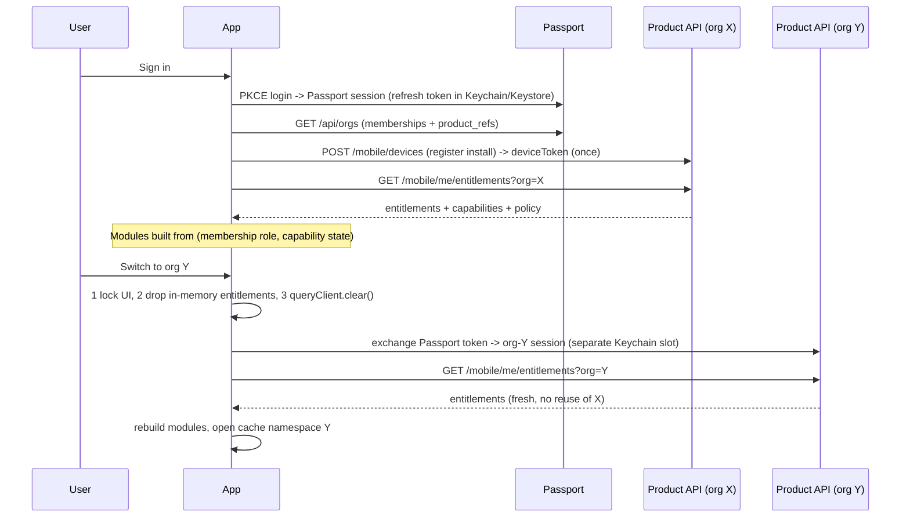
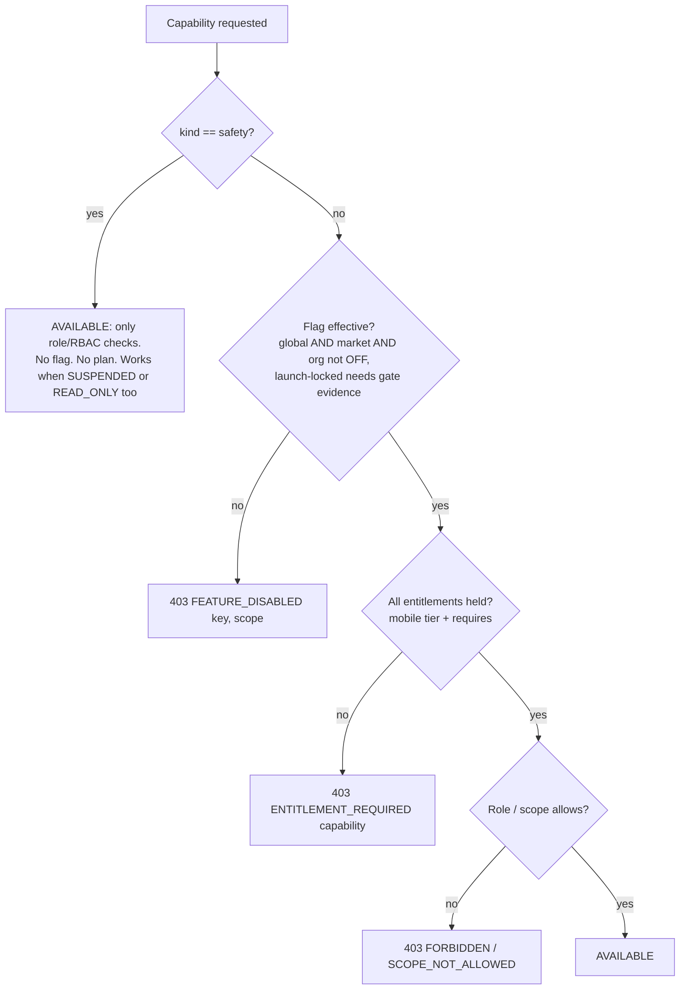
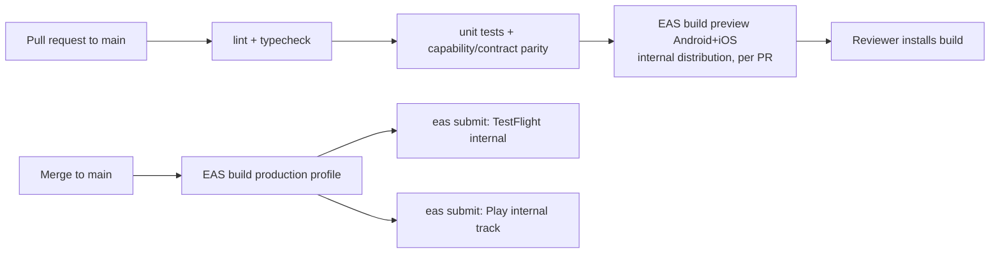

# Kiorly mobile app: design (one app, three product modules, tiered)

> Status: **DESIGN ONLY, 20 Nov 2026** (no feature code written). Supersedes the `kiorly-work` design (single `mobile_staff_app` entitlement, product-login, upgrade screen).
> Companion docs: [ADR-033](./ADR-033_One_Kiorly_App_Tiered_Mobile.md) · [FEATURE_TIER_MATRIX.md](./FEATURE_TIER_MATRIX.md) · [RISKS_AND_OPEN_QUESTIONS.md](./RISKS_AND_OPEN_QUESTIONS.md) · [STORE_POLICY_NOTE.md](./STORE_POLICY_NOTE.md) (Apple/Google policy, written separately).
> Everything marked **[verified]** was read in code on this date (paths relative to the workspace root `kiorex-v2/`). Everything marked **[gap]** does not exist yet. Where this design disagrees with an earlier document, the disagreement is flagged in section 0, not silently resolved.

## 0. Conflicts found while auditing (read first)

| # | Finding | Where | Handling here |
|---|---|---|---|
| C1 | The founder summary of ADR-018 is close but not exact: ADR-018 says "Kiorex app + Kiorly app (edition-aware for Kiorly Nurse); field apps only on demand". The words "no separate Nurse app" are in `_docs/CHANGES_2.2_to_2.3.md` item 294 and KX-19 §04. | `_docs/rev23/KX-01` ADR018; KX-19 §04 | ADR-033 **amends the consequence** of ADR-018 (Kiorly app hosts Clinic, Pharmacy and Lab modules). Note `_docs/KX-01_Decision_Log_ADRs.md` (workspace root of `_docs`) is the stale Rev 2.2 copy (28 ADRs); `_docs/rev23/KX-01` is current (32 ADRs). |
| C2 | KX-19 says "PWA remains primary at launch" for the Kiorly app and lists the Kiorly app audience as "doctors, physiotherapists, nurses & clinic staff" (no pharmacy or lab staff). | KX-19 §04 | Needs a founder ruling (Q1). This design assumes the native app ships beside the PWA, not instead. |
| C3 | `CLAUDE.md`, `INTEGRATION.md` and all `kiorly-work/Docs/*` and `*/Docs/MOBILE.md` describe "Kiorly Team, for Pro/Enterprise plans". | workspace root | Stale after this design. Not edited by this task (design only); update list in section 14. |
| C4 | Clinic rejects plan-gated calls with **402 `PLAN_UPGRADE_REQUIRED`** (`apps/api/src/entitlements/plan-upgrade-required.exception.ts`) and flags with 403 `FEATURE_DISABLED {key,scope}`; the brief asks for **403 `ENTITLEMENT_REQUIRED`**. | clinics-management | New code applies only to the mobile surface; web keeps 402. Both documented in section 5.6. |
| C5 | **One Passport subject cannot be linked to two Clinic orgs today**: `KiorexIdentityLink` has `userId @unique` and `@@unique([issuer, subject])`, and Clinic `User` rows are per tenant (`tenantId`). Pharmacy and Lab are fine (`@@unique([orgId, subject])`). Passport memberships (KA09/KA14) exist in the dev IdP (`kiorex-account/apps/dev-idp/src/orgs.ts`, `GET /api/orgs`) but are priority P2 in KX-04. | clinics-management `prisma/schema.prisma:4414`; kiorex-account | Multi-org is a real backend change (section 3.3), not just app work. |
| C6 | Pharmacy `transfers` capability exists only on `CHAIN`/`ENTERPRISE` (`kiorly-pharmacy/apps/api/src/kernel-adapter/local/local-kernel.ts:13-15`), and `purchasing` (PO receiving) on `PRO`+. The brief puts branch transfers in **Pharmacy Pro**. | kiorly-pharmacy | Matrix marks transfers Chain/Enterprise-only unless the web plan changes (Q9). |
| C7 | Lab `home_collection` is a **PRO** web capability (`kiorly-lab/.../kernel-adapter/local-kernel.ts:9-11`), and `GET /home-collections*` sit behind it. The brief puts "home-collection list read" in Lab **core** (entry tier). | kiorly-lab | A Lite lab has no home collections, so the list is empty; the mobile read route must not 402. Small backend change. |
| C8 | Rev 2.3 principle **P5** (KX-12 §home visits, KX-23 §05): home-visit booking, execution and safety are in **every** tier; only route view and dispatch are tiered. The brief puts "home visits" in Clinic **Pro**. | KX-12, KX-23, `plans-matrix.ts` ("home_route_view PRO, home_dispatch CLINIC") | Safety actions are in `mobile.safety` regardless. Whether depart/arrive/finish are core is Q7; this design recommends core. |
| C9 | Clinic OpenAPI (`apps/api/openapi/openapi.json`) contains **no `/mobile/*` routes**; Pharmacy and Lab `Docs/openapi.json` do (16 and 15 matches). | clinics-management | Generated API client needs Clinic to export mobile routes (S). |
| C10 | `mobile_staff_app` was never registered in `kiorex-contracts/flags/catalogue.json` (a TODO in each repo's MOBILE.md), so the Kiorex-side kill switch for it **has never worked**; only plan gating is live. | all three repos | New flag keys go through a contracts release (section 5.3). |
| C11 | Web audit (`audit.service.ts` `shouldAuditGet`) logs `GET /patients/:id` but **not** `/patients/:id/summary` and not `/mobile/schedule|search`. Mobile patient reads are therefore currently unaudited. | clinics-management | New audit events required (section 9.4). |
| C12 | Existing app derived `NURSE_AGENCY` as "ENTERPRISE"; Lab has no Enterprise edition (`LITE/PRO/CHAIN`). | kiorly-work, kiorly-lab | Mapping proposed in section 5.2, flagged Q10. |

## 1. Fixed decisions (from the founder brief, not reopened)

1. **One Expo app named "Kiorly Team"** (final, founder decision 23 Nov 2026; earlier drafts said "Kiorly"). Product modules **Clinic** (Nurse edition when the active org is a Nurse tenant), **Pharmacy**, **Lab**; product names are singular.
2. Branded split builds stay possible later through **build-time config only** (section 11).
3. Modules appear from **memberships + roles + per-org entitlements**. A user may belong to several orgs; switching org re-evaluates everything immediately; entitlements are never cached across orgs.
4. **Safety is never paywalled** (extends ADR-025): enforced in code and by a failing test (section 6).
5. Lite/entry gets a **real mobile tier** (no dead ends, no empty locked app).
6. **available = flag ON AND entitled**, both evaluated server-side; the app only reflects.

## 2. Architecture



**Module boundaries.** The app never links product source. Each module is a folder in the app repo (`modules/clinic`, `modules/pharmacy`, `modules/lab`) that talks only to its own product API through a generated client (section 12). Cross-module surfaces (Home, Inbox, Search, Scan) consume a small `ModuleContract` interface: `capabilities`, `tiles`, `searchProviders`, `deepLinkHandlers`, `alertSources`. Safety alerts are an `alertSource` of every module and are always registered (they do not depend on a capability check, only on `mobile.safety`).

**Org = one business in Passport; modules = its product tenants.** A Passport org carries `product_refs` (`kiorly_clinic_tenant_id`, `kiorly_pharmacy_tenant_id`, `kiorly_lab_tenant_id`) **[verified]** (`kiorex-account/config/idp.json`, `orgs.productRefKeys`). "Per org per product" entitlements in the brief map to **one product tenant**: the unit the product API evaluates. The app's *active org* is a Passport org; the *active modules* are the product tenants it references and the user has a role in.

## 3. Identity, orgs and switching

### 3.1 Login
Primary: **Kiorex Passport OIDC, authorization code + PKCE** with a new public client `kiorly-app` (redirect `kiorly://auth/callback`) **[gap: not registered, NEEDS_HUMAN in `kiorex-account/config/idp.json`; existing `kiorly-clinic` is confidential and unusable on a phone]**. Pharmacy and Lab already validate Passport RS256 tokens (`AUTH_MODE=oidc`, audiences `kiorly-pharmacy` / `kiorly-lab`) **[verified: their Docs/MOBILE.md]**. **Clinic does not**: it mints its own JWT + refresh session and only links Passport server-side (`/auth/kiorex/*`, KCV-201). Needed: `POST /auth/kiorex/exchange` accepting a Passport token from the public client and issuing a Clinic session bound to a device (M).
Product login (email + password) survives **only** as a hidden fallback for store-review demo accounts and local dev (`EXPO_PUBLIC_ENV!=production` or a review flag); it is not the primary path.

### 3.2 Sessions are per org and device-bound

* One Passport session (SSO) but **one product session per (org, device)**, stored under separate Keychain/Keystore items. A token for org X is never sent to org Y's API.
* `deviceId` is a client UUID per install; each product registers it (`POST /mobile/devices`, **[verified]** in all three repos) and returns a one-time `deviceToken` hashed server-side. Every request carries `X-Kiorly-Client: kiorly/<ver> (<platform>)`, `X-Kiorly-Device`, `X-Kiorly-Device-Token`. Revoked device: `401 DEVICE_REVOKED`.
* Refresh tokens (Passport and Clinic's own) are stored with `WHEN_UNLOCKED_THIS_DEVICE_ONLY` (iOS Keychain) / Keystore-backed SecureStore (Android) and rotate on use; the refresh call also presents the device token, so a stolen refresh token without the device token is useless. (DPoP / hardware key attestation is an Enterprise-hardening backlog item.)

### 3.3 What the multi-org promise needs from the backends
| Need | State | Effort |
|---|---|---|
| App discovers its orgs | Passport `GET /api/orgs` returns memberships **[verified]** but is not yet exposed to a public client; each product needs `GET /mobile/me/orgs` (orgs of this Passport `sub` in this product) | S per product |
| Same subject in several **Clinic** orgs | blocked by C5 (`KiorexIdentityLink` uniqueness). Change to unique `(issuer, subject, userId)`, allow N users per subject; login picks by `org` | M |
| Same subject in several Pharmacy / Lab orgs | works (`@@unique([orgId, subject])`) | none |
| Role per org | each product keeps authorization (ADR-013: memberships are hints only) | none |

## 4. Navigation

Bottom tabs, identical shape in every org: **Home · Work · Inbox · Me**. The header always shows the active org chip (name, edition/product accent) that opens the **org switcher sheet** (all memberships, last-used first, search when more than 5).

| Tab | Contents |
|---|---|
| Home | Org-scoped summary: next appointments (Clinic), expiry/low stock (Pharmacy), orders today (Lab); open **safety alerts banner always on top** |
| Work | Capability tiles for the active org grouped by module. If the org has several product tenants, a segmented module switcher (Clinic / Pharmacy / Lab). Sections: **Available** then a collapsed **Not included in your organization's current plan** list (section 7) |
| Inbox | Safety alerts (pinned) + notifications; acknowledge actions; deep links need unlock |
| Me | Profile, language (AR default / EN), app lock, devices, sync centre, **Plan & billing** (owners/admins only, informational), delete account, sign out |

Global: search (per-module providers, capability-filtered) and scan (barcode/QR) are shared screens that route into the owning module. Nurse edition: Clinic module re-skinned (Nurse Rose accent, terminology "Visit record", hidden prescribing), exactly as the existing `modulesFor(..., edition)` server logic already decides **[verified `mobile/mobile-roles.ts`]**.

## 5. Entitlements

### 5.1 Keys
Per org per product, evaluated by that product's API:

| Key | Meaning | Paid? |
|---|---|---|
| `mobile.clinic.core` / `mobile.clinic.pro` | Clinic mobile tier 1 / tier 2 | commercial |
| `mobile.pharmacy.core` / `mobile.pharmacy.pro` | Pharmacy tier 1 / 2 | commercial |
| `mobile.lab.core` / `mobile.lab.pro` | Lab tier 1 / 2 | commercial |
| `mobile.safety` | every safety capability of that product | **always granted, not removable** |
| `mobile.enterprise` *(addition, Q10)* | Enterprise controls: enforced biometrics, session policy, MDM config | commercial |

`mobile.safety` is not a column anyone can turn off: it is forced `true` inside `resolve()` after overrides and after SUSPENDED/READ_ONLY handling (section 6).

### 5.2 Default plan mapping (configurable per market, overridable per org)
| Product | Plan / edition | core | pro | safety | enterprise | Notes |
|---|---|---|---|---|---|---|
| Clinic | `LITE` | yes | no | yes | no | |
| Clinic | `PRO` | yes | yes | yes | no | |
| Clinic | `CLINIC` | yes | yes | yes | no | as Pro; multi-branch KPIs rely on web `multi_branch` entitlement |
| Clinic | `ENTERPRISE` | yes | yes | yes | yes | |
| Clinic (Nurse) | `NURSE_LITE` | yes | no | yes | no | Nurse-flavoured core |
| Clinic (Nurse) | `NURSE_PRO` | yes | yes | yes | no | |
| Clinic (Nurse) | `NURSE_AGENCY` | yes | yes | yes | no (override) | proposed Pro-level; the old app treated it as Enterprise (C12, Q10) |
| Pharmacy | `LITE` | yes | no | yes | no | |
| Pharmacy | `PRO` | yes | yes | yes | no | |
| Pharmacy | `CHAIN` | yes | yes | yes | no | Pro-equivalent + multi-branch + transfers (web `transfers`) |
| Pharmacy | `ENTERPRISE` | yes | yes | yes | yes | |
| Lab | `LITE` | yes | no | yes | no | |
| Lab | `PRO` | yes | yes | yes | no | |
| Lab | `CHAIN` | yes | yes | yes | no (override) | Lab has no Enterprise; propose `mobile.enterprise` by override for chains (Q10) |

* **Where it lives today** **[verified]**: Clinic = `PLAN_MATRIX` in `entitlements/plans-matrix.ts` seeded to `PlanEntitlement`, plus `TenantEntitlementOverride` (per org, with expiry); Pharmacy = hard-coded `EDITION`→capabilities map in `kernel-adapter/local/local-kernel.ts`; Lab = `EDITION_CAPABILITIES` in `kernel-adapter/local-kernel.ts`. **There is no per-market entitlement config and Pharmacy/Lab have no per-org override [gap].**
* **Per-market + per-org config** (recommended): extend the Kiorex control-plane snapshot (`/control/v1/flags/snapshot`) with an `entitlementPolicy` section `{ product, market, planKey -> [mobile.*] }` plus org overrides, edited in the ops super admin and applied by each product on top of its local plan (class "Commercial", same ADR-023 channel, same ETag/poll/push). Alternative: keep config local in each product and add override tables. **Decision needed (Q11); effort L (control plane + three consumers).**
* `mobile.*` unlocks the **mobile surface only**. A capability also lists the existing product entitlement it needs (`requires`), and the product's own guards still run: e.g. AI scribe needs `mobile.clinic.pro` **and** web `ai_scribe` (PRO+) **and** flag `clinic.ai_scribe`. A Lite clinic given `mobile.clinic.pro` by override still gets no scribe. This keeps one source of truth per feature and avoids the app becoming a back door around plans.
* Replaces the single `mobile_staff_app` key everywhere (migration, section 14). Data migration: every org gets `core` + `safety`; orgs that had `mobile_staff_app = true` get `pro`.

### 5.3 Flag vs entitlement

* **Flags** (global, default ON, super-admin switchable at global/market/org scope, ADR-023) decide **existence**. Module kill switches: `mobile.clinic`, `mobile.pharmacy`, `mobile.lab` (new, class Module, no launch lock). Feature flags that already exist are reused, not duplicated: `clinic.ai_scribe`, `clinic.home_visits` (**launch-locked**: effective only with GHV1/GHV2 gate evidence, ADR-024, so mobile home visits inherit that lock), `pharmacy.kiorex_orders`, `lab.home_collection`. New keys require a `kiorex-contracts` release because Clinic and Lab pin their flag lists to `flags/catalogue.json` with a test **[verified]**.
* **Entitlements** (plan, market policy, org override) decide **who may use** what exists.
* The response carries both, so the app can distinguish "not in your plan" (show locked row) from "switched off" (show nothing or a neutral maintenance note).
* No flag key may match a safety token; the Kiorex catalogue test `adr-025.unit.spec.ts` and each product's safety test extend with `mobile_safety`, `mobile.safety`, `safety_alert`.

### 5.4 API contract
One read per product API: `GET /api/v1/mobile/me/entitlements?org=<orgId>`. (Existing equivalent today: the `entitlement` block of `GET /mobile/bootstrap`; bootstrap stays one release for compatibility, then loses the entitlement block.) The `org` parameter is the product tenant id taken from Passport `product_refs`; it must equal the token's tenant or the call fails `403 ORG_MISMATCH`.

```http
GET /api/v1/mobile/me/entitlements?org=cmwo0x1
Authorization: Bearer <org-scoped access token>
X-Kiorly-Client: kiorly/1.0.0 (ios;build 42)
X-Kiorly-Device: <device id>
X-Kiorly-Device-Token: <token>
If-None-Match: "ent-7f3a"
```
```json
{
  "apiVersion": 1,
  "product": "clinic",
  "etag": "ent-7f3a",
  "issuedAt": "2026-11-20T10:30:28.190Z",
  "validUntil": "2026-11-20T10:45:28.190Z",
  "org": {
    "id": "cmwo0x1", "name": "Nile Care", "nameAr": "نايل كير",
    "edition": "CLINIC", "marketCode": "EG",
    "planKey": "LITE", "subscriptionStatus": "ACTIVE"
  },
  "membership": {
    "role": "PHYSICIAN", "roles": ["PHYSICIAN"], "profession": "PHYSICIAN",
    "isOwner": false, "canViewPlanInfo": false
  },
  "entitlements": {
    "mobile.clinic.core": true,
    "mobile.clinic.pro": false,
    "mobile.safety": true,
    "mobile.enterprise": false
  },
  "capabilities": [
    { "key": "clinic.schedule.read",        "kind": "commercial", "state": "AVAILABLE" },
    { "key": "clinic.alerts.ack",           "kind": "safety",     "state": "AVAILABLE" },
    { "key": "clinic.rx.sign",              "kind": "commercial", "state": "NOT_ENTITLED", "entitlement": "mobile.clinic.pro" },
    { "key": "clinic.scribe.record",        "kind": "commercial", "state": "FLAG_OFF",     "flag": { "key": "clinic.ai_scribe", "scope": "market" } }
  ],
  "policy": {
    "requireBiometric": false, "idleLockSeconds": 300, "maxSessionHours": 168,
    "offlineGraceHours": 72, "allowOfflineCache": true, "minAppVersion": "1.0.0"
  }
}
```
* `capabilities[].state`: `AVAILABLE | NOT_ENTITLED | FLAG_OFF`. Capabilities denied by **role** or scope of practice are **omitted** (the app hides them; it is not a plan matter and must not generate upsell signals). The server never puts prices, plan display names or URLs in this response; the app owns neutral copy keyed by `state` (section 7), so "no prices on iOS" holds by construction.
* `304` when `If-None-Match` matches. `policy` is non-default only with `mobile.enterprise`.
* Unknown org or no membership: `404 ORG_NOT_FOUND`; all other errors per 5.6.
* The same shape is served by all three products (`product` differs), contract published in `kiorex-contracts` (`openapi` + JSON schema) and verified by contract tests in each repo.

### 5.5 Caching, refresh, events (the app only reflects)
| Rule | Detail |
|---|---|
| Key | `(orgId, userId, deviceId)`; in-memory primary. Persisted copy only inside the **org's own** encrypted namespace, never read when another org is active |
| Refresh triggers | login · org switch (before any module renders) · silent push `entitlements.changed` · app foreground (if last fetch > 60 s) · any `403 ENTITLEMENT_REQUIRED|FEATURE_DISABLED` (refetch then re-render) · `validUntil` passes |
| Org switch | drop previous entitlements, clear query cache, show skeleton until the new response arrives; nothing from org X is visible in org Y |
| Offline | last snapshot for **the same org** usable until `issuedAt + offlineGraceHours` (default 72 h; Enterprise-configurable). After that: safety only + read of already cached data, Sync centre explains why |
| Downgrade | next refresh removes pro capabilities from navigation. **In-progress offline work is not broken**: the queue keeps its items; on replay each is re-checked (5.6) |
| Server events | `entitlements.changed` emitted on: plan change, override set/expire, market policy change, `flag.changed` for a `mobile.*` or capability flag, membership/role change. Delivered as a **silent data push** `{t:"ent", o:"<opaque org ref>"}` (no PHI) with polling as the safety net (iOS silent pushes are best-effort) |
| Sign-out events | `session.revoked` silent push triggers immediate wipe when online; otherwise wipe at next contact (`401 DEVICE_REVOKED`) |

### 5.6 Errors
| HTTP | `code` | When | Body extras | App behaviour |
|---|---|---|---|---|
| 403 | `ENTITLEMENT_REQUIRED` | live call to a capability the org lacks | `capability`, `entitlement`, `messageKey` | refresh entitlements, show neutral locked sheet (7) |
| 403 | `FEATURE_DISABLED` | flag OFF (existing contract, CLAUDE.md) | `key`, `scope` | refresh, hide capability |
| 403 | `FORBIDDEN` / `SCOPE_NOT_ALLOWED` | role or scope of practice | existing | friendly "not allowed", no upsell signal |
| 401 | `DEVICE_REVOKED` | remote sign-out | none | wipe local data, go to sign-in |
| 409 | `ENTITLEMENT_CHANGED` | **replay** of a queued action whose capability is no longer held | `capability`, `queuedAt`, `reason: "PLAN"\|"FLAG"` | park action as **Blocked** (kept, never dropped); notice: "Not included in your organization's current plan. Your clinic owner can manage plans from the Kiorly web app."; user may copy, export or discard; auto-retries if entitlement returns |
| 409 | `STALE_PRECONDITION` | queued edit's base revision changed | `server` (current copy), `serverRevision` | Conflict card, user decides (section 8) |
| 409 | `STATE_CONFLICT` | queued action invalid for current entity state (e.g. PO already closed) | `entityState` | Conflict card |
| 422 | `IDEMPOTENCY_KEY_REUSED` | same key, different payload | - | internal error, report |
| 422 | `VALIDATION_FAILED` | payload invalid at replay | field errors | action goes to Needs-attention |
| 200 | (same body as first) + `Idempotent-Replayed: true` | key already applied | - | mark Synced |

Mobile-only rule: for requests carrying `X-Kiorly-Client`, a missing entitlement returns 403 `ENTITLEMENT_REQUIRED` (not 402), so the iOS client never receives a payload shaped like a purchase prompt.

### 5.7 Conversion analytics (no PHI)
* **Server-side**: every entitlement evaluation that denies writes an `EntitlementCheck` row (`orgId`, `productKey`, `userRole` only, `capability`, `result`, `surface=mobile`, `appVersion`, day bucket); aggregated per org/capability/day. Allowed checks are sampled/counted, not logged per call.
* **Client**: `locked_feature_viewed` (locked list shown), `locked_feature_tapped {capability}`, `plan_info_opened`. Sent to `POST /mobile/telemetry` (batched). No names, patient ids, free text, or device advertising ids; app analytics SDK is first-party only (the shared `@kiorly/analytics`).
* Consumed by: ops console "which locked mobile capabilities do Lite orgs tap" report (sales), owner-visible nothing. Whether this feeds Kiorex CRM is Q12.

## 6. Safety is never paywalled: enforcement

### 6.1 What is a safety capability (initial registry; change = ADR + contracts release)
| Product | Safety capabilities (key) | Source in code today |
|---|---|---|
| Clinic | `clinic.alerts.read/ack` (kinds `HOME_VISIT_SOS`, `HOME_VISIT_MISSED_CHECKIN`, `NURSE_SAFETY`, `CRITICAL_VITALS`, `CRITICAL_LAB_RESULT`); `clinic.homevisit.sos`, `clinic.homevisit.safety_answer`, `clinic.homevisit.abort_unsafe`; `clinic.patient.allergy_banner` (allergies on the summary); server-side Rx interaction/allergy checks on any Rx path | `mobile/mobile-alerts.service.ts`; `home-visits.controller.ts` (`:id/sos`, `:id/safety/answer`, `:id/abort-unsafe`); `clinical/rx-safety-check.service.ts` |
| Pharmacy | `pharmacy.alerts.read/ack` (`CONTROLLED_DRUG_DISCREPANCY`, `CONTROLLED_WITNESS_PENDING`, `RECALLED_LOT_IN_STOCK`, `COLD_CHAIN_EXCURSION`, `EXPIRED_STOCK`); `pharmacy.controlled.countersign`; interaction/allergy warnings wherever a prescription is shown | `modules/mobile/mobile-alerts.service.ts`; controlled countersign |
| Lab | `lab.alerts.read/ack` (`CRITICAL_VALUE`, `TAT_BREACH_CRITICAL`, `QC_FAILURE`, `HOME_COLLECTION_SAFETY`); `lab.collection.sos/safety_answer/leave_unsafe` | `modules/mobile-alerts`; `field-safety.controller.ts` (explicitly **not** behind `lab.home_collection`: a precedent) |

Non-critical items are **not** safety and remain tiered: near-expiry (30/60/90 d) and low-stock alerts (core), routine TAT breach notifications (core), TAT escalation workflow (pro). Interaction/allergy **checks themselves** run server-side on every Rx path regardless of client (existing safety control `rx_safety_checks`); the capability above only guarantees the mobile screens that show a patient or Rx always render the warnings.

### 6.2 Design
1. **Static registry**: `mobile-capabilities` JSON in `kiorex-contracts/entitlements/` (beside `flags/safety-never-flags.json`), mirrored as a typed constant in each backend: `{ key, product, kind: "safety"|"commercial", entitlement, flag, requires[], routes[] }`. Safety rows must have `entitlement: "mobile.safety"`, `flag: null`, `requires: []`.
2. **Guard**: a `@MobileCapability("clinic.alerts.ack")` decorator + guard replaces ad-hoc interceptor checks. For `kind: "safety"` it checks RBAC only; it cannot read plan or flags (the guard's safety branch does not import the entitlement or flag service; a source-scan test pins that).
3. **`resolve()` forces `mobile.safety = true`** after plan, overrides, SUSPENDED/READ_ONLY handling (so an expired subscription never silences a panic alert). `setTenantOverride("mobile.safety", ...)` throws.
4. The control plane (Kiorex) rejects any flag key containing a safety token, and `FeatureFlagsService.evaluate` already throws `SafetyControlNotAFlagError` for safety ids in Pharmacy/Lab **[verified]**.

### 6.3 The test that fails if anyone tries (per backend, `node:test` like the existing ADR-025 tests)
```ts
// apps/api/src/mobile/mobile-safety-never-paid.node.test.ts  (Clinic; Pharmacy and Lab same shape)
import { describe, it } from "node:test";
import assert from "node:assert/strict";
import { readFileSync } from "node:fs";
import { MOBILE_CAPABILITIES, assertCapabilityRegistryValid } from "./mobile-capabilities";
import { PLAN_MATRIX } from "../entitlements/plans-matrix";            // Pharmacy/Lab: EDITION map
import contract from "@kiorex/contracts/entitlements/mobile-capabilities.json";

describe("ADR-033: safety is never paywalled", () => {
  const safety = MOBILE_CAPABILITIES.filter((c) => c.kind === "safety");

  it("every safety capability maps only to mobile.safety, with no flag and no extra requirement", () => {
    for (const c of safety) {
      assert.equal(c.entitlement, "mobile.safety", c.key);
      assert.equal(c.flag, null, `${c.key} must not be flag-gated`);
      assert.deepEqual(c.requires, [], `${c.key} must not require a paid entitlement`);
    }
  });
  it("no paid entitlement (core/pro/enterprise) is reachable from a safety route", () => {
    for (const c of safety) for (const r of c.routes) assert.ok(!/RequiresEntitlement|MobileCapability\("(?!.*safety)/.test(readFileSync(r.file, "utf8")), r.file);
  });
  it("mobile.safety is true in every plan/edition and cannot be overridden off", async () => {
    for (const plan of Object.keys(PLAN_MATRIX)) assert.equal(PLAN_MATRIX[plan]["mobile.safety"], true, plan);
    await assert.rejects(() => entitlements.setTenantOverride("t1", "mobile.safety", false, "x", "u"));
    assert.equal((await entitlements.resolveWith({ status: "SUSPENDED" })).entitlements["mobile.safety"], true);
  });
  it("the safety list equals the signed-off contract list (changing it needs an ADR + contracts release)", () => {
    assert.deepEqual(safety.map((c) => c.key).sort(), contract.safety.map((c: any) => c.key).sort());
  });
  it("the validator rejects a safety capability attached to a paid entitlement (mutation check)", () => {
    const bad = MOBILE_CAPABILITIES.map((c) => (c.kind === "safety" ? { ...c, entitlement: "mobile.clinic.pro" } : c));
    assert.throws(() => assertCapabilityRegistryValid(bad), /safety.*paid/i);
  });
});
```
CI runs it in `clinics-management`, `kiorly-pharmacy`, `kiorly-lab` and (registry parity only) in `kiorex-contracts`. A pull request that edits a safety capability onto `mobile.*.pro`, adds a flag to it, drops `mobile.safety` from a plan, or deletes a row from the safety list fails one of these assertions. The app repo also carries a parity test: its build-time capability list must match the contract.

## 7. Locked-feature UX (no commerce on iOS)

* Locked capabilities appear in a collapsed **"Not included in your organization's current plan"** list inside Work (greyed, lock glyph, no badge colours that imply sale). Tap opens a bottom sheet:
  > **Not included in your organization's current plan.** Your clinic owner can manage plans from the Kiorly web app.
  (AR copy via i18n; "clinic" becomes pharmacy/lab/practice per product and Nurse edition.) No price, no plan name, no tier name, no "Pro", no button, no external link, no QR, no email-us prompt.
* Owners/admins (server flag `canViewPlanInfo`) see **Me → Plan & billing**: an information screen with the same neutral sentence. It opens nothing payable and contains no link. Whether even a plain-text web address may appear is a store-policy question for [STORE_POLICY_NOTE.md](./STORE_POLICY_NOTE.md); default here is no address.
* Android uses the same neutral build by default (`LOCKED_UX=neutral`). A richer Android variant is a build-time setting, not a runtime one, and needs its own policy review.
* Role-denied or scope-denied capabilities are hidden (not "locked"). Flag-OFF capabilities are hidden.
* **Lite is never empty**: Work always contains the core tier and Home always shows the safety banner/alerts; the locked list is secondary, never the only content. A test renders each module for a Lite org and asserts at least N available tiles.
* Upgrading happens on web/sales. The server-side upgrade contract (`PLAN_UPGRADE_REQUIRED`) stays web-only.

## 8. Offline design

### 8.1 What the queue is
Per `(org, user)` namespace, in an **encrypted** store (SQLite via a SecureStore-held AES key; replaces the AsyncStorage queue in `kiorly-work/src/offline/queue.ts`, a documented backlog item). Every queued action carries:

```json
{
  "id": "q_01J...",            "idempotencyKey": "uuid-v4",
  "type": "pharmacy.stockcount.line", "orgId": "...", "userId": "...", "deviceId": "...",
  "clientTimestamp": "2026-11-20T10:31:02.114+02:00",
  "baseRevision": "2026-11-20T09:10:00Z",
  "payload": { }, "state": "PENDING|SYNCING|SYNCED|BLOCKED|CONFLICT|NEEDS_ATTENTION",
  "attempts": 2, "lastError": null
}
```
Sent as `Idempotency-Key`, `X-Kiorly-Queued: 1`, `X-Kiorly-Client-Time`, `X-Kiorly-Device`; user comes from the token. The server stores `clientTimestamp` and its own `receivedAt`; ordering rules use client time only where stated below.

**Visible sync state**: a header chip (Offline n waiting / Syncing / n conflicts / All synced), a Sync centre listing every item with state, last error and **Retry now / Retry all / Discard (confirm) / Copy details**. Replay: on connectivity, foreground, and every 60 s, FIFO per type within an org, safety lane first.

### 8.2 Conflict policy per action type
| Action | Queue? | Idempotency | Conflict / reconcile rule |
|---|---|---|---|
| Pharmacy stock-count line | yes | key per (count, lot, device, seq) | **Reconcile server-side**: server appends every submission as a `CountEntry` (qty, device, clientTime); count close computes variance against book at close; two devices differing on the same lot -> both kept and flagged for a supervisor, never silently last-write-wins (today `PUT /inventory/counts/:id/lines` is LWW per lot **[verified, gap]**) |
| Pharmacy receiving against PO | yes | existing `idempotencyKey` on `POST /inventory/receipts` **[verified]** | PO closed/partial since: `409 STATE_CONFLICT` -> Conflict card (post as unordered receipt, or discard) |
| Lab specimen scan (collect, transport, custody event) | yes | key per (specimen, event type, device) | **Append-only**: custody events are never edited or overwritten; duplicates no-op; order by `clientTimestamp`, ties by server receipt; a barcode mismatch discovered at sync is recorded as an exception event and raises an alert (the offline round downloads the expected-specimen manifest so the label match runs locally first, then again server-side: `safety.lab.label_match`) |
| Field visit: depart / arrive / finish | yes | key per (visit, step) | Append-only state events with client time and coarse geostamp accuracy; server accepts out-of-order if the sequence is consistent, else `409 STATE_CONFLICT` |
| Field visit: "I'm OK" | yes, **priority lane** | key per prompt | idempotent; late answers recorded with client time (the timer decides alert regardless) |
| Field visit: SOS | **no** (live only; offline shows tel 123 / 122 and retries as live) | - | Never delayed in a queue |
| Visit note / encounter draft edit | yes | key per edit | **Goes to the user**: `If-Match` revision; mismatch -> `409 STALE_PRECONDITION` with server copy; user picks keep mine / take server / copy both; never silent overwrite (today `PATCH /encounters/:id` has no server revision check **[gap, S]**) |
| Nurse sample collection against lab order | yes | per (order, identifier) | append-only like lab custody |
| Alert acknowledge | yes | per alert | first acknowledger wins (existing) |
| Appointment check-in / no-show | no (v1) | - | online only; stale queue risk outweighs benefit |
| Order accept/reject (Pharmacy), branch transfer | no | - | time-bound or two-party |
| **Rx create/sign, result approve/release, Rx verification override/sign-off, medical validation** | **never** | - | **Clinical sign-offs are online only, never queued**; UI disables the button offline and explains |
| Anything with money, account, entitlement or session | never | - | online only |

### 8.3 Downgrade and wipe interaction
* Downgrade while offline-queued: replay returns `409 ENTITLEMENT_CHANGED`; the item becomes **Blocked**, retained, visible, exportable.
* User sign-out is **blocked while the queue is non-empty** (prompt: sync now / export / discard).
* **Remote wipe wins over unsynced work** (security). To limit loss the device heartbeats its queue length; the admin UI warns "this device has N unsynced actions" before revoking (Q14).

## 9. Security model

### 9.1 Controls
| Control | Design |
|---|---|
| Sessions | device-bound (3.2); refresh tokens in Keychain (`WHEN_UNLOCKED_THIS_DEVICE_ONLY`) / Keystore; rotation on use; access tokens short-lived and memory-only |
| App lock | biometric (Face ID / fingerprint) with **device-passcode fallback** after idle timeout; default 5 min idle and on cold start; Enterprise can enforce on, set min/max, and `maxSessionHours` (existing code: `expo-local-authentication`, grace 0/30 s/5 min **[verified in kiorly-work]**). A custom app PIN is not in v1 (Q15) |
| Remote sign-out | per device or per user from web admin (product web) and super admin (ops). Existing `DELETE /mobile/devices/:id` **[verified]** covers the API; **admin UIs [gap, M]** and cross-product super-admin revoke by Passport `sub` **[gap, M-L]** (needs Passport back-channel logout to the three products **[verified: mechanism exists]**) |
| Local data | minimal encrypted cache (SQLCipher or per-record AES with a Keychain key), org-namespaced; wiped on sign-out, org removal, remote wipe, account deletion, and when `policy.allowOfflineCache` is false |
| Screens | `expo-screen-capture` prevent-capture on clinical/patient screens (Android `FLAG_SECURE`; iOS blur on capture + secure overlay), **blurred app switcher snapshot** on every screen |
| Push | **no patient data in bodies**: generic text ("You have a new notification in Kiorly") plus opaque deep link `{t,id}` needing unlock and an authenticated fetch. Existing templates are already free of clinical values **[verified `MOBILE_TEMPLATES`]**; booking events must follow the same rule |
| Transport | TLS only outside localhost; certificate pinning backlog (Enterprise option) |
| Integrity | jailbreak/root signal and App Attest / Play Integrity are Enterprise-hardening backlog |
| Privileged roles | existing privileged MFA (SC04) still applies on the Passport exchange (Clinic step-up `MFA_REQUIRED`) |
| Third parties | no ad/analytics SDKs; first-party telemetry only; no PHI in logs or analytics (CLAUDE.md rule) |

### 9.2 Enterprise controls (`mobile.enterprise`)
`policy` fields: `requireBiometric`, `idleLockSeconds` (min), `maxSessionHours`, `offlineGraceHours`, `allowOfflineCache`, `minAppVersion`, `allowedPlatforms`; MDM-friendly managed app configuration keys (`orgHint`, `apiEnv`, `requireBiometric`) read at launch (needs a small native config module, M). Policy is server-authoritative; MDM keys can only tighten.

### 9.3 Passport and identity limits
Identity carries no clinical data (ADR-013). Role hints never grant access by themselves; every product authorizes by its own role rows and, for Clinic, scope of practice (`@RequiresScope`, 403 `SCOPE_NOT_ALLOWED`).

### 9.4 Audit
Match the web model `AuditService.recordEvent({tenantId, actorId, clinicId, action, resource, resourceId, metadata})` **[verified]**. New mobile events: `mobile.session_started|ended`, `mobile.device_registered|revoked` (exist), `mobile.patient_viewed {via: schedule|search|summary|scan}`, `mobile.patient_searched {queryLength}` (never the text), `mobile.document_viewed`, `mobile.result_approved`, `mobile.rx_signed`, `mobile.alert_acknowledged` (exists), `mobile.entitlement_denied`, `mobile.export`. Each includes `deviceId`, `platform`, `appVersion`. Gap: today `/mobile/schedule|search` and `/patients/:id/summary` reads are not audited (C11) **[gap, M across three products]**; Pharmacy and Lab have audit modules but mobile read coverage was not verified.

### 9.5 Legal sign-off items that apply to mobile (NEEDS_HUMAN)
Full ids with how each bites mobile are in [RISKS_AND_OPEN_QUESTIONS.md §3](./RISKS_AND_OPEN_QUESTIONS.md#3-legal-and-clinical-sign-offs-that-apply-to-mobile). Code must name gates, never record them (CLAUDE.md).

## 10. Store readiness (summary; policy detail in [STORE_POLICY_NOTE.md](./STORE_POLICY_NOTE.md))
* Accounts: one Apple organization account (DUNS) and one Google organization account (KX-19 §04, ADR-018): **NEEDS_HUMAN, do not create**.
* Privacy labels / Data safety: contact info, health & fitness (patient data viewed by clinicians), user content (notes, scribe audio), identifiers (device id), location (home-visit check-in, coarse), diagnostics; data linked to identity; not used for tracking. Google **Health apps declaration** completed; "healthcare professional tool" positioning.
* **No diagnosis claims.** AI scribe is *documentation assistance a clinician reviews and signs*: record -> draft -> clinician signs, labelled per `Docs/AI_HONEST_LABELS.md`; never auto-filed.
* **Demo accounts** per module and tier (review credentials in App Review notes, reset by `demo:reset`): Clinic **Lite**, Clinic **Pro**, Nurse agency (KX-19 asks for it), Pharmacy (core + pro), Lab (core + pro), plus one **multi-org** reviewer user. Seeds exist per repo (`TEST_DATA.md`) and need tier variants.
* **In-app account deletion**: Me -> Delete account. Staff identities are org-owned, so the flow is a **deletion request** (Passport subject + product user deactivation, org admin notified, legal retention respected); clinical records stay with the org. Counsel wording is Q16.
* AR/EN with full RTL, default AR for Egypt market, verified on devices (NH-022 covers native Arabic review).
* Apple Critical Alerts / Android high-priority channels for safety push need their own capability request (see store note).

## 11. Branded split builds (later, build-time only)

Single codebase, `app.config.ts` selects a **variant** from `APP_VARIANT` (default `kiorly`):

| Variant | Name | Bundle id (placeholder) | Modules compiled in |
|---|---|---|---|
| `kiorly` (launch) | Kiorly | `com.kiorly.app` | clinic, pharmacy, lab |
| `kiorly-clinic` | Kiorly Clinic | `com.kiorly.clinic` | clinic |
| `kiorly-pharmacy` | Kiorly Pharmacy | `com.kiorly.pharmacy` | pharmacy |
| `kiorly-lab` | Kiorly Lab | `com.kiorly.lab` | lab |

A variant changes only: name, icon/splash (product lockup), bundle id/package, URL scheme, `modules` allow-list, store listing metadata, EAS profile. **No runtime branching on variant** except through the module allow-list; entitlements, flags and APIs are identical, and a variant cannot reveal a module the server did not grant. Naming rule: product names singular ("Kiorly Pharmacy", never "Pharmacies"); KX-19's "Kiorly Lab Collect" and "Kiorly Pharmacy Rider" are field apps for different workflows and are **not** used as names for these variants (Q5).

**Triggers to split** (any one is enough to open the discussion; two is a recommendation):
| Trigger | Signal |
|---|---|
| Store discoverability | users search "Kiorly Pharmacy / Lab" and cannot find a "Kiorly" app; ASO data after 2 months |
| Release cadence | Lab (regulated release) or Pharmacy needs a hotfix/release schedule independent of Clinic; > 2 emergency releases per quarter blocked by another module |
| Review risk | one module's feature (AI scribe, controlled-drug workflow, location) triggers repeated rejection or a health-policy question that holds the whole binary |
| App size / performance | download size or cold start exceeds budget (e.g. > 120 MB universal install, > 2.5 s TTI on a mid-range Android) |
| Enterprise MDM | a chain customer wants a pharmacy-only or lab-only managed app |
| Market regulation | a market requires a separate category/legal entity for pharmacy or lab apps |

## 12. Shared packages (workspaces in the app repo first; publish via GitHub Packages later, ADR-027)
| Package | Responsibility | Reuse of existing |
|---|---|---|
| `@kiorly/mobile-auth` | Passport PKCE, org-scoped session vault, device registration, refresh, lock | replaces `kiorly-work/src/auth`, `src/api/auth.ts` |
| `@kiorly/api-client` | clients generated from the three OpenAPI specs (`openapi-typescript` + thin fetch wrapper), error mapping per 5.6, headers | replaces `src/api/client.ts` (hand-written); needs Clinic mobile routes in OpenAPI (C9) |
| `@kiorly/entitlements-client` | fetch/cache/refresh rules of 5.5, `useCapability(key)`, capability registry parity check | new |
| `@kiorly/design-system` | RN components from `_brand` tokens (`theme.ts`), product accents, RTL, Jost + IBM Plex Sans Arabic | from `kiorly-work/src/brand`, `components/ui|kit|states` |
| `@kiorly/push` | token registration, silent-push handlers, deep-link router with unlock | from `src/lib/push.ts`, `NotificationDriver` |
| `@kiorly/offline-queue` | encrypted queue, idempotency envelope, replay, conflict cards, sync chip | from `src/offline/*` |
| `@kiorly/analytics` | PHI-free events, locked-feature taps, batching | new |
| `@kiorly/field-visit` | already exists (v0.1.0, vendored tgz) | keep; replace the vendored tgz by a registry dependency |

Repo: rename `mshall/kiorly-work` to **`mshall/kiorly-app`** (GitHub keeps redirects; folder renamed in the workspace). Founder decides (Q2).

## 13. Prerequisites, CI and EAS

**Toolchain (verified today):** Xcode is absent (`xcode-select -p` -> CommandLineTools); `eas` CLI not installed; Node 24.15. Consequences:
* iOS binaries are built in **EAS cloud** (no local Xcode needed). The iOS Simulator tool in this environment needs Xcode, so it stays unavailable; Android emulator/device and Expo web are the local loop.
* **Physical-device dev builds**: Android needs no store account (internal APK). **iOS dev builds on a physical iPhone need an Apple Developer Program account** (ad-hoc provisioning + device registration via `eas device:create`): this is the first human blocker (NEEDS_HUMAN, KX-19). No store-account creation is attempted here.
* Install `eas-cli`, create an Expo org account and `EXPO_TOKEN` (NEEDS_HUMAN), pin Expo SDK (currently 58 in `package.json`).

**Order of work gate:** dev build running on a physical Android phone and an iPhone, receiving a mock push, with Passport login, **before** any feature work beyond the shell.


* Gates on every PR: ESLint (the existing `lint` script is only `tsc`; add real lint), `tsc --noEmit`, jest (existing 10 test files), capability-registry parity against `kiorex-contracts`, safety-registry test, i18n key parity AR/EN, no-PHI log scan, secret scan.
* EAS profiles `development` / `preview` / `production` already exist; add per-variant profiles (section 11). `appVersionSource: remote` stays. OTA updates: JS-only via EAS Update on a staged channel; **never** for a change touching safety flows without a store build review (Q17).
* Backends CI additions: capability contract tests, entitlement endpoint contract tests, safety never-paid test (6.3).

## 14. Migration from `kiorly-work` (mshall/kiorly-work, 6 commits, ~4.7k lines under `src/`)

| Area | Decision |
|---|---|
| Brand kit, `components/ui|kit|states`, Logo, i18n bundles, haptics, motion, scanner | **Salvage** (strings stay "Kiorly Team", the final name) |
| Module screens `app/clinic|pharmacy|lab/*` (schedule, patients, prescriptions, lab-results, rounds, barcode, receiving, stockcount, controlled, orders, accession, phlebotomy, critical, validation ...) | **Salvage**, re-gate by capability key instead of `mobile_staff_app`; split into core/pro per the matrix |
| `src/offline/*` | **Salvage and rework**: add idempotency/clientTime/deviceId/userId envelope, encrypted store, per-org namespace, `ENTITLEMENT_CHANGED` handling |
| `hooks/useRead`, `useAlerts`, `NotificationDriver` | **Rework**: org-namespaced encrypted cache; silent-push events |
| `auth/SessionProvider`, `api/auth.ts` (per-product login, one session per product) | **Rewrite**: Passport PKCE primary, one session per (org, device); product login only for demo/dev |
| `modules/registry.ts` (tiles from bootstrap modules) | **Rewrite** as the capability registry |
| `app/upgrade.tsx`, Home upgrade card, Pro feature list, plan names | **Delete** |
| Names: `kiorly-work`, scheme `kiorlywork`, bundle `com.kiorly.work`, header `kiorly-work/<v>` | **Rename** to Kiorly / `kiorly` / `com.kiorly.app` (placeholder, NEEDS_HUMAN) / `kiorly/<v>`; backends accept both client headers for one release |
| `Docs/ENTITLEMENTS.md` and the entitlement sections of the three `Docs/MOBILE.md` | **Supersede** (point to this design) |
| Backends `/mobile/*` (devices, inbox, alerts, summary, schedule, pharmacy read models, lab scan/search ...) | **Keep**; replace `MobileInterceptor`'s single-key check by `@MobileCapability` guard; add `/mobile/me/entitlements`, `/mobile/me/orgs`, queued-action envelope handling; deprecate `mobile_staff_app` after one release |
| `CLAUDE.md`, `INTEGRATION.md` rows for Kiorly Team, `.gitignore` nested-repo entry | update when the founder approves ADR-033 (not done here) |

**Phases**
| Phase | Scope | Gate |
|---|---|---|
| P0 | Toolchain: `eas-cli`, Expo org, Apple/Google accounts (human), Android dev build on a phone, iOS dev build on an iPhone | device build + mock push works |
| P1 | Contracts + backends: capability registry, `mobile.*` entitlements, `/mobile/me/entitlements`, safety never-paid tests, flag keys release, `mobile_staff_app` migration | tests green in 3 repos |
| P2 | App shell: rename, Passport login (+ Clinic exchange), org switcher, entitlement client, lock, locked UX, CI + EAS per PR | TestFlight/Play internal |
| P3 | Core tiers of all three modules + safety, push (real Expo in staging) | internal pilot (Lite orgs) |
| P4 | Pro tiers (Rx, scribe, home visits, receiving/counts, phlebotomy, validation) + offline queue hardening | pilot (Pro orgs) |
| P5 | Enterprise controls, admin remote sign-out UIs, audit coverage, store submission (demo accounts, labels) | store review |

Nothing in this document is built; effort per item is in [FEATURE_TIER_MATRIX.md](./FEATURE_TIER_MATRIX.md).
