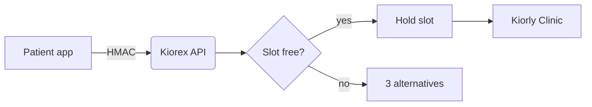
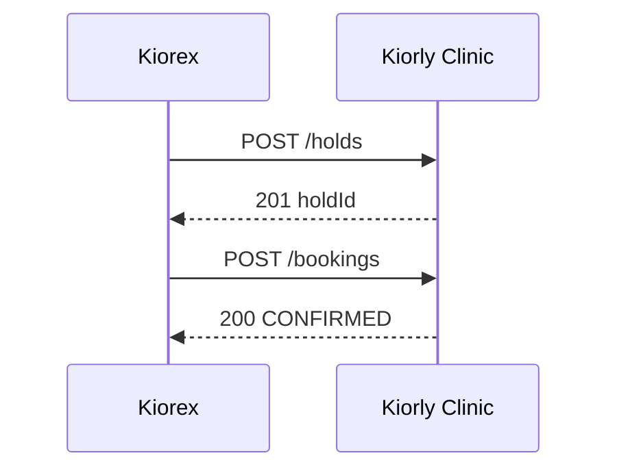

# KX-99 — Markdown Conventions Showcase
Source: fixture
Revision: Rev 2.3 · Reference Edition · 20 November 2026 · Approved reference
Owner role: Docs tooling. Audience: Anyone writing Kiorex documents.
Subtitle: Every rich component the PDF builder recognises, rendered from plain Markdown.
Tags: Callouts · KPI cards · Status pills · Mermaid · Arabic · Landscape tables

## What changed in Rev 2.3
Demonstrates the document-control "What changed" panel: this section is lifted onto the About page.

## 01 Callouts and quotes

> "Book verified care in under two minutes, in Arabic, at the clinic or at home."

> **Note** Plain notes use an info icon. Inline IDs such as ADR-033, KX-09 and `R8` become badges.

> **Warning** Prices are planning numbers until the Egypt pilot produces cohorts.

> **Decision** Deploy equals live; the super admin can switch a module off (ADR-023).

> **Risk** Marketplace liquidity: density first, clusters before breadth.

> **Open question** Arabic name for Kiorly Nurse (Q12).

RULE: Commission charges are created by Kiorly, never by Kiorex.

### Key numbers
<!-- kpis -->
- **108** Build steps (Stages A–F)
- **4** Plans (Lite · Pro · Clinic · Enterprise)
- **EGP 40** Per attended new patient
- **27 mo** Runway (base)

Tiles: BUILD STEPS 108 (Stages A–F) · PLANS 4 (Lite · Pro) · SPECIALTIES 11 (pending sign-off)

## 02 Tables and status

| Workstream | Status | Owner | Target |
|---|---|---|---|
| Money engine | Done | CFO | Q1 |
| Home visits | Planned | CPO | Q4 |
| Pen test | Blocked | CISO | Q2 |
| Pilot cohort | In progress | COO | Q3 |
| Counsel review | Open | Legal | Q2 |
| ADR-033 | Proposed | Architect | Q3 |

| Risk | Likelihood | Impact | Mitigation |
|---|---|---|---|
| R1 Liquidity | High | High | Density-first clusters |
| R2 Regulation | Medium | High | Counsel-gated verticals |
| R3 Founder bandwidth | Low | Medium | CTO hire by M6 |

| A very wide table | Region | Plan | Seats | Price | Currency | Billing | Tax | Discount | Annual | Monthly | Notes and rationale |
|---|---|---|---|---|---|---|---|---|---|---|---|
| Egypt Lite | EG | Lite | 2 | 0 | EGP | Commission | 14% | None | 0 | 0 | Free to start, commission only |
| Egypt Pro | EG | Pro | 10 | 1,299 | EGP | Per clinician | 14% | Annual 23% | 11,988 | 1,299 | Validate 799 / 999 / 1,299 in pilot |
| Egypt Clinic | EG | Clinic | 50 | 3,499 | EGP | Per org | 14% | Configurable | 41,988 | 3,499 | Includes five clinicians |
| Egypt Enterprise | EG | Ent | Unlimited | Custom | EGP | Contract | 14% | Negotiated | n/a | n/a | Hidden from public catalog |

## 03 Steps, flows and checklists

Steps to onboard a clinic:

1. Create the organization and invite the owner
2. Import patients and the drug list
3. Configure plans and entitlements
4. Go live with a pilot doctor

Flow: Free signup → Daily use → Kiorex demand → Higher-of invoice → Expand

- Patient deposit → capture via PSP → Kiorex Pay → weekly payout → Provider
- [x] Contract tests in CI
- [ ] Restore drill recorded





```ts
export async function hold(slotId: string): Promise<Hold> {
  // idempotent per externalRef
  return api.post('/marketplace/v1/holds', { slotId, ttl: 300 });
}
```

## 04 Arabic and mixed text

كيورلي للعيادات من كيوريكس — نظام إدارة العيادات الأول باللغة العربية.

| English | العربية |
|---|---|
| Kiorly Clinic | كيورلي للعيادات |
| Kiorly Lab | كيورلي لاب |
| Kiorly Pharmacy | كيورلي للصيدليات |

The lockup reads «كيورلي للعيادات» then "by Kiorex" (من كيوريكس) in mixed text.
