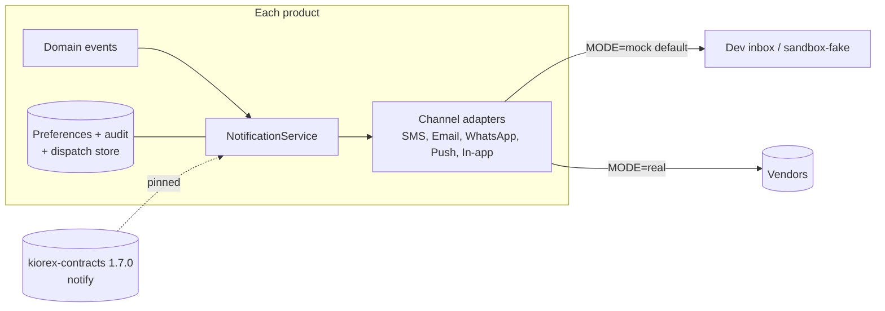
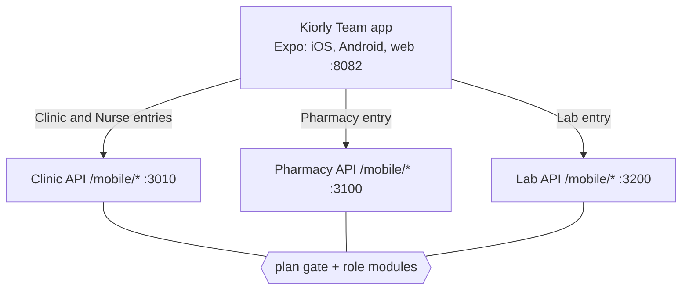

# KX08 — Target Architecture & Repository Design

Source: 1uLxpvO063I9jGeKscWTN5eJiou3mwfNs
Revision: Rev 2.3 · Reference Edition, updated 23 November 2026 (first issued 20 November 2026; this update adds the notification layer, provider adapters, the staff app and the repository states of 23 Nov 2026)

## What changed in Rev 2.3
Kiorly Nurse runs as an edition inside clinics-management (ADR-031); nurse.kiorly.com alias; no new repository or database.
New shared package @kiorly/field-visit (ADR-030), consumed by Kiorly Clinic, Kiorly Nurse and Kiorly Lab. New §07 data model additions (profession, scope of practice, home visits, care plans, MAR); flag catalogue +15 keys; never-flag list extended.

Systems, containers, repositories, data ownership and deployment topology for the decoupled Kiorex ecosystem — starting from what Kiorly already runs in production.

Authored in the role of Chief Software Architect. Owns service boundaries, technology choices and the path from today's code to the target state.

Tags: C4 views · 6 repositories · Modular monoliths · Kernel & field-visit packages · Feature-flag control plane · Cells & scaling

| Field | Value |
|---|---|
| DOCUMENT | KX08 (03 — Technical documents) |
| REVISION | Rev 2.3 · Reference Edition (updated 23 Nov 2026) |
| DATE | 23 November 2026 (first issued 20 November 2026) |
| STATUS | Approved reference |
| AUDIENCE | Engineering, Cursor sessions, technical due diligence |
| OWNER ROLE | Chief Software Architect |
| SUPERSEDES | KX08 Rev 2.2 19 Nov 2026 |

## Contents

01 Architecture drivers · 02 System context (C4 level 1) · 03 Containers (C4 level 2) · 04 Repository plan · 05 Shared packages (ADR-004, ADR-030) · 06 Kiorex platform internal design · 07 Data model additions (Kiorly Clinic, v2.3) · 08 Deployment topology · 09 Feature-flag control plane (ADR-023) · 10 Feature-flag catalogue · 11 Scaling path

## 01 Architecture drivers

What the design must optimize for, in order.

| # | Driver | Architectural response |
|---|---|---|
| 1 | Provider SaaS must keep working when Kiorex fails | Separate deployables, databases and failure domains; async events; no synchronous Kiorex dependency in Kiorly critical paths |
| 2 | Small team, fast delivery | Modular monoliths per product (NestJS, enforced module boundaries), shared kernel by package, editions instead of forks, one cloud (AWS) |
| 3 | Money correctness | Idempotency keys, transactional outbox, immutable charges, idempotent settlement, property-based tests |
| 4 | Clinical safety & privacy | Per-product authorization, scope of practice per profession, consent enforcement in code, PHI-free logs, encryption, audit, home-visit safety controls |
| 5 | Multi-market by configuration | Market packs (incl. scope-of-practice matrix and district lists), data-cell registry, per-market provider adapters |
| 6 | Cost discipline | App Runner + RDS, no NAT gateways, CloudFront single origin per product, scale-to-need |

## 02 System context (C4 level 1)

Figure 1 — External actors and systems.

- Patients (web · iOS · Android)
- Providers (doctors · physiotherapists · nurses · pharmacists · labs)
- Kiorex (marketplace) — HMAC API + webhooks to the Kiorly suite (Clinic (+ Nurse edition) · Pharmacy · Lab)
- Kiorex Account (OIDC)
- Payment providers (Paymob · Fawry · InstaPay)
- Meta WhatsApp (templates · inbound)
- AI providers (OpenAI EU · self-hosted)
- AWS (SES · S3 · KMS · Location — email · files · keys · maps)

## 03 Containers (C4 level 2)

Figure 2 — Container view; each product owns its API, database, storage and dispatcher. Kiorly Nurse is not a separate container.

- Experience: Kiorex app (Expo RN), Kiorex web (React), Kiorly web/PWA (React+Vite; Clinic and Nurse editions), Pharmacy POS PWA, Lab console PWA, Ops console
- Edge: CloudFront + WAF per product (kiorex.com · kiorly.com · nurse.kiorly.com (alias of the Clinic stack); /api/* → API origin)
- Product APIs: kiorex-platform API, clinics-management API (Clinic + Nurse editions), kiorly-pharmacy API, kiorly-lab API
- Shared: Kiorex Account IdP, @kiorly/commerce-kernel (pkg), @kiorly/field-visit (pkg), kiorex-contracts (OpenAPI/events)
- Async: Outbox dispatchers (per product), HMAC webhooks, Schedulers (settlement, dunning, trials, care-plan visit generation, safety timers)
- Data: RDS Postgres per product, S3 per product, OpenSearch (Kiorex search, M9), Redis (slot/session cache, as needed)

## 04 Repository plan

Six repositories. One per product plus identity and contracts; the kernel and field-visit packages ship from Kiorly.

| Repository | Contents | State today | Action |
|---|---|---|---|
| mshall/clinics-management | Kiorly Clinic API + web (Clinic and Nurse editions) + docs + infra (CDK → OpenTofu) | Production-ready | Keep. Publish @kiorly/commerce-kernel and @kiorly/field-visit from packages/ |
| kiorex-platform (new) | Marketplace API (NestJS modular monolith), web, Expo app, ops console + super admin, feature-flag control plane, infra | Create new | New repo from Kiorly skeleton; harvest patient UI from kiorex-web-app; no code from kiorex-backend; archive 2025 repos (KX22) |
| kiorly-pharmacy (new) | Pharmacy API + POS PWA + infra | Planned M9 | Scaffold from Kiorly template; consume kernel |
| kiorly-lab (new) | Lab API + console + phlebotomist app + infra | Planned M15 | Scaffold from template; ASTM/HL7 adapters; consume field-visit |
| kiorex-account (new) | IdP configuration-as-code, themes, OTP sender lambdas, back-channel logout | Planned M1 | Managed IdP; no custom crypto |
| kiorex-contracts (new) | OpenAPI specs, JSON Schemas for events, generated TS SDKs, contract tests | Extract | Move marketplace.openapi.json + consumer contract here; both CIs pin versions (NH019) |

> **Note** State on 23 Nov 2026. All repositories below now exist locally under one workspace (private GitHub remotes under the founder's account) and run together on one Postgres cluster; the "Planned" and "Create new" states in the table are historical. Plus one repository that this plan did not list: **kiorly-work**, the Kiorly Team staff app (Expo, iOS, Android, web). Pushes of `clinics-management` branch `kiorex` need founder approval; nothing is deployed.

| Repository | Role | State (23 Nov 2026) |
|---|---|---|
| kiorex-contracts | OpenAPI, event schemas, flags, HMAC SDK, notification layer | Done: 1.7.0 |
| kiorex-platform | Kiorex API, patient web, patient Expo app, ops console, Kiorex Pay, flag control plane | Done (pre-launch), mock providers |
| kiorex-account | Passport: dev OIDC provider, config as code, OTP sender | Done (dev) |
| clinics-management (branch `kiorex`) | Kiorly Clinic and Nurse edition, `/mobile/*` staff API | Done (dev) |
| kiorly-pharmacy | Pharmacy API and web, Kiorex machine API, `/mobile/*` | In progress; built ahead of the M9 plan |
| kiorly-lab | Lab API and web, Kiorex machine API, nurse custody, `/mobile/*` | In progress; built ahead of the M15 plan |
| kiorly-work | Kiorly Team staff app; owns no data, calls the three product APIs | Done (dev builds) |
| kiorex-workspace | Docs, brand kit, cross-service e2e (18 suites), seed scripts | Done |

NOTE: The 2025 repositories kiorex-backend, kiorex-web-app, kiorex-ai-services and kiorex-backend-documentation were assessed on 19 Nov 2026 as prototypes and references only. Keep / harvest / archive decisions, the full repo map and the build-agent brief are in KX22. There is no kiorly-nurse repository (ADR-031).

### Standard repository layout

```
<repo>/
  apps/api/        NestJS modular monolith (bounded contexts as modules, *-public.ts façades)
  apps/web/        React + Vite + TanStack Query + shadcn/ui + i18next (EN/AR, RTL); edition-aware shell in clinics-management
  apps/mobile/     Expo React Native (Kiorex only, later Kiorly field apps)
  packages/        shared libs (commerce-kernel, field-visit in clinics-management)
  infra/tofu/      OpenTofu: modules/aws/* behind cloud-neutral contracts, product-stack, live/<env>/<cell>/<product> (ADR-028)
  Docs/            product docs, runbooks, ADR references, market packs
  .cursor/rules/   repo rules for autonomous build sequences
  .github/workflows/  ci-test-reusable, deploy-aws (OIDC role), pr-synth-build
```

## 05 Shared packages (ADR-004, ADR-030)

The most valuable reusable assets in Kiorly — reused, not re-invented, by Nurse, Pharmacy and Lab.

| Package / module | From Kiorly step | Responsibility | Consumers |
|---|---|---|---|
| kernel · plans & prices | PL01, SB06 | Versioned per-market price catalog, cohorts, grandfathering, indexation | Clinic, Nurse, Pharmacy, Lab |
| kernel · entitlements | PL03/04 | Resolve plan ⊕ trial ⊕ overrides; guards; limits | All |
| kernel · subscriptions & trials | PL02, CR01, PL07 | Lifecycle, activation rules, proration | All |
| kernel · credit wallet | CR05 | Immutable ledger, FIFO expiry, grants | All |
| kernel · settlement | CR06, SB05 | max(S, C), trial policies, Lite minimum invoice, carry-forward, VAT | All (C = commissions/order fees) |
| kernel · dunning | SB03 | Config timeline, access guard that never blocks records | All |
| kernel · market packs | FD00, PA02 | Currency, tax, payment methods, data cell, commercial config, scope-of-practice matrix, district lists | All + Kiorex |
| field-visit · zones | KCV206 | Coverage zones (districts → polygons later), in-zone checks | Clinic, Nurse, Lab |
| field-visit · scheduling | KCV206 | Travel buffers, daily caps, route ordering | Clinic, Nurse, Lab |
| field-visit · visit lifecycle | KCV206 | On my way · arrived · finished · aborted-unsafe with coarse geostamp | Clinic, Nurse, Lab |
| field-visit · safety | KCV206 | Safety timer, SOS, safety-contact alerting (never a flag) | Clinic, Nurse, Lab |

RULE: Packages are libraries with their own semver and test suite (QA03 matrix travels with the kernel; a safety-drill suite travels with field-visit). Each product keeps its own database tables for these models — no shared billing or visit database.

## 06 Kiorex platform internal design

A modular monolith with bounded contexts mirroring Kiorly's discipline.

| Context | Responsibilities | Data owned |
|---|---|---|
| Catalog & search | Provider projection from Kiorly sync + events (incl. profession, coverage districts); search index; ranking | Provider projections (with source version) |
| Booking orchestration | Intent, holds, idempotent booking calls, state machine incl. home-visit sub-states, reconciliation job | Booking intents, correlation IDs |
| Kiorex Pay | Deposits, refunds, payouts, PSP adapters, ledger, reconciliation | Payment ledger, payouts |
| Engagement | Notifications (WhatsApp/push/email), reminders, review invitations, family visit-status links | Message log, consents |
| Trust | Reviews, moderation, complaints, home-visit safety console | Reviews (source of truth) |
| Patient | Profiles, family, address book, consent centre, record vault (shares) | Patient profile, addresses (encrypted), shares |
| Ops | Admin console, dashboards, dispute and support tooling | Ops notes, audit |

## 07 Data model additions (Kiorly Clinic, v2.3)

Additive Prisma changes in clinics-management; one migration backfills profession. No new database.

| Model / field | Purpose | Notes |
|---|---|---|
| Organization.edition | CLINIC | NURSE | Default CLINIC; set at sign-up; super-admin change only |
| Clinician.profession | PHYSICIAN | DENTIST | PHYSIOTHERAPIST | NURSE | Required; migration backfills |
| ProfessionalRegistration | Register, number, documents, verifiedBy, expiresAt | Replaces doctor-only syndicate fields; ≥1 per clinician (extraction: "≥ 1 per clinician" ambiguous) |
| ScopeOfPractice (market pack) | profession × capability → allowed | Versioned; read by @RequiresScope |
| VisitType.serviceLocation, travelBufferBefore/After, homeSurcharge | Home-visit configuration | Slot engine reads these |
| CoverageZone | clinicianId, district codes, optional geometry | District list from market pack |
| HomeVisit | appointmentId, encrypted address snapshot, en-route/arrived/finished timestamps + geostamps, abort reason | 1:1 with Appointment (extraction shows "11 with Appointment", likely 1:1) |
| SafetyContact, SafetyAlert | Org safety contact; timer and SOS alerts | Audited; not a flag |
| CarePlan, CarePlanItem | Recurring services × frequency × duration | Generates appointments; linked to a package |
| VisitRecord (nursing) | Edition-NURSE encounter type | Reuses encounter sign-off and lock |
| VitalsObservation | Typed vitals with units and thresholds | Also used for physio outcome measures |
| DoctorOrder, MedicationAdministration | Order source (shared or uploaded), expiry; MAR entries | Allergy/duplicate checks always on |
| ShiftBooking | Private-duty shifts and handovers | Nurse Pro and above |

WATCH: Geostamps are stored as coarse coordinates (about 100 m) with accuracy, kept 12 months, then reduced to district only (retention per market pack; DPO to confirm under PDPL, KX15).

## 08 Deployment topology

Product stack in the market's data cell (Egypt: frankfurt, eu-central-1). Kiorly Nurse is served by the Clinic stack.

Figure 3 — Per-product stack, identical across products (OpenTofu product-stack module, KX21 §01):

CloudFront + WAF (kiorly.com · nurse.kiorly.com / kiorex.com) → S3 SPA assets (edition-aware shell) and /api/* → App Runner API (autoscale, VPC connector) → RDS PostgreSQL 16 (Multi-AZ, PITR); S3 uploads (KMS); Secrets Manager / KMS; CloudWatch + alarms (logs/metrics) → on-call webhooks; VPC endpoints.

| Environment | Purpose | Data |
|---|---|---|
| local | Docker Postgres, seeded demo tenants (incl. a Nurse-edition agency and a solo nurse) | Synthetic |
| staging (KIORLY_ENV=staging) | WhatsApp sandbox, payment sandboxes, pilot rehearsal, field-visit safety drills | Synthetic + demo:reset ≤ 60 s |
| production | Live tenants per cell | Real; PITR + quarterly restore drill |

## 09 Feature-flag control plane (ADR-023)

Everything that is built ships to production enabled by default. The Kiorex super admin can switch any capability off — globally, per country or per organization — without a deploy.

Key figures:

- Default for every flag: ON (unless launch-locked)
- Scopes: 3 (global · market · organization)
- Change mechanism: toggle + reason; flag.changed signed snapshot; org-adjustable only for organization-scope flags
- Propagation: ≤ 60 s (push ≤ 30 s pull)
- Safety controls behind flags: 0 (never switchable)

Figure — One registry, evaluated locally in every product. Products never call the control plane per request.

Kiorex super admin (ops.kiorex.com · SSO + MFA) → Flag control plane (kiorex-platform · registry · audit) → Registry DB (definitions · values · gates) → local snapshot + evaluator in Kiorly Clinic, Kiorly Pharmacy, Kiorly Lab, Kiorex apps & API. Org admins toggle their own org only.

### How the effective value is computed

1. Global — default ON
2. Market — inherit / off
3. Organization — inherit / off
4. Plan entitlement — 402 if not in plan
5. Gate evidence — launch-locked only
6. Dependencies — parent flags ON
7. Effective — ON / OFF

| Rule | Detail |
|---|---|
| Default | Every flag defaults ON at every scope. A missing row means 'inherit', and the root inherits ON. |
| Any OFF wins | OFF at global, market or organization makes the capability OFF for everything beneath it. A lower scope cannot re-enable what a higher scope turned off. |
| Plan still applies | A flag says the capability is *available*; the plan says the customer *paid* for it. Effective = flag ∧ entitlement (@RequiresEntitlement, HTTP 402). Scope of practice is a third, independent guard (@RequiresScope, 403). |
| Launch-locked flags | Default ON, but effective only after the gate evidence is recorded in the super admin (gate ID, approver, date, document link). The panel shows 'ON · awaiting gate'. |
| Dependencies | A child flag is effective only if its parents are (e.g. clinic.commission_settlement needs clinic.kiorex_listing and kiorex.marketplace; kiorex.home_visits needs clinic.home_visits). |
| Edition | nurse.* flags evaluate only for NURSE-edition organizations; clinic.* flags apply to both editions unless marked. |
| Who may toggle | Kiorex super admin: every flag, every scope, every product. Organization admins: only flags marked organization-scope, only for their own organization. |

### What 'OFF' must do — universal contract

- Never deletes or hides data: records stay viewable, printable and exportable.
- Stops new actions only: entry points hidden; APIs return 403 FEATURE_DISABLED {key, scope}; UI shows 'temporarily unavailable' in AR/EN.
- Honours what is in flight: confirmed bookings and home visits, paid deposits, accepted orders, active care plans and booked collections complete or are refunded per policy.
- Money stays consistent: charges already CONFIRMED still settle; new charges stop; settlement re-runs remain idempotent.
- Reversible: turning a flag back ON restores the capability with no migration.

### Distribution and resilience

| Concern | Design |
|---|---|
| Delivery | Signed snapshot per product (GET /control/v1/flags/snapshot?product=, ETag, 30 s poll) + HMAC flag.changed webhook for immediate refresh |
| Evaluation | In-process from the product's persisted snapshot — no network call per request; Kiorly's FeatureFlagsService becomes the evaluator |
| Control plane down | Fail-static: keep last-known snapshot. A fresh deploy with no snapshot uses code defaults: ON, except launch-locked → OFF until a snapshot confirms the gate |
| Audit | Every change: actor, scope, old → new, reason, ticket, expiry; streamed to each product's audit log |
| Safety net | Optional expiry on any OFF ('disable for 2 hours'); scheduled toggles for planned maintenance |
| Two-person rule | Global or market OFF of a money-path flag needs a second approver; an emergency kill by one admin is allowed and auto-reviewed within 24 h |

## 10 Feature-flag catalogue

Every capability that can be switched off from the Kiorex super admin. All default ON. Scopes: G global · M market · O organization.

| Key | Product | Scopes | Class | When OFF | Depends on / gate |
|---|---|---|---|---|---|
| clinic.kiorex_listing | Kiorly Clinic | G M O | Module | Listings PAUSED on Kiorex; confirmed bookings honoured; booking link still works | kiorex.marketplace |
| clinic.commission_settlement | Kiorly Clinic | G M | Commercial | New commission charges stop; invoices = subscription only; confirmed charges still settle | clinic.kiorex_listing |
| clinic.kiorly_pay_deposits | Kiorly Clinic | G M O | Commercial | No new deposit requirements or links; existing deposits refund/convert per policy | — |
| whatsapp_reminders | Kiorly Clinic | G M O | Integration | Reminders stop; manual call list shown | — (existing key) |
| clinic.whatsapp_inbound | Kiorly Clinic | G M O | Integration | Replies no longer change appointments; routed to inbox | whatsapp_reminders |
| instapay · fawry · card_payments | Kiorly Clinic | G M O | Integration | Method hidden at cashier; cash and other methods remain | — (existing keys) |
| ai_assistant | Kiorly Clinic | G M O | AI | Widget hidden; chat returns 403 | — (existing key) |
| clinic.ai_scribe | Kiorly Clinic | G M O | AI | Record button hidden; signed notes unaffected | — |
| clinic.whatsapp_ai_receptionist | Kiorly Clinic | G M O | Launch-locked | Inbound messages go to human inbox | clinic.whatsapp_inbound · gate: Meta approval + consent copy |
| clinic.no_show_risk | Kiorly Clinic | G M O | AI | Risk chip hidden | — |
| clinic.waitlist_autofill | Kiorly Clinic | G M O | Module | Waitlist kept; no automatic offers | whatsapp_reminders |
| clinic.record_share_patient_app | Kiorly Clinic | G M O | Module | No new shares; existing shares stay visible to the patient | kiorex.record_vault |
| clinic.eprescription_handoff | Kiorly Clinic | G M O | Module | Rx printed / WhatsApp only | pharmacy.module |
| clinic.lab_order_handoff | Kiorly Clinic | G M O | Module | Lab orders kept as records only | lab.module |
| clinic.payers_tpa | Kiorly Clinic | G M O | Module | Contract prices kept; no new claims | — |
| clinic.specialty_templates.<code> | Kiorly Clinic | G M | Launch-locked | Template hidden from new encounters | gate: specialty board sign-off (NH010) |
| clinic.referral_rewards | Kiorly Clinic | G M | Commercial | No new codes; earned credits honoured | — |
| clinic.field_rep_onboarding | Kiorly Clinic | G M | Commercial | Rep codes rejected at signup; earned commissions honoured | — |
| clinic.profession.physiotherapy | Kiorly Clinic | G M | Module | No new physio sign-ups; existing physios keep working | — |
| clinic.home_visits | Kiorly Clinic | G M O | Launch-locked | Home visit types hidden for new bookings; booked visits honoured | gate: GHV1 + GHV2 |
| clinic.home_route_view | Kiorly Clinic | G M O | Module | List view only | clinic.home_visits |
| clinic.home_dispatch | Kiorly Clinic | G M O | Module | Manual assignment | clinic.home_visits |
| nurse.edition | Kiorly Nurse | G M | Module | No new Nurse sign-ups; existing tenants read-only with export | — |
| nurse.individual_tenants | Kiorly Nurse | G M | Commercial | Solo plans hidden at sign-up; existing solos keep working | nurse.edition |
| nurse.care_plans | Kiorly Nurse | G M O | Launch-locked | Single visits only; active plans complete | gate: GKN1 |
| nurse.mar | Kiorly Nurse | G M O | Launch-locked | Medication recorded as free text in the visit record | gate: GKN1 |
| nurse.private_duty_shifts | Kiorly Nurse | G M O | Module | Shift booking hidden | nurse.edition |
| nurse.family_updates | Kiorly Nurse | G M O | Integration | No family messages | whatsapp_reminders |
| nurse.individual_kiorex_listing | Kiorly Nurse | G M | Launch-locked | Solo nurses not listed on Kiorex | kiorex.home_visits · gate: GKN2 |
| kiorex.marketplace | Kiorex | G M | Module | Search shows clinic phone only; no new bookings; existing bookings honoured | — |
| kiorex.pay_deposits | Kiorex | G M | Commercial | Deposit-required visit types bookable without deposit or hidden (per market setting) | kiorex.marketplace |
| kiorex.reviews | Kiorex | G M | Module | No new reviews; aggregates still displayed | kiorex.marketplace |
| kiorex.family_accounts | Kiorex | G M | Module | Existing dependants kept; cannot add new | — |
| kiorex.record_vault | Kiorex | G M | Module | Vault read-only | — |
| kiorex.whatsapp_booking | Kiorex | G M | Integration | WhatsApp replies with app link | kiorex.marketplace |
| kiorex.sponsored_listings | Kiorex | G M | Commercial | Sponsored slots removed; organic ranking only | kiorex.marketplace |
| kiorex.home_visits | Kiorex | G M | Launch-locked | Home filter hidden; booked home visits honoured | clinic.home_visits · gate: GHV1 + GHV2 |
| kiorex.category.physiotherapy | Kiorex | G M | Launch-locked | Physio providers not shown | gate: GPR1 |
| kiorex.category.nursing | Kiorex | G M | Module | Home nursing not shown | kiorex.home_visits, nurse.edition |
| kiorex.visit_tracking | Kiorex | G M | Module | Status timeline without on-the-way updates | kiorex.home_visits |
| kiorex.pharmacy_orders | Kiorex | G M | Launch-locked | Pharmacy tab hidden; open orders completed or refunded | pharmacy.kiorex_orders · gate: merchant-of-record + counsel memo (Q5) |
| kiorex.lab_bookings | Kiorex | G M | Launch-locked | Lab tab hidden; booked collections honoured | lab.kiorex_bookings · gate: counsel memo |
| kiorex.telemedicine | Kiorex | G M | Launch-locked | Video option hidden | gate: clinical governance sign-off |
| kiorex.ai_navigation | Kiorex | G M | Launch-locked | Plain specialty search | gate: clinical evaluation (KX11) |
| account.passkeys | Kiorex Account | G M | Module | OTP only | — |
| account.provider_sso | Kiorex Account | G M O | Module | Providers use product login | — |
| pharmacy.module | Kiorly Pharmacy | G M O | Module | No new sign-ups; existing tenants read-only with export | — |
| pharmacy.kiorex_orders | Kiorly Pharmacy | G M O | Module | Order inbox hidden; stock not exposed | pharmacy.module |
| pharmacy.forecasting | Kiorly Pharmacy | G M O | AI | Min/max reorder only | pharmacy.module |
| pharmacy.insurer_claims | Kiorly Pharmacy | G M O | Module | Cash/self-pay only | pharmacy.module |
| lab.module | Kiorly Lab | G M O | Module | No new sign-ups; existing tenants read-only with export | — |
| lab.analyzer_interfaces | Kiorly Lab | G M O | Integration | Manual entry with dual control | lab.module |
| lab.home_collection | Kiorly Lab | G M O | Module | Walk-in collection only | lab.module |
| lab.kiorex_bookings | Kiorly Lab | G M O | Module | Not bookable from Kiorex | lab.module |
| market.<country>.live | All products | G | Launch-locked | Country hidden from sign-up and search; existing tenants unaffected | gate: market pack certification + local counsel |

RULE: Not flags — never switchable: Rx safety checks (interactions, allergies, duplicates); Encounter sign-off, auto-lock and versioned amendments; Audit logging; Consent enforcement; Record view / print / export for the tenant; Lot expiry / recall / quarantine blocks; Pharmacist sign-off; Lab QC blocks and authorized release; Critical-value escalation; Privileged MFA on production; Tenant isolation and authorization; Breach-response tooling; Scope-of-practice enforcement; Profession verification before listing; Home-visit safety timer, SOS, unsafe-abort and address masking; MAR allergy/duplicate checks and doctor-order requirement.

## 11 Scaling path

Design for 10× without re-architecture; extract only with evidence.

| Trigger | Action |
|---|---|
| Slots p95 > 150 ms at load | Redis slot cache (beyond current 60 s in-process cache); read replica |
| Search > 50k providers or complex ranking | OpenSearch index fed by provider events |
| Home-slot search with travel-time routing becomes slow | Precompute district-to-district travel matrix per cell; later a routing service behind the field-visit adapter |
| > 3 consumers of the same events | Introduce EventBridge/SNS fan-out behind the outbox dispatcher |
| A context needs independent scaling or team (e.g. Nurse edition with its own squad) | Extract per MODULAR_MONOLITH.md: stop imports → OpenAPI → own schema → route by path |
| New market without suitable cell | Add cell to platform/data-cells.json; deploy stack in new region; tenants pinned to cell |

## 12 Notification layer, provider adapters and the staff app (23 Nov 2026)
### 12.1 Notification layer (ADR-034)
A pure TypeScript layer, `@kiorex/contracts/notify` (contracts 1.7.0), decides which channels, in which order and in which words a message goes out and whether it is allowed (consent, opt-out, quiet hours, WhatsApp 24 h window, PHI guard). Each product injects its own channel adapters, preference store, audit sink, dispatch store and clock. There is no central service and no shared database. Full design, status model, provider table and migration plan: KX24.


Adoption: kiorex-platform done; Passport, Lab, Pharmacy, Clinic planned in that order.

### 12.2 Provider adapter contract (ADR-035)
Every outbound dependency (SMS, Email, WhatsApp, Payment, Push, Storage, Consent, AI) has a port plus `mock` and `real` implementations chosen by `<KIND>_MODE`, with timeouts, retries (never on 4xx), the same idempotency key on every attempt, signed webhooks, fail-fast startup validation and one mapping file per vendor. Details: `_docs/PROVIDER_GO_LIVE.md`. Remaining for go-live is only URLs and credentials, template approvals and PSP onboarding.

### 12.3 Staff mobile app (ADR-033, Proposed)

The app owns no data; each backend decides, per role and plan, which modules exist and answers 403 `FEATURE_DISABLED` for a Lite organization on every route except alerts and the upgrade request (safety alerts reach every plan, ADR-025). One session is kept per product. Today's gate is the single `mobile_staff_app` entitlement; the tiered `mobile.*` model of ADR-033 is Planned.

### 12.4 Local ports (dev)
| Service | Port |
|---|---|
| Clinic API / web | 3010 / 5174 |
| Kiorex API / patient web / ops console / patient Expo web | 4000 / 5180 / 5181 / 8081 |
| Passport / second fake IdP | 4400 / 4401 |
| Pharmacy API / web | 3100 / 5192 |
| Lab API / web | 3200 / 5193 |
| Kiorly Team (Expo web) | 8082 |
| Postgres | 5433 |
Ports 3000, 5173 and 5175 belong to the founder's other checkout and are never touched.

## What changed in this revision (23 Nov 2026)
- §04 gains the repository states table (including kiorly-work); new §12 on the notification layer, the provider adapter contract, the staff app and local ports.
- Containers, data model, deployment topology, flag control plane, flag catalogue and scaling path are unchanged. Nothing was deployed.
- Not verified: any AWS deployment; Pharmacy and Lab schedules (M9, M15) were not re-planned though the code is ahead of them.
