# KX-26 — System Architecture Reference

Revision: Rev 2.3 · Reference Edition, updated 23 November 2026 (new volume in this set; owner: Chief Software Architect; supersedes: none; consolidates KX-08, KX-09, KX-10, KX-21, KX-24 and KX-25 into one picture)

Subtitle: The whole Kiorex and Kiorly system on one set of diagrams: context, containers, components, data, identity, integration, notifications, storage, hosting, security, mobile and resilience, with what is built and what is planned.

Tags: C4 context and containers · Components · Data and storage · Identity · Integration · Hosting · Security · Mobile · Resilience

> **Note** How to read this volume. Every diagram is labelled Done (built and running locally on 23 Nov 2026), Planned or Proposed. Nothing here has run against a real vendor or in AWS production. Detail lives in the volume named in each section; this volume is the map that connects them.

| Field | Value |
|---|---|
| DOCUMENT | KX-26 |
| REVISION | Rev 2.3 · Reference Edition (updated 23 November 2026) |
| STATUS | Architecture as built locally; hosting and real vendors Planned |
| OWNER ROLE | Chief Software Architect |
| AUDIENCE | Engineering, build agents, security reviewers, technical due diligence, new joiners |
| RELATED | KX-01 ADRs; KX-04 identity; KX-08 target architecture; KX-09 contracts; KX-10 security; KX-21 AWS; KX-24 notifications; KX-25 storage |

## Key numbers (verified 23 Nov 2026)
- **5** deployable backends: Kiorex platform API, Kiorly Clinic API (also serves the Nurse edition), Kiorly Pharmacy API, Kiorly Lab API, Kiorex Passport (identity).
- **2** mobile apps: Kiorex patient app and **Kiorly Team** staff app (Clinic, Nurse, Pharmacy and Lab entries).
- **1** shared contracts package `@kiorex/contracts` **1.7.0** (events, flags, HMAC, notify) plus two kernel packages (commerce kernel, field-visit).
- **1** database per product, **0** shared databases. **0** synchronous Kiorex dependencies in Kiorly critical paths.
- **8** provider kinds behind ports with mock and real adapters: SMS, Email, WhatsApp, Payment, Push, Storage, Consent, AI.
- **36** ADRs, 31 Accepted, 5 Proposed (KX-01).

## 01 Architecture in one page
Kiorex is the patient-facing marketplace and company brand. Kiorly is the provider-facing suite (Clinic with a Nurse edition, Pharmacy, Lab). They are separate products with separate databases that talk through signed HTTP calls and events, so a Kiorex outage never stops a clinic from working. One identity service (Kiorex Passport) logs people in everywhere but never holds medical data.

| Principle | What it means in the design | Where enforced |
|---|---|---|
| P1 Providers keep working without Kiorex | Local feature-flag evaluation, local notification library, outbox for every outward event | Each product API |
| Modular monolith per product | NestJS modules with enforced boundaries, not microservices | `module-boundaries.unit.spec.ts` in platform; module layout in each API |
| Share by package, not by service | Commerce kernel, field-visit and contracts are libraries with their own semver | `kiorex-contracts`, kernel adapters |
| Identity is not clinical data | Passport tokens carry no clinical claims | ADR-013, KX-04 |
| Mock by default, real by configuration | `<KIND>_MODE` and vendor URL and secret, never code changes | ADR-035, KX-24 |
| One cloud, managed services first | App Runner, RDS, S3, CloudFront, SES, Secrets Manager, KMS | KX-21 |

## 02 System context (C4 level 1)
Figure 1 — Who and what talks to the system.

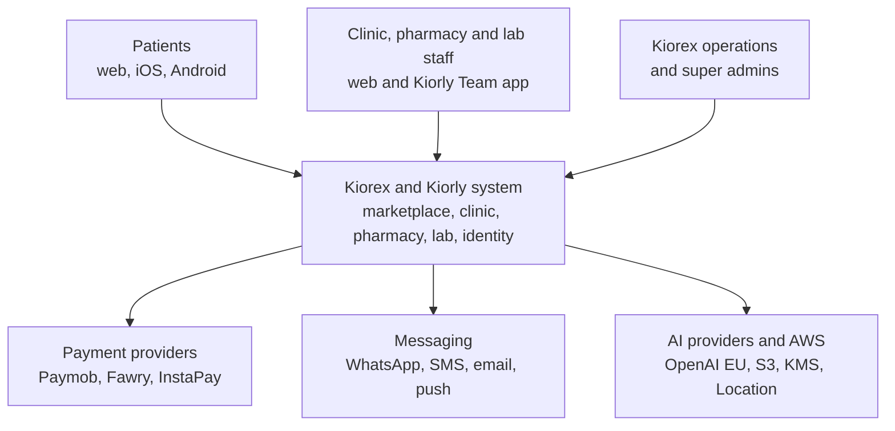

## 03 Containers (C4 level 2)
Figure 2 — Deployable containers and the one-way boundaries between them. Solid arrows are synchronous HTTPS; the webhook arrows are asynchronous and signed.

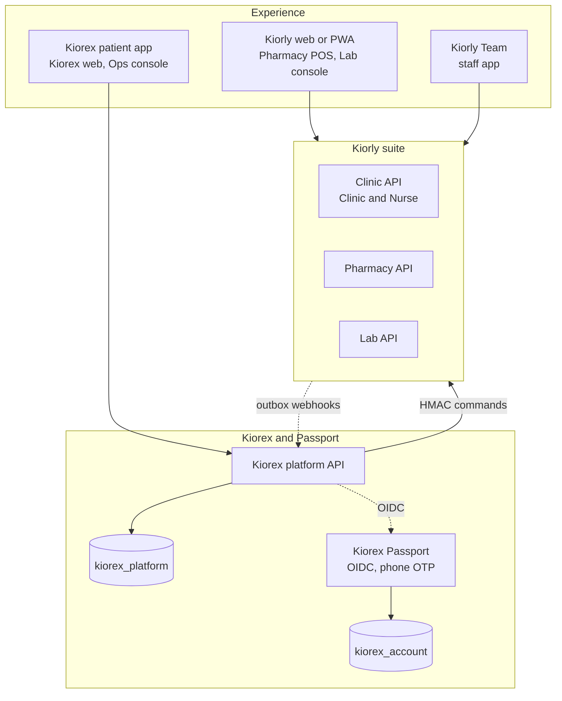

| Container | Repository | Port (local) | Database | Status |
|---|---|---|---|---|
| Kiorly Clinic API (Clinic and Nurse) | `clinics-management/apps/api` | 3010, prefix `/api/v1` | `kiorly` | Done |
| Kiorly Clinic web | `clinics-management/apps/web` | 5174 | none | Done |
| Kiorex platform API | `kiorex-platform/apps/api` | 4000 | `kiorex_platform` | Done |
| Kiorex patient web, ops console | `kiorex-platform/apps/web`, `apps/ops` | 5180, 5181 | none | Done |
| Kiorex patient app | `kiorex-platform/apps/mobile` | Expo | none | Done (dev) |
| Kiorly Pharmacy API and web | `kiorly-pharmacy/apps/api`, `apps/web` | 3100, 5192 | `kiorly_pharmacy` | Done |
| Kiorly Lab API and web | `kiorly-lab/apps/api`, `apps/web` | 3200, 5193 | `kiorly_lab` | Done |
| Kiorex Passport (dev IdP) | `kiorex-account/apps/dev-idp` | 4400 | `kiorex_account` | Done (dev); production on Cognito Planned |
| Kiorly Team staff app | `kiorly-team` | Expo web 8082 | none | Done (dev) |

## 04 Repositories and shared packages
Figure 3 — Eight repositories, one workspace, and who depends on whom.

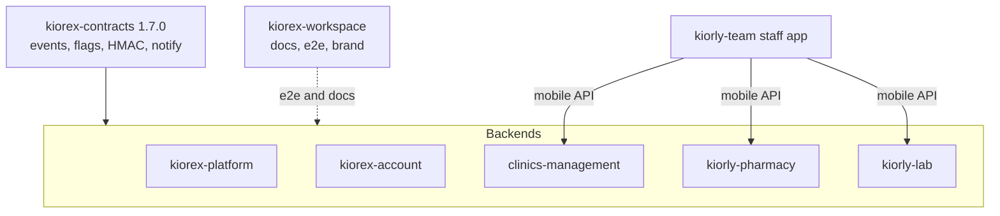

| Package | Responsibility | Consumers |
|---|---|---|
| `@kiorex/contracts` 1.7.0 | OpenAPI, event schemas, flag registry types, HMAC helpers, notification layer (`/notify`) | all backends; platform consumes a vendored tarball |
| commerce kernel | plans and prices, entitlements, subscriptions, credit wallet, settlement, dunning, market packs | Clinic, Nurse, Pharmacy, Lab |
| field-visit | coverage zones, travel scheduling, visit lifecycle, safety timer and SOS | Clinic, Nurse, Lab |

> **Rule** Packages are libraries, never services. Each product keeps its own tables for the models a package defines; there is no shared billing or visit database.

## 05 Components inside each product
### 05.1 Kiorly Clinic API (also serves the Nurse edition)
Figure 4 — The Clinic API as groups of NestJS modules. Edition (Clinic or Nurse) changes names, navigation and visible modules, never the database or API.

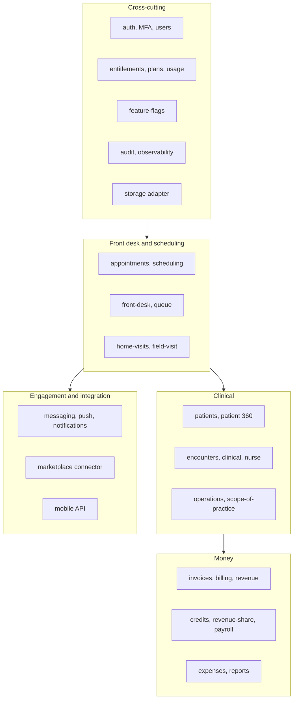

### 05.2 Kiorex platform API
| Bounded context | Responsibility | Data owned |
|---|---|---|
| catalog, market | Provider projection from sync and events; search; market packs | provider projections with source version |
| booking, waitlist | Intent, holds, idempotent booking, state machine incl. home visits, reconciliation | booking intents, correlation ids |
| pay | Deposits, refunds, payouts, PSP adapters, ledger | payment ledger |
| engagement, messaging, channels | Notifications, reminders, review invites, notification layer bridge | message log, consents |
| trust, safety | Reviews, moderation, complaints, home-visit safety console | reviews |
| patient, address, records | Profiles, family, address book, consent centre, record vault | patient profile, encrypted addresses |
| homecare, telemedicine, pharmacy, lab, partners | Service lines that route to Clinic, Pharmacy and Lab | per-line projections |
| control-plane | Feature-flag registry and signed snapshot | flag revisions |
| ai-gateway, analytics, ops, outbox, webhooks | AI with PHI redaction, analytics, admin console, event dispatch | ops notes, outbox |

### 05.3 Pharmacy and Lab APIs
Each has `auth`, `tenancy`, `audit`, `feature-flags`, `kernel-adapter`, `outbox`, `providers` (adapter ports) and domain `modules`. Pharmacy exposes the Kiorex machine API at `/marketplace/v1`; Lab at `/api/v1/integration/v1`. Both serve `/mobile/*` for the Kiorly Team app and keep working when Kiorex is down.

## 06 Identity and sign-in
Figure 5 — Patient sign-in with phone OTP and PKCE through Kiorex Passport.

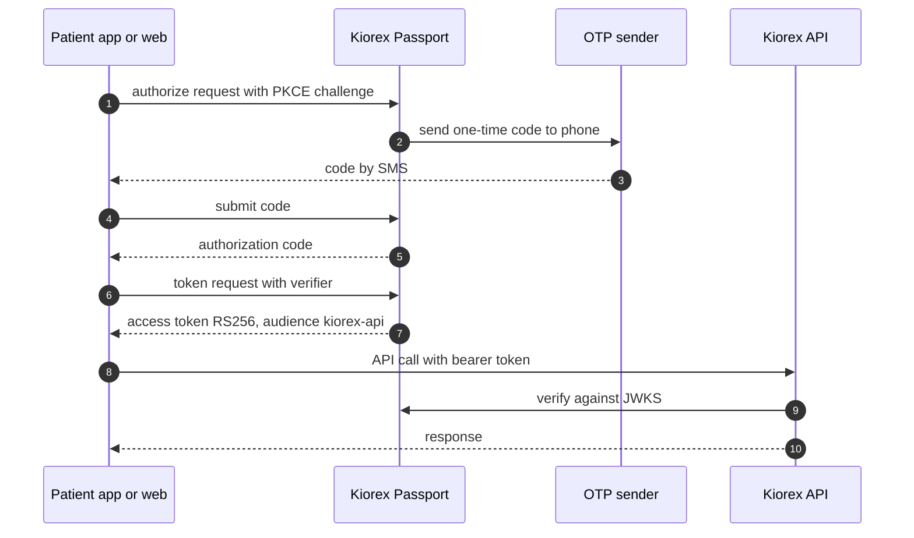

| Rule | Detail |
|---|---|
| Token | JWT RS256 with `sub`, phone, `locale`, `kx_roles`; no clinical data |
| Clients | `kiorex-web`, `kiorex-ops`, `kiorex-mobile` (public, PKCE), `kiorly-clinic` (confidential), `kiorly-team` (public, PKCE, dev only) |
| Logout | Back-channel logout posted to registered URLs |
| Staff apps | Kiorly Team uses its own staff login today; Passport sign-in is Planned |
| Production | Cognito registration of every client is NEEDS_HUMAN |

## 07 Integration: commands, events and webhooks
Figure 6 — A booking from the patient app to a confirmed appointment, with the failure path.

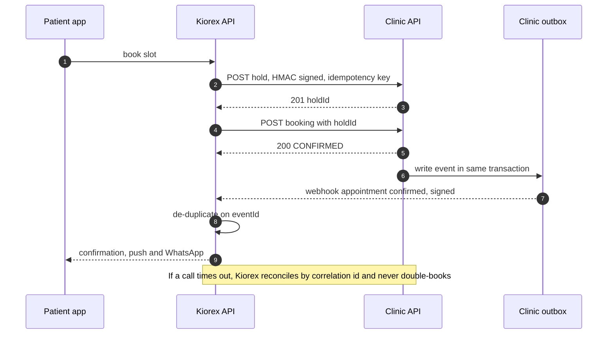

| Mechanism | Rule |
|---|---|
| HMAC | Signature `sha256=hex(HMAC(secret, timestamp + "." + rawBody))`, timestamp in seconds, replay window |
| Idempotency | Every command carries a key; the receiver returns the first result for repeats |
| Outbox | Events are written in the same database transaction as the change, then dispatched with retries |
| De-duplication | Receivers de-duplicate on `eventId` |
| Governance | OpenAPI in `kiorex-contracts` wins over prose; contract versions are semver |

## 08 Money
Figure 7 — The two revenue engines and the higher-of rule.

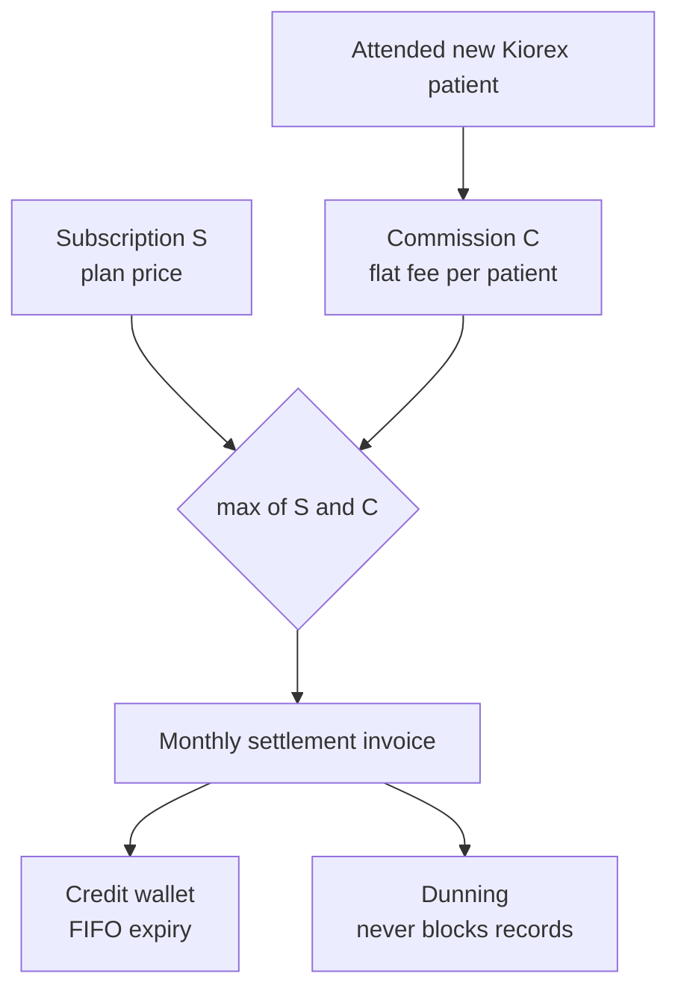

Kiorex Pay holds patient deposits and refunds through PSP adapters behind an interface (`paymob`, `fawry`, `instapay`); locally `PSP_MODE=sandbox-fake`. Kiorly does no tax-authority integration (ADR-011). Lite is commission-only with a minimum invoice and carry-forward.

## 09 Notifications
Figure 8 — The shared notification layer, a library inside each product (KX-24).

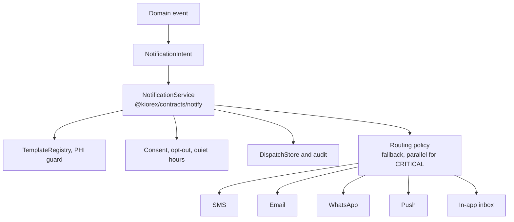

Five channels, three severities, six normalized delivery statuses. Migrated: Kiorex platform. Planned in order: Passport, Lab, Pharmacy, Clinic. Real vendors: none contacted.

## 10 Feature-flag control plane
Figure 9 — Flags are decided in Kiorex but evaluated locally in every product.

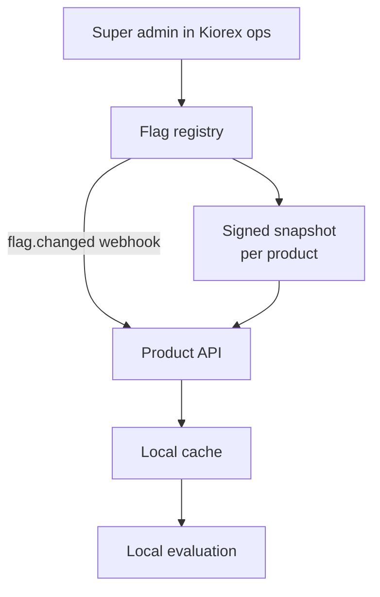

Effective value = global, market and organization scopes combined with dependencies and launch locks. If no snapshot has been received, code defaults apply (on, launch-locked off), so a Kiorex outage never turns a product off.

## 11 Data and storage
Figure 10 — Where data lives and how documents are stored.

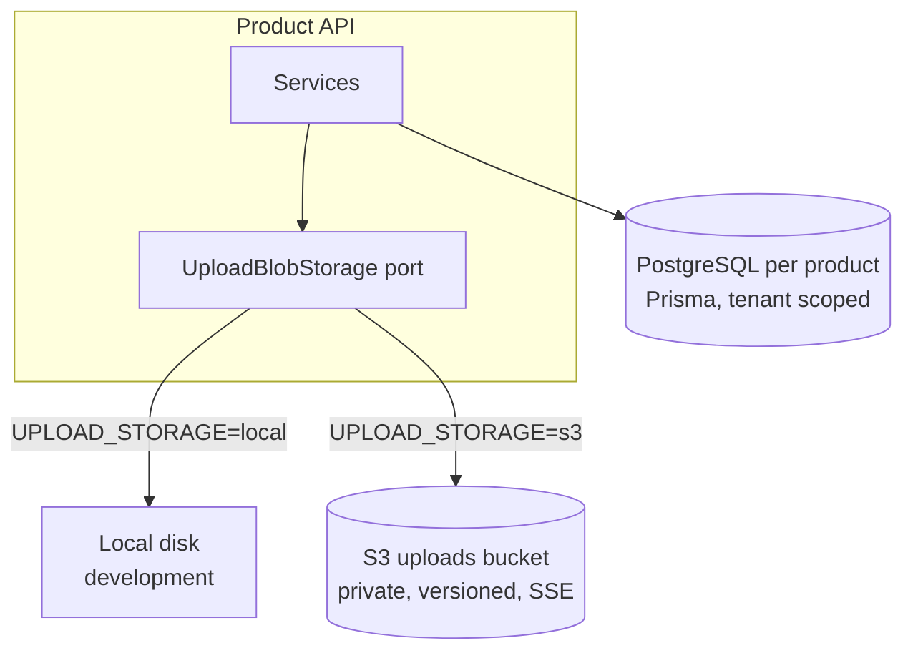

| Rule | Detail |
|---|---|
| Tenant isolation | Every table and storage key carries `tenantId` |
| Documents today | 15 MB cap, client-side resize, S3 with versioning |
| Documents target | Lifecycle rules, per-plan quotas, server-side compression, retention, presigned upload (KX-25, ADR-036, Proposed) |
| PHI | Never in logs, SMS, push or WhatsApp bodies; PHI redaction before any AI call |
| Backups | RDS Multi-AZ and point-in-time recovery; quarterly restore drill (KX-10) |

## 12 Hosting on AWS
Figure 11 — One product stack in the market's data cell (Egypt tenants run in Frankfurt, eu-central-1). Every product uses the same OpenTofu module.

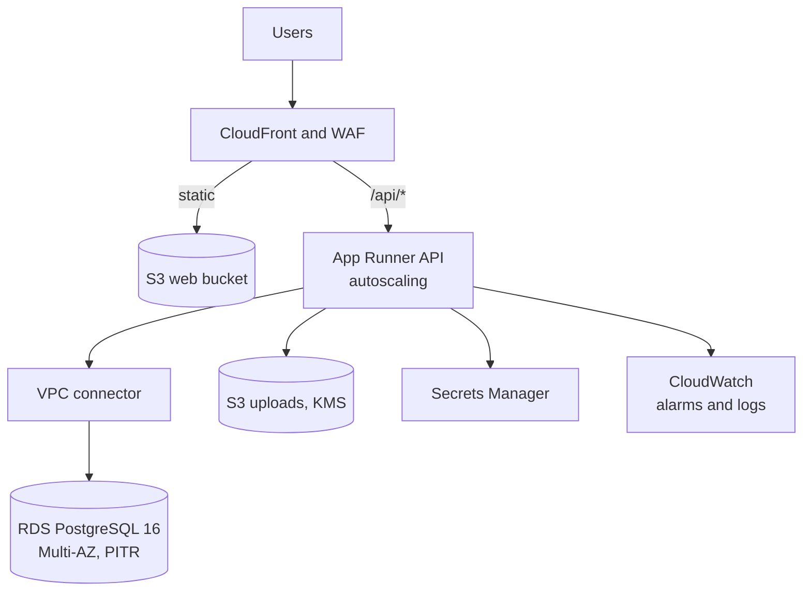

| Topic | Decision |
|---|---|
| Infrastructure as code | OpenTofu with encrypted S3 state; legacy CDK being retired for Clinic (ADR-028) |
| Network | 2 AZs, isolated database subnets, no NAT gateway, VPC endpoints for AWS APIs |
| Environments | local (Docker Postgres), staging, production per cell |
| Deployment | Founder instruction on 23 Nov 2026: no deploys and no `tofu apply` until told |

## 13 Mobile architecture
Figure 12 — The two Expo apps and what they call.

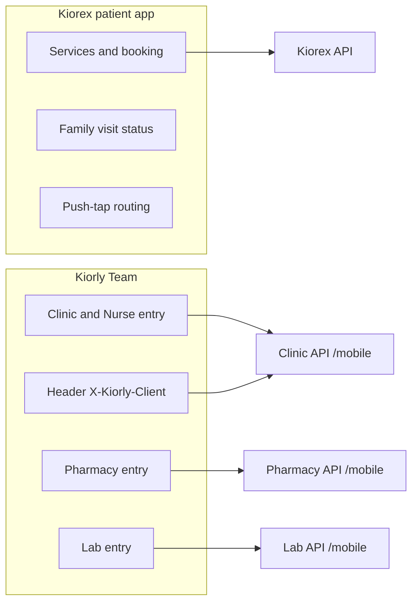

Kiorly Team is the final name of the staff app (bundle id `com.kiorly.team`, scheme `kiorlyteam`). All three backends accept only the header `X-Kiorly-Client: kiorly-team/<version>` on mobile routes. Status: dev builds verified on the iOS simulator and an Android emulator; release builds, physical devices and real push delivery are Open.

## 14 Security architecture
Figure 13 — Trust zones and the controls on each boundary.

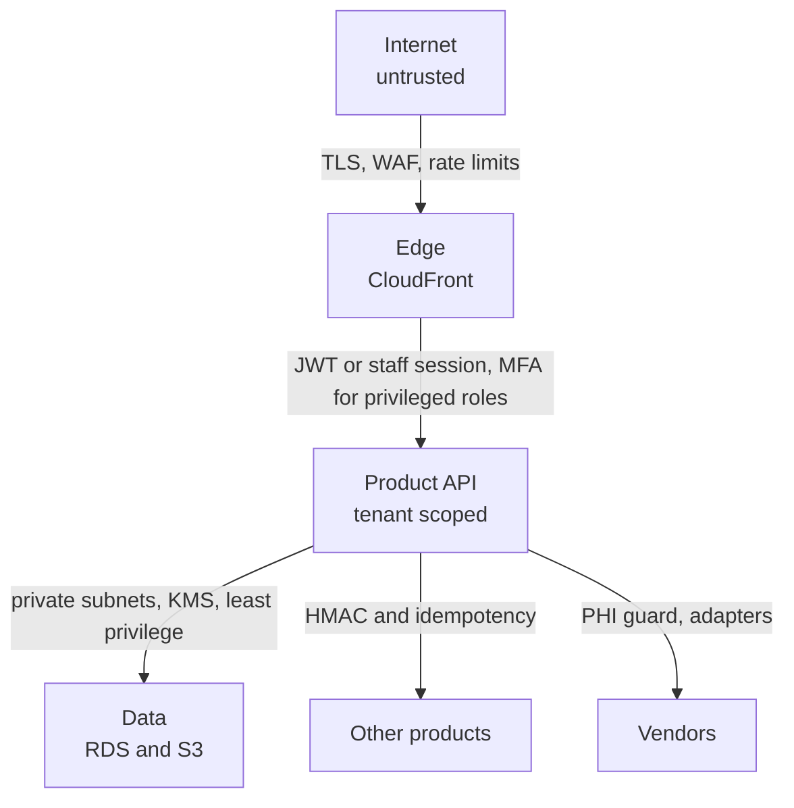

| Control | Where |
|---|---|
| Authorization | Per product; scope of practice per profession; entitlement guards |
| Audit | Immutable audit log per product; document views audited |
| Secrets | Secrets Manager; no secret in code; HMAC secrets per product pair |
| Privacy | Consent enforced in code; PHI-free logs; address masking after visits; coarse geostamps |
| Threats | STRIDE highlights and hardening backlog in KX-10 and KX-21 |

## 15 Resilience and failure modes
| Failure | Effect | Design response |
|---|---|---|
| Kiorex down | Marketplace bookings pause | Clinics, pharmacies and labs keep working; outbox retries events when Kiorex returns |
| Passport down | New sign-ins on Kiorex fail | Existing tokens keep working until expiry; staff apps use their own login today |
| Clinic API slow or timing out on a booking | Possible double-book risk | Idempotency key, hold then book, reconciliation by correlation id |
| Vendor outage (SMS, WhatsApp) | Messages delayed | Channel fallback; CRITICAL severity fans out in parallel; delivery status recorded |
| Flag snapshot missing | None | Code defaults apply |
| Storage growth | Cost rises without bound | Lifecycle rules, quotas, retention (KX-25, Proposed) |

## 16 Scaling path
| Stage | Trigger | Move |
|---|---|---|
| Now | Pilot clinics | Single cell, App Runner autoscale, one RDS per product |
| Growth | Database CPU or connections high | Read replicas, connection pooling, move heavy reports off the primary |
| Scale | Multi-market | Second data cell, market packs, per-market adapters |
| Later | Team or load demands | Extract a bounded context (for example search) behind the existing contract |

## 17 Status and open items
| Area | Status | Remains |
|---|---|---|
| All backends and web apps, local | Done | none |
| Kiorex Passport (dev IdP) | Done | production Cognito clients (NEEDS_HUMAN) |
| Notification layer | Done in platform | migrate Passport, Lab, Pharmacy, Clinic |
| Real vendors (SMS, email, WhatsApp, PSP, push) | Blocked | contracts, templates, credentials (FD-04) |
| Mobile release builds and devices | Open | store accounts, signing, device test |
| AWS deployment | Blocked | founder instruction: no deploy |
| Document storage growth (ADR-036) | Proposed | build per KX-25 prompt |
| Communications control plane | Proposed | KX-24 §10 |

> **Decision** This volume is the single architecture map. When it disagrees with a detail volume (KX-08, KX-09, KX-10, KX-21, KX-24, KX-25), the detail volume and then the code win; update this volume in the next revision.
