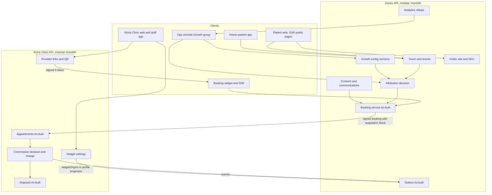
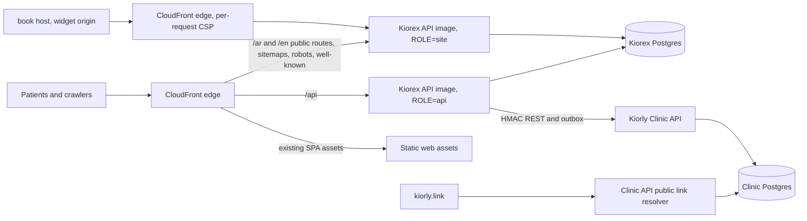
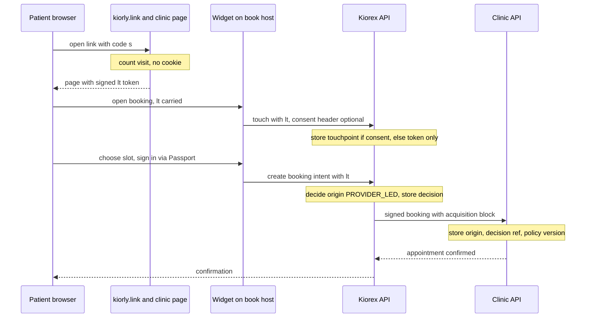
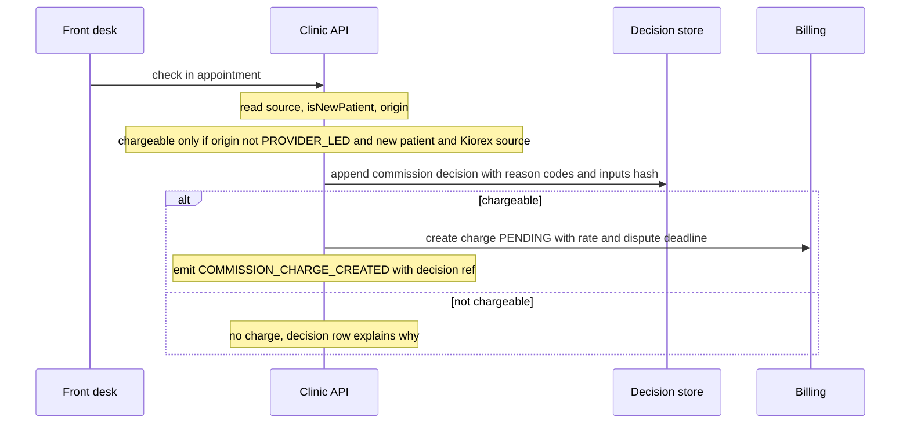
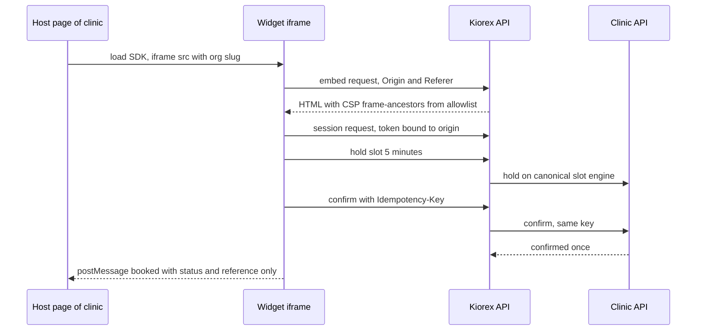
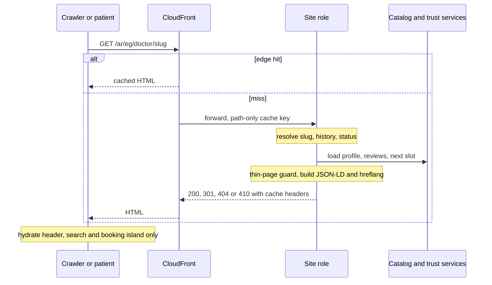
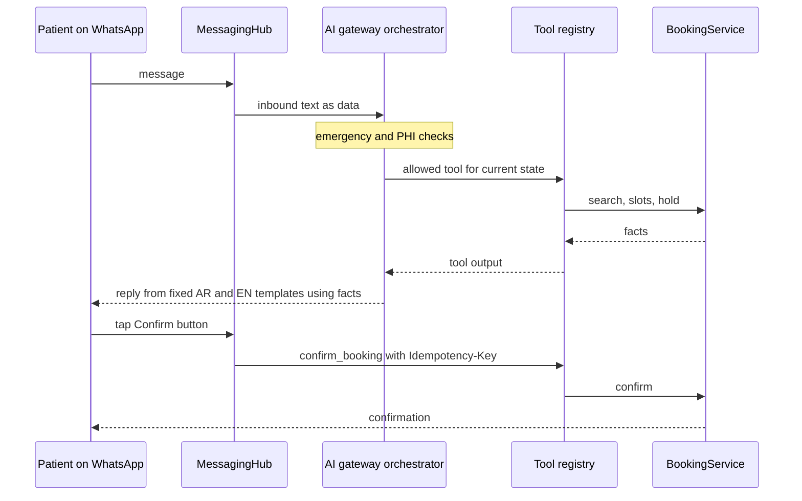
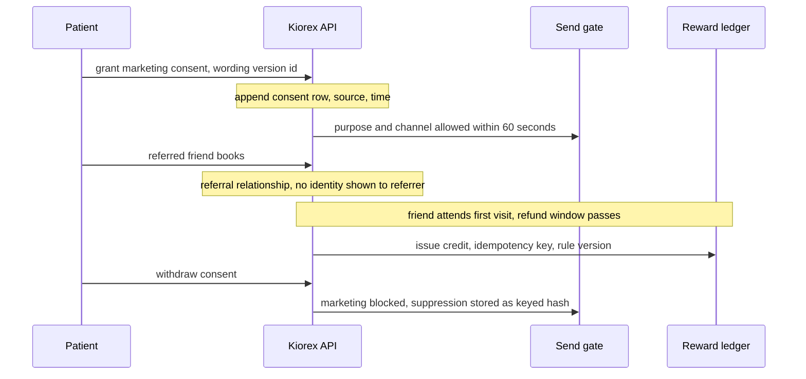
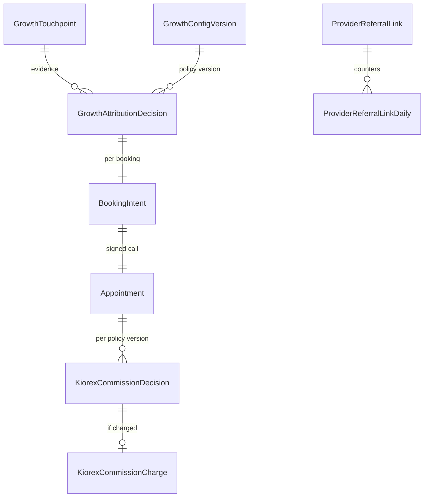

# KX-28 — Growth Engine System Architecture

Revision: Rev 2.4 · Growth Edition, as-built verified 24 November 2026 (new volume; owner: Chief Software Architect; supersedes: Rev 2.4 draft 1 of this volume)

Subtitle: How the Growth Engine is built inside the existing Kiorex and Kiorly systems: components, deployment, sequences, data, events, security, privacy, service levels, runbooks, markets and recovery.

Tags: Architecture · Components · Sequences · Data model · Contracts 1.10.0 · Threat model · PIA · SLO · Runbooks · Multi-market · DR

> **Note** How to read this volume. Section 02 is the verified baseline and, since Rev 2.4, the as-built table of everything Phase 1 added (checked against the repositories and tests on 24 Nov 2026). Diagrams are labelled in their captions: As-built where code and a passing test exist, Proposed where only designed, Roadmap for Phase 2 and later. Requirements are in KX-27; attribution and money rules in KX-30.

| Field | Value |
|---|---|
| DOCUMENT | KX-28 |
| REVISION | Rev 2.4 · Growth Edition (24 November 2026) |
| STATUS | Phase 1 As-built locally, not deployed (ADR-041 to ADR-047 still Proposed); Phase 2 and later Roadmap |
| OWNER ROLE | Chief Software Architect |
| AUDIENCE | Engineering, build agents, security and privacy reviewers, SRE |
| RELATED | KX-26 system architecture; KX-08; KX-09; KX-10; KX-21; KX-24; KX-27; KX-30; KX-32; KX-33 |

## Revision history
| Revision | Date | Change | Author |
|---|---|---|---|
| Rev 2.4 draft 1 | 24 Nov 2026 | First issue from the architecture decisions report; status legend added | Documentation agent |
| Rev 2.4 | 24 Nov 2026 | Section 02 rebuilt from code (baseline plus as-built table); figures and tables relabelled; configuration kinds, flags, migrations, events and SLO status corrected; gaps listed | Documentation agent |

## Contents
01 Summary · 02 As-built baseline · 03 Logical components · 04 Deployment · 05 Ownership and modules · 06 Sequence diagrams · 07 Data model · 08 Events and contracts 1.10.0 · 09 Security and threat model · 10 Privacy impact assessment · 11 SLIs and SLOs · 12 Runbooks · 13 Multi-market configuration · 14 Failure modes and disaster recovery · 15 Acceptance, KPIs, risks, dependencies, cross-references

## Key numbers
<!-- kpis -->
- **0** new services, **0** Redis, **0** Kafka (ADR-041)
- **10** configuration kinds in the contract vocabulary, **5** with JSON Schemas and editable in Phase 1 (`ATTRIBUTION_POLICY`, `SEO`, `WIDGET_POLICY`, `CONSENT_DEFAULTS`, `MARKET_GROWTH`), versioned and maker-checker
- **13** SLIs with proposed SLOs; only decision determinism and latency have tests, none is monitored yet
- **1.10.0 and 1.11.0** additive contracts minors (71 flag keys, 14 added by growth)
- **4th** ledger (rewards), Phase 2, never commingled

## Status legend (read first)
Every statement in this volume carries one of these labels, in a column, a prefix or a callout. Phase 1 is now built locally; the labels separate what runs from what is only designed.

| Label | Meaning | Rule for readers |
|---|---|---|
| **As-built** | Exists in code with a passing test in the workspace, verified by reading the repositories and re-running the suites on 24 Nov 2026 (Rev 2.4). Local only: not deployed, not run against a real provider | Safe to rely on for behaviour in the local stack |
| **Approved target** | Accepted by the founder as an ADR or founder decision (FD) | Binding. No growth ADR (ADR-041 to ADR-047) has been accepted, so this label marks only rules inherited from existing Accepted ADRs |
| **Proposed** | Designed in the Growth reports of 24 Nov 2026 and written up here, not yet signed (ADR-041 to ADR-047) | Build only after sign-off, or inside a work package the founder released |
| **Roadmap** | Phase 2 to 4 capability, scoped coarsely | Do not build; estimates are ranges |
| **Open decision** | A founder or CEO choice with a stated default | Use the default, never decide silently |
| **Regulatory dependency** | Needs counsel, DPO, a regulator position or a partner approval (NEEDS_HUMAN) | Flag stays OFF in production until evidence is recorded; never mark a gate satisfied |

> **Warning** Nothing in this volume has run in production, against a real ad platform, search engine, WhatsApp number or payment provider. Messaging and provider integrations stay MOCKED until the pre-launch pass (FD-04). Numbers marked ASSUMPTION are starting hypotheses, not forecasts.

## 01 Summary
Growth is a module family inside the two modular monoliths, not a new system. Kiorex owns demand-side evidence (touchpoints, visitor identity under consent, the attribution decision, SEO pages, campaigns, referral, rewards, lifecycle messaging, analytics). Kiorly Clinic owns provider-owned assets and the money outcome (links, QR, widget settings, appointment attribution fields, the commission decision, charges and disputes). The two exchange one signed attribution block on the existing booking call. Queues are the existing Postgres outbox; rate limiting is the existing Postgres limiter.

| Principle | Design consequence | Source |
|---|---|---|
| Kiorly works without Kiorex | Clinic-side link, QR and widget settings never call Kiorex | ADR-001/002 |
| One system of record for appointments | Growth adds columns and a signed block, never a shared table | ADR-004/005 |
| Deterministic and replayable money decisions | Pure function, immutable decision, inputs hash | ADR-042 (Proposed) |
| Privacy by construction | Consent-gated visitor key, no IP, no specialty in the visitor stream, k-anonymity | ADR-045 (Proposed) |
| Mock first | `GrowthIntegrationPort` with `MODE=mock|real` | FD-04, ADR-035 |
| Configuration is versioned data | `GrowthConfigVersion` with maker-checker | ADR-047 (Proposed) |

## 02 As-built baseline
### 2.1 Baseline before Phase 1 (discovery, 24 Nov 2026, kept for the record)
The rows below describe the repositories before the Growth Engine code landed. Rows that Phase 1 changed are marked in section 2.2.

| Area | As-built fact | Where |
|---|---|---|
| Booking source stamp | `Appointment.bookingSource` enum of 8 values; `isNewPatientAtBooking` frozen with 24-month lookback; `attributionJson` unvalidated JSON | clinics-management `appointments/booking-attribution.ts`, `prisma/schema.prisma` |
| Chargeability | `isCommissionChargeableBooking(source, isNew)`: false for `CLINIC_LINK`, false if not new, true only for `KIOREX_MARKETPLACE`, `KIOREX_WHATSAPP`, `INTEGRATION` | same file |
| Charge engine | Idempotent per appointment; states PENDING, CONFIRMED, DISPUTED, REVERSED, WAIVED, BILLED; effective-dated rate table; disputes | clinics-management `src/kiorex/*` |
| Booking pages | Slugs, public page `/b/:slug`, cache 60 s; Book button points to a widget URL that does not exist yet (NH-008) | clinics-management `marketplace/*` |
| Supply-side referral | Doctor-to-doctor `ReferralCode`/`Referral`, fraud signals, flag `clinic.referral_rewards` | clinics-management `src/growth/*` |
| Patient web | Vite SPA, `BrowserRouter`, one static title, no sitemap, robots, JSON-LD, hreflang, slugs; doctor URL by id; Google Fonts render-blocking | kiorex-platform `apps/web` |
| Analytics | Anonymous ingest: 13 event names, 7 properties, no identifiers | kiorex-platform `analytics` |
| Notification layer | Purposes TRANSACTIONAL, REMINDER, MARKETING, SECURITY; consent; quiet hours; WhatsApp window; PHI guard | KX-24; kiorex-platform `engagement` |
| WhatsApp booking | Deterministic state machine over `MessagingHub` and `BookingService` | kiorex-platform `channels` |
| Flags and policy | Control plane with maker-checker flags and gate evidence; `PolicySetting` unversioned | kiorex-platform `control-plane`, `policy` |
| Hosts | `domains.json` lists passport, clinic web and api hosts, `www.kiorly.com`; no `kiorex.com` patient web, no `kiorly.link`; `frame-ancestors 'none'` everywhere | kiorex-account `config/domains.json` |
| Contracts | `@kiorex/contracts` 1.9.0; 57 flag keys; no growth event | kiorex-contracts |
| Growth modules | `kiorex-platform/apps/api/src/growth` does not exist; clinic `src/growth` holds only the referral files | verified 24 Nov 2026 before wave 1 landed |

### 2.2 As-built after Phase 1 (verified 24 Nov 2026)
Evidence: unit suites re-run on 24 Nov 2026 (contracts 276, Kiorex API 578, Clinic API 1,222, Passport 314) plus the growth integration suites on a local Postgres; the e2e suites 25 to 28 and the edge sweep 40 to 49 are recorded in `_docs/growth/GROWTH_PHASE1_WORK_PACKAGES.md` sections 8 to 12 and `_docs/test-flow/EDGE_CASE_REPORT_2026-11.md`. Nothing is deployed.

| Area | As-built fact | Where | Label |
|---|---|---|---|
| Contracts | `@kiorex/contracts` 1.11.0 (1.10.0 then 1.11.0, both additive); 71 flag keys (13 `growth.*` plus `kiorex.whatsapp_ai_assistant`); growth OpenAPI `kiorex-growth.v1` (`/growth/v1/touch`, `/growth/v1/events`, `/growth/v1/evidence/{bookingId}`, `/api/v1/bootstrap`); marketplace OpenAPI 1.5.0 with `acquisition`, optional `lt`, `GET /referral-links/{code}` and `GET /referral-links`; events `CommissionAdjusted`, `PatientConsentUpdated`, `ReferralLinkCreated`, `ReferralLinkRevoked`, internal `AttributionAssigned` and `PatientAcquisitionRecorded`; five config JSON Schemas | `kiorex-contracts` | As-built |
| Kiorex schema | Migrations `20261128100000_growth_core`, `20261128120000_growth_attribution_consent`, `20261129090000_growth_analytics_v1`, `20261129120000_growth_admin_config`, `20261130090000_growth_link_registry`; models `GrowthAcquisitionSource`, `GrowthTouchpoint`, `GrowthAttributionDecision`, `GrowthEvent`, `GrowthMetricDaily`, `GrowthRevenueFact`, `GrowthSpendEntry`, `GrowthConfigVersion`, `GrowthConfigReader`, `GrowthSlug`, `GrowthSlugHistory`, `GrowthLandingPage`, `WidgetRegistration`, `GrowthFraudSignal`, `GrowthVisitorConsent`, `CommunicationSuppression`; `BookingIntent.acquisitionOrigin` and `attributionDecisionId` | `kiorex-platform/apps/api/prisma` | As-built |
| Clinic schema | Migrations `20261128110000_growth_links_attribution`, `20261128120000_growth_link_tags`, `20261128120100_growth_widget_settings`; models `ProviderReferralLink`, `ProviderReferralLinkDaily`, `BookingWidgetConfig`, `KiorexCommissionDecision`; appointment columns for origin, decision ref and policy version; dispute reason `PROVIDER_LED_EVIDENCE` | `clinics-management/apps/api/prisma` (branch `kiorex`) | As-built |
| Attribution | Pure `decide.ts` (PROVIDER_FIRST default, windows 30, 30, 7 days inclusive, dwell minimum 1,000 ms, other-organisation touches ignored); one immutable decision per booking and policy version; `lt` verified in two formats; booking flow writes the decision before the clinic call; flag OFF is identical to before | `growth/attribution`, `booking` | As-built |
| Commission | `isCommissionChargeableBooking(source, isNew, origin)`; append-only `KiorexCommissionDecision` at check-in; `PROVIDER_LED_EVIDENCE` dispute auto-approval; `CommissionAdjusted`; monthly statement counters | `clinics-management/.../kiorex` | As-built |
| Provider links | Links for five scopes, QR SVG and PNG from a local library (no third-party service), A4 and A5 AR and EN posters, public `/q/:code` and `go/:slug`, widget settings, Growth workspace UI, staff app Growth tab (Clinic and Nurse). Server PDF not built | `clinics-management/.../growth/provider-links`, `kiorly` | As-built |
| Public site | SSR role, 14 page types, slugs with history, guard, JSON-LD, robots, segmented sitemaps, SPA fallback; Lighthouse not measured | `kiorex-platform/apps/api/src/public-site`, `apps/web/src/public` | As-built (lab scores open) |
| Widget | Widget host as a role of the API image, per-request CSP from `WidgetRegistration`, SDK 1.46 KB gzip, Preact widget 18 KB gzip, Passport popup sign-in (client `kiorex-widget`) | `apps/widget`, `apps/api/src/widget` | As-built (real Passport popup not exercised) |
| Deep links | Domain table keys `patient`, `link`, `widget` and `appLinks.patient`; bootstrap endpoint; well-known files (404 in production until configured); fallback pages; handlers in the patient app and the staff app; deferred link by Play referrer | `kiorex-account/config`, `market`, mobile apps | As-built (not verified on a device) |
| Consent | Consent purposes, append-only history, `PatientConsentUpdated`, anonymous visitor consent, suppression list, marketing gate, STOP handling, web banner and preference centre, patient app preferences screen. `growth.analytics_visitor` and `growth.marketing_messaging` launch-locked | `growth/consent`, `engagement`, web, mobile | As-built |
| Analytics | Rollups, funnel, channels, cohorts, unit economics, k = 10 masking, CSV export, spend entry, provider analytics | `growth/analytics` | As-built |
| Config | `GrowthConfigService` with maker-checker, effective dates, rollback as a new version, propagation monitor, guardrails; ops console group with 22 sections | `growth/config`, `growth/admin`, `apps/ops` | As-built |
| Link registry | The Clinic emits link created and revoked events and serves a signed lookup; Kiorex stores `linkStatus` and reconciles hourly | `growth/links` | As-built |
| Erasure | `subject.deleted` consumer registered as the `growth` anonymiser; a bug that made the Passport back-channel deletion read as a plain revoke was fixed (`auth.controller.ts`, e2e 28) | `growth/erasure`, `auth` | As-built |
| Not built | Daily decision replay job; WhatsApp assistant; campaign engine; patient referral and rewards; lifecycle journeys; real Search Console, Play Console and App Store Connect adapters; Pharmacy and Lab Growth tabs; `no-health-targeting.unit.spec.ts` (only `growth-no-phi.unit.spec.ts` exists) | | Roadmap |

## 03 Logical components
Figure 1 — Logical components and ownership. As-built for the Phase 1 components (Rev 2.4); nothing in it is deployed.

## 04 Deployment
Figure 2 — Deployment view. Code and module flags As-built, infrastructure designed and validated only (`tofu validate`, `tofu fmt`), not applied. No deployment is performed until the founder says so (FD-17); infrastructure changes are validated only with `tofu validate` and `tofu fmt`.

| Decision | Detail | Label |
|---|---|---|
| Same image, two roles | `SITE_ROLE=all|api|site` serves server-rendered public routes from the API image; the widget host is a third role of the same image (`WIDGET_HOST`); one image, scaled separately later | As-built (code, Dockerfile builds); ADR-043 still Proposed |
| Cache | HTML `s-maxage=300`, `stale-while-revalidate=3600`, ETag, path-only cache key with a query whitelist; purge on `LISTING_STATUS_CHANGED` and `PROVIDER_PROFILE_UPDATED` (the CDN purge adapter is a mock) | As-built (headers), Proposed (CDN behaviours not applied) |
| Widget origin | Dedicated host (`book.kiorex.com` in the domain table) whose CSP `frame-ancestors` is generated per request from an exact-origin allowlist; every other host keeps `'none'` | As-built (ADR-044 still Proposed); Open decision (host name and DNS) |
| Cell | Kiorex runs one cell today (`frankfurt`); growth data stays in the cell; cross-cell routing is out of scope until a second cell exists | As-built constraint |

## 05 Ownership and modules
| Concern | Repo and path | Phase | Label |
|---|---|---|---|
| Growth core API | kiorex-platform `apps/api/src/growth/**` | 1 | As-built |
| Public site (SSR role, sitemaps, robots, well-known) | kiorex-platform `apps/api/src/public-site/**`, `apps/web/src/public/**` | 1 | As-built |
| Widget app and SDK | kiorex-platform `apps/widget/**` | 1 | As-built |
| Ops Growth pages | kiorex-platform `apps/ops/src/pages/growth/**` | 1 | As-built |
| Provider links, QR, widget settings, workspace UI | clinics-management `apps/api/src/growth/**` (existing folder extended), `apps/web/src/features/growth/**`; branch `kiorex`, no push without founder approval (FD-18) | 1 | As-built |
| Commission decision | clinics-management `appointments/booking-attribution.ts`, `src/kiorex/**` | 1 | As-built |
| Contracts | kiorex-contracts (events, OpenAPI, flags, config schemas) | 1 | As-built |
| Hosts and app links | kiorex-account `config/domains.json`, `config/app-links/*` | 1 | As-built |
| Staff app tab | kiorly `app/(tabs)/(more)/clinic/growth.tsx`, `src/modules/clinic/growth.ts` (the repository was renamed from `kiorly-team` to `kiorly`) | 1 (thin) | As-built |
| Pharmacy and lab | kiorly-pharmacy, kiorly-lab | 4 | Roadmap (vendored contracts only; no Growth tab, no link service) |

Module boundaries: growth imports only `*-public.ts` barrels of other modules; `module-boundaries.unit.spec.ts` enforces it (As-built test). Guard tests: `growth-no-phi.unit.spec.ts` is As-built; `no-health-targeting.unit.spec.ts` (modelled on `no-tax-authority.unit.spec.ts`) is not written yet (Proposed).

## 06 Sequence diagrams
Labels per diagram (Rev 2.4): 6.1 to 6.4 As-built; 6.5 Roadmap; 6.6 consent As-built, rewards Roadmap.

### 6.1 Referral-to-booking attribution
Figure 3 — A patient arrives through a provider link and books through the widget (As-built; e2e 25 and 27).

### 6.2 Commission decision
Figure 4 — At check-in the clinic writes the decision whether or not a fee applies (As-built).

### 6.3 Widget booking
Figure 5 — Widget security and idempotency (As-built; Playwright and `widget.int.spec.ts`).

### 6.4 SSR request path
Figure 6 — A crawler or patient requests a doctor page (As-built).

### 6.5 WhatsApp assistant (Phase 2, Roadmap)
Figure 7 — Tool-based assistant with a closed registry (Roadmap, Phase 2).

### 6.6 Consent and rewards (rewards are Roadmap, counsel-gated)
Figure 8 — Consent capture (As-built) and the delayed reward (Roadmap).

## 07 Data model
Logical entities mapped to existing or new tables. Every Phase 1 row is As-built (section 2.2 lists the migrations); Phase 2 and 3 rows are Roadmap. Differences from the design: `ProviderReferralLinkDaily` and `BookingWidgetConfig` exist as designed; no `GrowthFraudReview` table (fraud review columns sit on `GrowthFraudSignal`); `GrowthRevenueFact`, `GrowthSpendEntry`, `GrowthVisitorConsent`, `GrowthConfigReader` and `WidgetRegistration` are additional. KP is the Kiorex database, CM the clinic database. All new KP tables carry `market`. Models keep the PascalCase naming of the existing schemas.

| Logical entity | Class | Home | Table or change | Phase |
|---|---|---|---|---|
| AcquisitionSource | New | KP | `GrowthAcquisitionSource` | 1 |
| AttributionTouchpoint | New, append-only | KP | `GrowthTouchpoint` | 1 |
| AttributionDecision | New, append-only | KP | `GrowthAttributionDecision` | 1 |
| BookingAttribution | Extend | KP and CM | KP `BookingIntent.acquisitionOrigin`, `attributionDecisionId`; CM `Appointment.acquisitionOrigin`, `acquisitionDecisionRef`, `acquisitionPolicyVersion` (existing `attributionJson` kept) | 1 |
| ProviderReferralLink | New | CM | `ProviderReferralLink`, `ProviderReferralLinkDaily` | 1 |
| BookingWidget | New | CM and KP | CM `BookingWidgetConfig`; KP `WidgetRegistration` | 1 |
| CommissionPolicy | Extend | CM and KP | `KiorexCommissionRate` (existing, effective-dated) plus `GrowthConfigVersion kind=ATTRIBUTION_POLICY` | 1 |
| CommissionDecision | New, append-only | CM | `KiorexCommissionDecision`, unique per appointment and policy version | 1 |
| MarketingConsent | Extend | KP | `ConsentRecord` gains purposes `ANALYTICS_MEASUREMENT`, `MARKETING_WHATSAPP`, `MARKETING_SMS`, `MARKETING_EMAIL`, `MARKETING_PUSH`; clinic keeps `MessagingConsent` | 1 |
| CommunicationPreference | Extend | KP | `NotificationPreference` (quiet hours exist) plus `CommunicationSuppression` (1) and `CommunicationFrequencyCap` (2) | 1 and 2 |
| LandingPage | New | KP | `GrowthLandingPage` (type, market, locale, indexable, guard result) | 1 |
| Slug | New | KP | `GrowthSlug`, `GrowthSlugHistory` | 1 |
| SEOConfiguration, MarketGrowthConfiguration, ConfigurationVersion | New | KP | `GrowthConfigVersion` (kinds) | 1 |
| ConversionEvent | New | KP | `GrowthEvent` | 1 |
| GrowthMetric | New | KP | `GrowthMetricDaily` | 1 |
| FraudSignal | New | KP | `GrowthFraudSignal` | 1 |
| FraudReview | New | KP | `GrowthFraudReview` | 2 |
| GrowthCampaign, CampaignChannel, CampaignBudget | New | KP | `GrowthCampaign`, `GrowthCampaignChannel`, `GrowthCampaignBudget` | 2 |
| PatientReferralLink, ReferralRelationship, ReferralQualification | New | KP | `PatientReferralLink`, `PatientReferralRelationship`, `PatientReferralQualification` | 2 |
| RewardProgram, RewardRule, RewardLedgerEntry, PromotionalCredit | New | KP | `RewardProgram`, `RewardRule`, `RewardLedgerEntry` (append-only), `RewardCreditLot` | 2 |
| GrowthExperiment, ExperimentAssignment | New | KP | `GrowthExperiment`, `GrowthExperimentAssignment` | 3 |
| AuditEvent | Existing | KP and CM | `AuditLog` with actions prefixed `growth.` | 1 |

Immutability (As-built): `GrowthTouchpoint`, `GrowthAttributionDecision`, `KiorexCommissionDecision` and both consent tables reject UPDATE and DELETE by database trigger. Erasure and retention run through `SECURITY DEFINER` functions (`growth_erase_subject`, `growth_purge_expired`) that write an audit row. Corrections create a new row with `supersedesId`.

Figure 9 — Core entity relations (As-built for the Phase 1 entities).

## 08 Events and contracts 1.10.0 and 1.11.0
Contracts 1.10.0 and 1.11.0 are additive minors (As-built, published to the vendored tarballs of the platform, pharmacy and lab). No existing event is renamed or removed; consumers that ignore unknown fields keep validating.

| Change | Detail |
|---|---|
| Booking request | Optional `acquisition { origin, decisionId, policyVersion, reason, evidenceHash, touch { kind, ref, at } }` on `POST /marketplace/v1/bookings`; response unchanged |
| `COMMISSION_CHARGE_CREATED` | Additive `decisionRef`, `origin`, `policyVersion` (serves the founder's `CommissionAttributed`; no second event) |
| `PROVIDER_PROFILE_UPDATED` | Additive `widgetOrigins[]` |
| New event `CommissionAdjusted` | Amount waived or changed by dispute, with decision ref; `COMMISSION_CHARGE_REVERSED` stays for full reversal |
| New event `PatientConsentUpdated` | `{purpose, granted, textVersion}`, opaque subject ref only |
| 1.11.0 | Optional SEO extension keys, optional `lt` on the booking body, signed lookup `GET /referral-links/{code}` and feed `GET /referral-links`, `ReferralLinkCreated` with `orgRef` and `clinicRef`, new `ReferralLinkRevoked` |
| New OpenAPI `kiorex-growth.v1` | Public `POST /growth/v1/touch`, `POST /growth/v1/events`, `GET /api/v1/bootstrap` |
| Flags | 14 keys added to the catalogue (13 `growth.*` and `kiorex.whatsapp_ai_assistant`; list in KX-30 section 10) |
| Config schemas | JSON Schemas for config kinds shared by API and ops UI |
| Naming | Growth events are PascalCase (matches Rev 2.3 and the founder's list); outbox type equals the name; `ReferralIssued` is a clinical event and is never reused; patient referral uses `PatientReferral*` |

Internal (Kiorex outbox, not published to partners): `AttributionAssigned`, `PatientAcquisitionRecorded`, `PatientRegistered`; Phase 2: `ReferralQualified`, `RewardIssued`, `RewardRedeemed`, `RewardReversed`, `CampaignActivated`, `CampaignPaused`, `CampaignBudgetThresholdReached`; Phase 3: `ExperimentAssigned`, `ExperimentConversionRecorded`. Mapped to existing facts (no duplicate): `BookingInitiated` from the booking INTENT event, `BookingConfirmed` from `APPOINTMENT_CONFIRMED`, `BookingCompleted` from `COMPLETED`, `BookingCancelled` from the two cancel events, `CommunicationDispatched` from the KX-24 audit record.

## 09 Security and threat model
| Threat | Asset | Mitigation |
|---|---|---|
| Forged provider token to dodge the fee | Commission | HMAC token bound to org, link code and time with expiry; evidence hash; random audit sampling |
| Provider tags marketplace patients as provider-led | Commission | Touch must precede the booking intent; dwell minimum; distinct visitor; anomaly rules; only Kiorex can set origin |
| Kiorex bias toward charging | Trust | Public deterministic rules; evidence visible to provider; auto-approval of evidence-backed disputes |
| Open redirect via `kiorly.link` or `/open` | Phishing | Resolve by id; allowlist hosts from `domains.json`; no URL parameters |
| Widget clickjacking or hostile embed | Patients | Exact-origin CSP per org; `postMessage` origin checks; short-lived tokens; popups for sign-in and pay |
| SDK supply chain | Widget hosts | Immutable versioned URLs, SRI, no third-party scripts inside the widget |
| Slug enumeration and scraping | Provider data | Rate limit on the shared Postgres limiter; no phone numbers by default; bot throttling |
| Cache poisoning on SSR | SEO | Path-only cache key; query whitelist; canonical built from config not the Host header |
| Thin or spam pages | Domain reputation | Thin-page guard; verified reviews only |
| Private page indexed | Privacy | Auth plus `noindex` header; robots is not a privacy control; snapshot test of every route |
| Reward farming (Phase 2) | Money | Reward after attended visit and refund window; phone OTP; velocity caps; payment fingerprint; review queue |
| Consent forgery or silent opt-in | Compliance | Unticked controls, versioned text, source, time, rotating `ipHash`, append-only |
| WhatsApp prompt injection and tool abuse (Phase 2) | Patients, cost | Closed tool registry; schema-validated arguments; confirmation button; per-subject holds; budget caps |
| Insider changes policy to favour a provider | Commission | Maker-checker; effective-dated versions; audit; 7-day lead for money policy |
| Secrets in integrations | Ad accounts | `secretRef` only; none in database, logs or UI |
| PII in URLs (UTM carrying emails) | Privacy | Keep only `utm_source`, `utm_medium`, `utm_campaign`, `utm_content`, `utm_term` and four click-id keys, each length-capped, pattern-checked and PHI-checked |

> **Note** Status (Rev 2.4). As-built mitigations: HMAC link tokens with expiry, evidence hash, dwell minimum, only Kiorex sets origin, exact-origin CSP, `postMessage` origin and source checks, SRI on the SDK, path-only cache key from config, thin-page guard, an App.tsx snapshot test that every SPA route is public-table or `noindex`, unticked consent controls, a closed UTM and click-id field list with a PHI guard, secrets as references only (a test sets sentinel values and asserts none appears in any read model). Not built: random audit sampling of provider-led bookings and the public help page; reward and assistant rows are Roadmap. The internal penetration test (`_docs/security/PENTEST_2026-11_REPORT.md`) found no flaw in the growth core and verified the link resolver and widget controls; its 14 findings are in KX-10.

## 10 Privacy impact assessment (summary)
> **Warning** This is an engineering summary. The formal PIA is a DPO deliverable (Regulatory dependency). Legal bases below are proposals for counsel to confirm.

| Data | Purpose | Basis (proposed) | Retention (proposed) | Identifiable | Health-related |
|---|---|---|---|---|---|
| In-session `lt` token | Credit provider-led booking | Contract necessity | With the booking | No | No |
| `kxv` visitor key and `GrowthTouchpoint` | Cross-session attribution | Consent | 13 months; 25 if linked to a decision | Pseudonymous | No |
| `GrowthAttributionDecision` | Commission fairness | Legitimate interest and provider terms | 25 months | Via booking | Indirect (a booking exists) |
| `GrowthEvent` | Funnel analytics | Consent for visitor-keyed; operational for server facts | 13 months | Pseudonymous | No (care type only) |
| Anonymous `AnalyticsEvent` (As-built) | Product analytics | Legitimate interest | Existing | No | Specialty in aggregate only |
| `ConsentRecord` history | Proof of consent | Legal obligation | Per counsel | Yes | No |
| Suppression list | Honour opt-outs | Legal obligation | While suppressed | Keyed hash of address | No |
| Reward ledger, referral graph (Phase 2) | Rewards | Contract | 5 years financial record (counsel) | Yes | No |
| Fraud signals | Abuse prevention | Legitimate interest | 12 months | Keyed hashes, rotating salt | No |
| WhatsApp `ChannelConversation.context` (As-built) | Booking | Contract | Existing policy NOT VERIFIED | Phone | Yes by inference (specialty choice) |

Never stored: IP address (a daily-rotating keyed hash for rate limiting and fraud, 24 hours), full user agent, full referrer URL (host only), unknown query parameters, device fingerprints, search text, any health information. Dependants are excluded from growth tables. Cross-border: Kiorex data stays in the Frankfurt cell; only aggregates leave AWS (Regulatory dependency, DPO). Subject rights: erasure through the `subject.deleted` consumer deletes touchpoints, events and preferences; decisions are reduced to origin and reason where the provider's financial record requires it (counsel to confirm).

## 11 SLIs and SLOs
All targets are Proposed (ASSUMPTION to ratify). Status in Rev 2.4: decision latency p99 under 150 ms on 1,000 seeded touches and decision determinism (replay equality) are tested; the daily 1,000-decision replay job, page availability, Web Vitals, sitemap freshness, indexation and widget ready time are not measured or monitored, and no alert exists.

| SLI | SLO |
|---|---|
| Public page availability (site role and CDN) | 99.9 percent monthly |
| HTML TTFB edge hit, origin miss | p95 at most 150 ms, at most 800 ms |
| Core Web Vitals, field, mobile, p75 | LCP at most 2.5 s, INP at most 200 ms, CLS at most 0.1 on 75 percent of URL groups |
| Touch ingestion latency, loss | p99 at most 300 ms, at most 0.1 percent dropped after accept |
| Attribution decision latency inline in booking | p99 at most 150 ms, at most 5 percent added to booking p95 |
| Decision determinism | 100 percent replay equality on a daily sample of 1,000; any mismatch pages on-call |
| Sitemap freshness | Status change reflected within 15 minutes |
| Indexation health (diagnostic) | At least 90 percent of indexable URLs indexed after 60 days |
| Widget ready time | p75 at most 1.5 s on 4G |
| Consent propagation | Withdrawal honoured within 60 s |
| Marketing send correctness | 0 sends without consent, 0 in quiet hours |
| WhatsApp assistant (Phase 2) | p95 reply at most 8 s; wrong-booking incidents 0 |
| Disputes attributable to attribution | Below 3 percent of charges per month |
| Outbox lag for growth consumers | p95 at most 60 s |

## 12 Runbooks
The levers named below exist as built (flags `growth.attribution`, `growth.ssr_public_pages`, `growth.widgets`, `growth.marketing_messaging`; revocation of a widget origin; slug history); the runbooks themselves are not yet written as operator documents and stay Proposed.

| Runbook | Trigger | First actions | Label |
|---|---|---|---|
| RB-G1 Decision mismatch | Daily replay differs | Page on-call; freeze policy changes; compare stored inputs hash; stop sending the acquisition block by flag `growth.attribution` OFF (decision becomes UNATTRIBUTED, today's rules apply); never edit rows, append a superseding decision | Proposed |
| RB-G2 SSR regression | 5xx rate or CWV breach | Turn `growth.ssr_public_pages` OFF to serve the SPA shell; keep robots and sitemap; purge CDN; inspect last release | Proposed |
| RB-G3 Indexation drop | Search Console drop in indexed pages | Check robots, canonical and noindex snapshot test; check guard thresholds; do not mass-publish pages | Proposed |
| RB-G4 Widget abuse | Hold hoarding or hostile embed | Reduce hold limit; revoke org allowlist entry; flag `growth.widgets` OFF returns 403 `FEATURE_DISABLED` | Proposed |
| RB-G5 Consent error | Send without consent found | Turn `growth.marketing_messaging` OFF; export affected sends; notify DPO within the legal clock (counsel to define) | Proposed |
| RB-G6 Key or secret rotation | Scheduled or suspected leak | Rotate partner HMAC secret and `lt` signing key with overlap window; no secret in UI | Proposed |
| RB-G7 Slug dispute | Provider renames or collides | Slug history keeps the old URL as 301; ops can pin a slug | Proposed |
| RB-G8 Kiorex outage | Kiorex API down | Providers keep working: clinic links and QR work standalone; bookings through widget fail closed with a friendly message; Clinic bookings by other sources unaffected | Proposed |

## 13 Multi-market configuration
As-built: every growth table has `market` (ISO alpha-2) and config resolves with market isolation in every read. Every growth table has `market` (ISO alpha-2). Configuration resolves `(kind, scope MARKET cc)` with fallback to GLOBAL. No market conditionals in code. A new market is configuration plus data.

| Setting | Where | Example for Egypt | Label |
|---|---|---|---|
| Market live | `market.<cc>.live` flag | `market.eg.live` | As-built |
| Locales and canonical host and segment | `GrowthConfigVersion(MARKET)` | `ar`, `en`; `kiorex.com`; `eg` | Proposed |
| Currency, phone region | Market pack | EGP, `+20` | As-built |
| Attribution windows and precedence | `ATTRIBUTION_POLICY` | 30, 30, 7 days; `PROVIDER_FIRST` | Proposed |
| Quiet hours, frequency caps | `COMMS_CAPS` | 21:00 to 09:00 `Africa/Cairo`; 1 per day, 3 per week | Proposed (ASSUMPTION) |
| Geography lists | Market pack | District list (NH-040, FD-14 open) | Open decision |
| WhatsApp phone-number ids | `MARKET_GROWTH` secret references | per market | Proposed |
| Marketing licence flag, consent regime id | `CONSENT_DEFAULTS` | Counsel to define | Regulatory dependency |
| Integrations on or off | `INTEGRATIONS` | Search Console on, ads off | Proposed |

Root URL while one market is live: 301 to `/ar/eg/`; with two or more live markets `/` becomes a selector and the `x-default` target, consistent with the rule that selectors stay hidden until more than one market is live (As-built rule in the product webs).

## 14 Failure modes and disaster recovery
| Failure | Effect | Behaviour | Recovery |
|---|---|---|---|
| Growth module down or flag OFF | No decision | Booking continues; origin `UNATTRIBUTED`; no acquisition block; today's chargeability rules apply | Re-enable; no backfill of origin (a superseding decision may be appended for evidence-backed cases) |
| Kiorex to clinic call fails after decision stored | Retry | Decision persisted before the call; retry reuses it (decision keyed by booking id) | Existing outbox and idempotency |
| Site role down | Public pages 5xx | CDN serves stale for `stale-while-revalidate`; flag falls back to SPA shell | Restore role; purge |
| Postgres loss | Growth tables | Same RPO and RTO as the product database (KX-21); append-only tables are covered by the same backups and PITR | Restore; replay outbox |
| Cache poisoning | Wrong HTML | Path-only key; purge by tag | Purge, redeploy |
| Policy mistake | Wrong decisions | Rollback creates a new version; decisions cite their version; disputed bookings re-evaluated by superseding decision | RB-G1 |
| Consent store unavailable | Marketing blocked (fail closed) | Transactional and safety messages unaffected (ADR-025) | Restore |
| Widget origin compromised | Hostile frame | Remove allowlist entry; CSP changes on next request | RB-G4 |

Backup and restore targets are those of KX-21; growth adds no new storage tier. Data cell failover is out of scope until a second cell exists.

## 15 Acceptance criteria, KPIs, risks, dependencies, cross-references
- Acceptance (status Rev 2.4: met locally, with the open items named in KX-27 section 07 and KX-33 section 04): the Phase 1 exit list of KX-27 section 07; SLO baselines recorded from the first pilot month; replay job running; every route in the SPA is either public-table or `noindex` (snapshot test).
- KPIs: decision determinism, p99 decision latency, page availability, indexed pages, consent correctness (definitions KX-32).
- Risks: schema bottleneck (single owner for the Kiorex growth migration `20261128100000_growth_core` and the clinic migration `20261128110000_growth_links_attribution`), SSR on the shared image affecting API latency (mitigation: role split and flag), CDN cost, thin-page abuse, legal drift.
- Dependencies: contracts 1.10.0; hosts and DNS; counsel; store accounts.
- Cross-references: KX-08 §host security (amend with the widget exception), KX-09 (contracts), KX-10 (security), KX-19 (hosts), KX-21 (CDN module), KX-24 (consent and sends), KX-26 (system diagrams).
