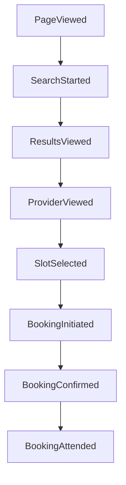

# KX-32 — Growth Analytics and Unit Economics Reference

Revision: Rev 2.7 · Growth Edition, Phases 2 and 3 metrics as-built, updated 25 November 2026 (supersedes Rev 2.4 of 24 November 2026; owner: Head of Finance with the Head of Growth)

Subtitle: One set of definitions for every growth number: what counts, what is divided by what, revenue versus booking value, CAC, LTV, ROAS, MER, the canonical funnel, cohorts and privacy-safe reporting.

Tags: Metrics · Definitions · Denominators · Revenue vs GBV · CAC · LTV · ROAS · MER · Funnel events · Cohorts · k-anonymity

> **Note** How to read this volume. It is a reference. When a dashboard, deck or model uses a growth number, it must use the definition here. The numbers in section 08 are arithmetic on stated assumptions, not forecasts. As-built data sources are named; nothing in the growth analytics pipeline exists in code yet except the anonymous event ingest.

| Field | Value |
|---|---|
| DOCUMENT | KX-32 |
| REVISION | Rev 2.7 · Growth Edition (25 November 2026) |
| STATUS | Definitions fixed; Phases 1 to 3 implementation As-built locally (analytics, channel performance, reporting models, cohorts and LTV, experiments); revenue definition amended for the credit systems and sponsored promotions (ADR-048 Proposed); nothing measured on real traffic |
| OWNER ROLE | Head of Finance; Head of Growth |
| AUDIENCE | Finance, growth, product, investors, data analysts |
| RELATED | KX-13; KX-14; KX-27; KX-28; KX-29; KX-30 |

## Revision history
| Revision | Date | Change | Author |
|---|---|---|---|
| Rev 2.4 draft 1 | 24 Nov 2026 | First issue from architecture decisions section 17 and the work-packages finance section | Documentation agent |
| Rev 2.7 | 25 Nov 2026 | Revenue definition amended for the two credit systems and sponsored promotions (ADR-048 Proposed); product decisions are counts, not revenue | W7 A4 documentation |
| Rev 2.4 | 24 Nov 2026 | Re-verified against `growth/analytics/*`: endpoints, k = 10 masking with secondary suppression, revenue definition and its two deviations (confirmation inferred at COMPLETED, BILLED not observed), canonical events actually emitted, worked examples tested | Documentation agent |
| Rev 2.7 | 25 Nov 2026 | Phases 2 to 4 as-built status (W5 to W8 and W9 documentation pass); ADR-049 to ADR-057 registered; statuses re-read from the as-built records and the wave 8 exit gate | Documentation agent (wave 9 lane A4) |

## What changed in Rev 2.7
New section 4.2 (Phase 2 and 3 as-built: channel performance and blended CAC formulas, reporting models, cohorts and LTV estimates, experiment metrics, recommendation thresholds); section 07 cohort method now has an implementation; revenue definition unchanged from the Rev 2.7 amendment of W7 A4 (credits, sponsored amounts, corporate benefit and product decisions are not Kiorex revenue).


## Contents
01 Summary · 02 Principles · 03 Data sources · 04 Definitions and denominators · 05 Formulas · 06 Funnel and canonical events · 07 Cohort method · 08 Bottom-up pressure test · 09 LTV and CAC guardrails · 10 Privacy and k-anonymity · 11 Acceptance, KPIs, risks, dependencies, open decisions · Rev 2.7: section 4.2 (Phases 2 and 3 as-built)

## Key numbers
<!-- kpis -->
- **EGP 38** fee value of one attended new patient after a 4 percent dispute rate
- **14 percent / 34 percent** bottom-up versus KX-14 attended-visit targets at month 6 and month 12
- **15** canonical funnel events
- **k at least 10** minimum cell size in any report
- **0** places where GBV is shown as revenue

## Status legend (read first)
Every statement in this volume carries one of these labels, in a column, a prefix or a callout. Phase 1 is now built locally; the labels separate what runs from what is only designed.

| Label | Meaning | Rule for readers |
|---|---|---|
| **As-built** | Exists in code with a passing test in the workspace, verified by reading the repositories and re-running the suites on 24 Nov 2026 (Rev 2.4). Local only: not deployed, not run against a real provider | Safe to rely on for behaviour in the local stack |
| **Approved target** | Accepted by the founder as an ADR or founder decision (FD) | Binding. No growth ADR (ADR-041 to ADR-047) has been accepted, so this label marks only rules inherited from existing Accepted ADRs |
| **Proposed** | Designed in the Growth reports of 24 Nov 2026 and written up here, not yet signed (ADR-041 to ADR-047) | Build only after sign-off, or inside a work package the founder released |
| **Roadmap** | Phase 2 to 4 capability, scoped coarsely | Do not build; estimates are ranges |
| **Open decision** | A founder or CEO choice with a stated default | Use the default, never decide silently |
| **Regulatory dependency** | Needs counsel, DPO, a regulator position or a partner approval (NEEDS_HUMAN) | Flag stays OFF in production until evidence is recorded; never mark a gate satisfied |

> **Warning** Nothing in this volume has run in production, against a real ad platform, search engine, WhatsApp number or payment provider. Messaging and provider integrations stay MOCKED until the pre-launch pass (FD-04). Numbers marked ASSUMPTION are starting hypotheses, not forecasts.

## 01 Summary
Under ADR-007 Kiorex earns EGP 40 only on an attended new patient, once per patient per provider network (24-month lookback). Repeat visits at the same clinic earn Kiorex nothing. Gross booking value (GBV) is therefore a volume indicator and never revenue, and patient LTV for marketing purposes is dominated by the first-visit fee. This volume fixes the vocabulary so that finance, growth and the investor materials cannot disagree.

## 02 Principles
1. Revenue is what Kiorex keeps: confirmed or billed commission charges net of reversals and waivers, plus later sponsored fees and Pay margin. Deposits, held funds and GBV are cash-flow or volume items.
2. Every ratio states its numerator, denominator, period and filter.
3. Attributed means "decision origin and source on the stored decision", never a spreadsheet join.
4. Reports are aggregates with k at least 10; no cell identifies a person or a provider's patient.
5. Specialty never joins the visitor stream.

## 03 Data sources
| Source | Content | Label |
|---|---|---|
| `BookingIntent`, `BookingEvent` (Kiorex) | Bookings and their states | As-built |
| `KiorexCommissionCharge`, `CommissionDispute` (clinic) | Fees and disputes | As-built |
| `Appointment.isNewPatientAtBooking`, check-in status | Attended new patient | As-built |
| Anonymous `AnalyticsEvent` and `ProfileViewDaily` | 13 event names, 7 properties, no identifiers | As-built |
| Ops `LiquidityPage`, `PartnerFunnelMark` | Liquidity and supply funnel | As-built |
| `GrowthAttributionDecision`, `GrowthTouchpoint`, `GrowthEvent`, `GrowthMetricDaily`, `GrowthRevenueFact`, `GrowthSpendEntry` | Origin, evidence, canonical events, rollups, revenue facts from clinic charge events, manual spend | As-built |
| Campaign spend and budgets | Manual spend entry with maker-checker is As-built (`GrowthSpendEntry`, database CHECK that the approver differs); campaign records and integrations are Phase 2 | As-built (manual), Roadmap (campaigns) |
| Meta, Google, Play, App Store rate and spend data | Pulled by adapters in mock mode first | Roadmap |

## 04 Definitions and denominators
| Metric | Definition | Denominator or filter | Source |
|---|---|---|---|
| Gross booking value (GBV) | Sum of visit fees of CONFIRMED bookings | Informational; never revenue | `BookingIntent` |
| Kiorex revenue | Sum of commission charges in CONFIRMED or BILLED (EGP 40 flat today), net of reversals and waivers; excludes provider SaaS revenue (a separate line in KX-13). **Rev 2.7 (ADR-048): patient credit, refund credit, provider credit and provider-sponsored discount amounts are never Kiorex revenue** (patient credit is a liability or a marketing expense of the funder, a sponsored amount is provider-funded and is neither Kiorex revenue nor a Kiorex marketing expense); the Kiorex fee of a sponsored booking is computed on the fee before the sponsored discount (`SPONSORED_PROMOTION_POLICY.commissionBasis = GROSS_BEFORE_SPONSORED`). Pharmacy, lab and nurse decisions (`GrowthProductDecision`) carry no charge: the commission link of products is inert (AD-13) | Period by charge confirmation date | `KiorexCommissionCharge` |
| Attended new patient (ANP) | An appointment attended with `isNewPatientAtBooking` true | Counted once per patient per provider network in the lookback | Clinic stamp |
| Provider-led share | `PROVIDER_LED / (PROVIDER_LED + MARKETPLACE + UNATTRIBUTED)` bookings (or attended new patients; always state which) | Same period and market | Decisions |
| Incremental Kiorex bookings | Bookings with origin `MARKETPLACE` | | Decisions |
| Fee-bearing ANP | ANP whose decision is not `PROVIDER_LED` | | Decisions and charges |
| Search-to-booking conversion | Bookings confirmed over search sessions in the same period (anonymous stream) | The KX-14 liquidity gate uses at least 8 percent | Events |
| Booking-to-attended | Attended over confirmed bookings, cohort by booking month | Excludes cancellations before the deadline when stated | Bookings |
| Dispute rate | Disputed charges over charges in the period; attribution dispute rate counts the attribution reasons only | | Disputes |
| Blended patient CAC | Total patient-acquisition spend over all ANP in the period | Spend lines of KX-14 section 09 (patient acquisition and content and SEO) | Finance and decisions |
| Paid CAC (campaign c) | Spend of c over ANP attributed to c within its click window | Needs campaign tracking (Phase 2) | Decisions and spend |
| Provider CAC | KX-13 blended supply CAC (EGP 12,500 assumption), always shown separately from patient CAC | | KX-13 |
| LTV (patient, Kiorex) | Kiorex revenue per patient cohort over 12 months, undiscounted: the first-visit fee net of disputes plus attributable Pay margin | A repeat visit at the same network earns no fee | Cohort |
| ROAS | Kiorex revenue attributed to a campaign over its spend; not GBV | Click window per policy | Decisions |
| MER | Total Kiorex revenue over total marketing spend in the period | All spend lines | Finance |
| Cohort retention | Share of a registration-month cohort that books again within 30, 90 and 180 days | Retention is a product measure; it does not earn fees by itself | Events |

### 4.1 As-built implementation notes (Rev 2.4)
| Item | What the code does | Label |
|---|---|---|
| Revenue | `kiorexRevenue` accepts only charge facts: CONFIRMED or BILLED charges minus reversals; PENDING, DISPUTED and WAIVED are not revenue; GBV, deposits, credits, tax lines and settlements have no way in (test) | As-built |
| Revenue date | The Clinic sends no confirmation event, so Kiorex writes the CONFIRMED fact when the booking is COMPLETED. The definition says period by charge confirmation date; the implementation uses completion. BILLED and waiver events other than reversal are not observed | As-built, deviation |
| Attended | Booking-to-attended and cohort figures use Kiorex-side booking status, not the Clinic attendance record | As-built, deviation |
| CAC, ROAS | `null` (not zero) when no approved spend exists; channel rows match spend by source kind and campaign only; CAC by campaign needs campaign tags (Phase 2) | As-built |
| LTV | `f * (1 - r)` with Pay margin 0 (not modelled) | As-built |
| Verdict | LTV over CAC at least 3 scale, at least 1 sustain, else review | As-built |
| k-anonymity | `K_MIN = 10`; cells of 1 to 9 show `<10` and carry no money or ratio; secondary suppression masks the smallest visible cell when exactly one cell is masked and the total is shown; CSV export uses the same outputs | As-built |
| Endpoints (ops, `ops/growth-analytics`) | `overview`, `funnel`, `channels`, `breakdown/:dimension`, `cohorts`, `unit-economics`, `export/:report`, `spend` (list, enter, approve, reject), `rollup` (super admin) | As-built |
| Endpoints (provider, `growth/v1/provider-analytics`) | `overview`, `funnel`, `channels`, `cohorts`, `export/:report`; signed partner, own organisation only, no Kiorex money | As-built |
| Rollups | `GrowthRollupService`, hourly job and manual trigger, idempotent including concurrent runs; visitor-stream rows never carry booking-only dimensions; no specialty-by-visitor join (test) | As-built |
| Cohorts | Closed 30, 90 and 180 day windows | As-built |
| Worked examples | `analytics-formulas.unit.spec.ts` reproduces section 08 (month 6 EGP 7,872, month 12 EGP 106,637, LTV 38.40) | As-built |
| Reconciliation | `growth-analytics.int.spec.ts` reconciles the overview to bookings and charges on the seed and asserts GBV is never revenue | As-built |

### 4.2 As-built implementation notes (Rev 2.7, Phases 2 and 3, local only)
| Item | What the code does | Label |
|---|---|---|
| Not Kiorex revenue | Patient credit and coupons, provider credit and waivers, provider-sponsored promotion amounts and the corporate sponsor benefit are tender or marketing cost, never revenue; product decisions (Pharmacy, Lab, Nurse) are counts, not revenue | As-built |
| Channel performance | ROAS and blended CAC are shown only when the denominator is at least k = 10 attended patients and spend is at least the EGP 500 floor (`guardRatio`); an adapter row wins over a manual row on reconciliation; with no external row the page says "not connected"; blended CAC includes reward cost read from the ledger as redeemed minus reversed marketing-funded lots | As-built locally |
| Reporting attribution models | Seven models over the same facts; every model reconciles to the same conversions and revenue to the minor unit; a conversion with no touch is `UNATTRIBUTED`; default report `POSITION_BASED` 40/40/20; windows counted in Cairo market days; data-driven model only at 1,000 attended new patients in 90 days; reporting only, never a decision (ADR-054) | As-built locally |
| Cohorts and LTV | Acquisition cohort by first attended month; retention at 30, 90 and 180 days; LTV as a group ESTIMATE with n, a 90 percent interval from a seeded bootstrap (1,000 resamples), horizon 12 months, geometric tail, rewards cost subtracted; payback and LTV:CAC against approved spend only; cells below k = 10 stored suppressed; no per-person LTV | As-built locally |
| Experiments | Primary and guardrail metrics are first-party funnel facts joined by the same unit key; conversions count within 7 days of exposure; arms under 10 show "<10"; no segment breakdown (ADR-053) | As-built locally |
| Recommendations | Aggregate-only inputs with k 10 and a spend floor of EGP 500; a channel must be 1.5 times better to propose a move, at most 20 percent shifted, pause only after 14 days; all PROPOSED_DEFAULT and human-approved | As-built locally, numbers unconfirmed |
| Open caveats | Revenue confirmation is inferred at COMPLETED until the Clinic reports a charge status: wave 9 (G-19) records the basis of every confirmed charge (`CLINIC_FACT` or `INFERRED_AT_COMPLETION`), upgrades inferred rows when a Clinic CONFIRMED or BILLED fact arrives and shows the inferred share in the overview (launch guide 11.144); per-source reward cost is not a metric column; language cohort cut and repeat rate are not built | Open |

## 05 Formulas
```
ListedProviders(t)      = T(t) * L(t) * d
ANP_total(t)            = ListedProviders(t) * a(t)
ANP_fee_bearing(t)      = ANP_total(t) * (1 - p(t))
KiorexFeeRevenue(t)     = ANP_fee_bearing(t) * f * (1 - r)
BookingsNeeded(t)       = ANP_total(t) / c2
SearchersNeeded(t)      = BookingsNeeded(t) / c1          // marketplace-origin share only
BlendedPatientCAC(t)    = (S_p(t) + S_c(t)) / ANP_total(t)
PaidCAC(c)              = Spend(c) / ANP_attributed_to(c)
ReferralCost(t)         = QualifiedReferrals(t) * q * (1 - b)
ROAS(c)                 = FeeRevenue_attributed(c) / Spend(c)
MER(t)                  = KiorexFeeRevenue(t) / TotalMarketing(t)
MessagingCost(t)        = sum over categories (messages * delivered price)   // Meta rate card
LTV                     = f * (1 - r) + PayMargin_per_patient   // PayMargin: not modelled
```
Symbols: T active clinic tenants; L share with a LIVE listing; d listed providers per listing tenant; a ANP per listed provider per month; p provider-led share; f fee per ANP; r dispute and reversal rate; c1 search to booking; c2 booking to attended; S_p patient marketing spend; S_c content and SEO spend; q reward cost per qualified referral; b referral breakage.

Starting inputs (all ASSUMPTION until pilot): d 1.5; a 4 at month 6 and 8 at month 12 (the KX-14 gate to open the next cluster is 12); p 35 to 50 percent; f EGP 40 indexed; r 4 percent; unattributed share 10 percent of bookings; c1 at least 8 percent (KX-14 gate); c2 75 percent; b 30 percent.

Consequences: every point of provider-led share removes EGP 40 per patient from revenue while increasing provider adoption, so p is modelled explicitly; Kiorex earns once per patient per network so LTV is about the first-visit fee plus Pay margin; GBV, deposits held and refunds are cash-flow items and sit in the held-deposit ledger.

## 06 Funnel and canonical events
Figure 1 — Canonical funnel and where each stage is measured.



Canonical events written to `GrowthEvent` (names stable, minimal properties; the 15 names are As-built in contracts `GROWTH_EVENT_NAMES`, nine may be reported by a client, the rest are written only by the server): `PageViewed` (landing kind only), `SearchStarted`, `ResultsViewed`, `ProviderViewed`, `SlotSelected`, `BookingInitiated`, `BookingConfirmed`, `BookingAttended` (from COMPLETED or CHECKED_IN), `BookingCancelled`, `AppInstalled`, `PatientRegistered`, `WidgetLoaded`, `WidgetBookingStarted`, `WhatsAppConversationStarted`, `ConsentGranted`.

| Stage range | Measured how |
|---|---|
| Up to `ProviderViewed` | Anonymous stream, by care type and market only |
| From `SlotSelected` | Server-side operational facts keyed to the booking |
| Visitor-keyed analysis | Only with consent; specialty and provider ids rejected by the event guard |
| Emitters (As-built) | Server facts: `SlotSelected`, `BookingInitiated`, `BookingConfirmed`, `BookingAttended` (new or returning bucket), `BookingCancelled` (closed reason), `PatientRegistered`, `WhatsAppConversationStarted`, idempotent per booking. Web and mobile libraries send `PageViewed`, `SearchStarted`, `ResultsViewed`, `ProviderViewed`, `ConsentGranted`, `AppInstalled` after the visitor decides. No emitter was found in the widget app for `WidgetLoaded` and `WidgetBookingStarted`: NOT VERIFIED that they fire |
| Mapping | `BookingInitiated` from the booking INTENT event; `BookingConfirmed` from `APPOINTMENT_CONFIRMED`; `BookingAttended` from COMPLETED or CHECKED_IN; `BookingCancelled` from the two cancel events; no duplicate events |

## 07 Cohort method
1. A cohort is the set of patients whose first attended visit with the network falls in a calendar month (acquisition cohort) or whose Passport registration falls in the month (registration cohort). State which.
2. Revenue per cohort is Kiorex revenue from that cohort's charges net of reversals, by month since acquisition.
3. Retention is the share booking again within 30, 90 and 180 days; reported by origin and source kind.
4. Cohorts below k = 10 are shown as "<10".
5. Observation windows are closed (a cohort is final after the dispute window plus billing).
6. Any retention improvement is a product result; its revenue effect is zero under the current fee unless Pay margin or sponsored listings are present.

## 08 Bottom-up pressure test
Columns: T tenants, Listed listed providers, ANP attended new patients, Fee revenue at f EGP 40 and r 4 percent, KX-14 visits the attended-Kiorex-visits target, Ratio is ANP over that target. Arithmetic on the assumptions in section 05 and KX-14 tenants (341 at month 6, 857 at month 12), not a forecast.

| Month | T | L | d | Listed | a | ANP | p | Fee-bearing | Fee revenue per month | KX-14 visits | Ratio |
|---|---|---|---|---|---|---|---|---|---|---|---|
| 6 | 341 | 20% | 1.5 | 102 | 4 | 409 | 50% | 205 | EGP 7,872 | 2,900 | 14% |
| 12 | 857 | 45% | 1.5 | 578 | 8 | 4,628 | 40% | 2,777 | EGP 106,637 | 13,667 | 34% |

Reading: the bottom-up of attended new patients is about 14 percent (month 6) and 34 percent (month 12) of KX-14's attended-visit series. The series reconcile only if KX-14 counts repeat visits and visits that came through provider links, or if listing rates and patients per provider are much higher. At KX-14's cluster gate of 12 ANP per listed provider, month 12 needs about 1,140 listed providers to reach 13,667, which exceeds 857 active tenants. **Action:** KX-13 splits "attended Kiorex visits" into new, returning and provider-led and re-bases fee revenue on fee-bearing ANP. This is a modelling finding, not a claim that the target is wrong.

## 09 LTV and CAC guardrails
| Guardrail | Rule | Label |
|---|---|---|
| Payback on fee | A paid campaign is acceptable on the fee alone only if paid CAC is at or below about EGP 38 (LTV on the fee) | Proposed |
| Scale-up | LTV over CAC at least 3 to scale a campaign; at least 1 to sustain; below 1 for two weeks, stop | Proposed (ASSUMPTION) |
| Supply justification | Where CAC is above the fee, the spend is justified only if it demonstrably raises listed-provider supply or retention, tracked in KX-13 as an investment, not as acquisition | Proposed |
| MER floor | Track MER monthly; a plan with MER below 1 needs a finance-approved reason | Proposed |
| Pay margin | Add to LTV only once Kiorex Pay margin per patient is measured | Open decision |
| Messaging cost | Include Meta's delivered-message cost by category before approving proactive messaging | Proposed |

> **Risk** On the fee alone, the arithmetic in section 08 shows that blended patient CAC at an illustrative EGP 150,000 monthly budget exceeds one fee at month 6 in every scenario (KX-29 section 10). Treat paid patient marketing as a bounded test funded by supply-side logic, not a self-paying channel, until fees, Pay margin or sponsored revenue change.

## 10 Privacy and k-anonymity
- Server-side operational events are always allowed; a pseudonymous `visitorKey` exists only after consent.
- Specialty and provider never join the visitor stream; funnel steps up to `ProviderViewed` are by care type and market only.
- Every report, export and ops chart masks cells under k = 10 as "<10" and refuses a breakdown that would reveal one patient. CSV export applies the same masking.
- Metrics are emitted without identifiers; ad-platform payloads use `AnonymizedConversion` only (event name, hour, market, value, currency, campaign ref, click id).
- Dependants are excluded from growth tables.

## 11 Acceptance criteria, KPIs, risks, dependencies, open decisions
- Acceptance (GRW-P1-J), status Rev 2.4: met locally by the tests named in section 4.1. Overview numbers reconcile to `BookingIntent` and commission charges on the demo seed; GBV is never labelled revenue (test); rollup idempotent; k-masking tested; funnel arithmetic tested on a fixture; no specialty-by-visitor join possible (test).
- KPIs: reconciliation variance zero on seed; freshness; share of bookings with a decision row.
- Risks: definitions drift between decks (this volume is the source); small cells identify people (k rule); attribution gaps without consent (reporting notes the coverage).
- Dependencies: Phase 1 rollups; Phase 2 spend entry and integrations; KX-13 re-base.
- Open decisions: Pay margin per patient; who owns spend entry; confirmation of c2 and r from pilot.
- Cross-references: KX-13 section 13, KX-28 (events), KX-30 (origin), KX-29 (scenarios).
