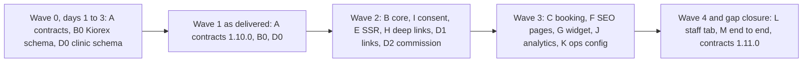

# KX-33 — Growth Engine Implementation Roadmap and Agent Handoff

Revision: Rev 2.4 · Growth Edition, as-built verified 24 November 2026 (new volume; owner: Chief Software Architect with the delivery lead; supersedes: Rev 2.4 draft 1 of this volume)

Subtitle: Phases 1 to 4, the 13 Phase 1 work packages with owners, dependencies, acceptance and effort, the commercial and regulatory gates, and the rules a build agent must follow.

Tags: Roadmap · Work packages · Waves · Dependencies · Effort · Gates · Agent handoff · Next actions

> **Note** How to read this volume. The work packages are the plan; the detail of each package lives in `_docs/growth/GROWTH_PHASE1_WORK_PACKAGES.md` (sections 8 to 12 are the as-built records of the implementing agents). Rev 2.4 re-verified the status column against the repositories on 24 Nov 2026: unit suites re-run (contracts 276, Kiorex API 578, Clinic API 1,222, Passport 314, staff app 276, patient app 251, patient web 282, ops console 84, all passing) and the growth integration suites re-run on a local Postgres (Kiorex growth, consent, public-site, widget, deep-link and link-registry suites: 278 of 279 passing; Clinic growth and kiorex suites: 55 passing, 1 live-mode test skipped on purpose). Nothing is deployed and nothing is pushed.

| Field | Value |
|---|---|
| DOCUMENT | KX-33 |
| REVISION | Rev 2.4 · Growth Edition (24 November 2026) |
| STATUS | Phase 1 built and verified locally (waves 0 to 4 and a gap-closure wave); ADR-041 to ADR-047 still Proposed; gates and production evidence open |
| OWNER ROLE | Chief Software Architect; delivery lead |
| AUDIENCE | Build agents, engineering leads, founders |
| RELATED | KX-22 (repo map and hand-off); KX-27 to KX-32; KX-17; KX-18 |

## Revision history
| Revision | Date | Change | Author |
|---|---|---|---|
| Rev 2.4 draft 1 | 24 Nov 2026 | First issue from the Phase 1 work packages report | Documentation agent |
| Rev 2.4 | 24 Nov 2026 | Status column re-verified against code and tests; Phase 1 packages relabelled; honest gaps listed per package; next actions rewritten | Documentation agent |

## Contents
01 Summary · 02 Phases · 03 Waves and shared-file ownership · 04 Phase 1 work packages · 05 Phases 2 to 4 packages · 06 Commercial and regulatory gates · 07 Rules for build agents · 08 Recommended next actions · 09 Acceptance, KPIs, risks, dependencies, open decisions

## Key numbers
<!-- kpis -->
- **84** engineer-days in Phase 1 (13 packages)
- **8 to 9 weeks** critical path with 5 to 6 parallel agents
- **5** waves (0 to 4) plus a gap-closure wave; single owners for every shared file
- **26** NEEDS_HUMAN items in the work packages report (section 7), plus the new human items of the pentest and edge-case reports (launch guide sections 11 and 12)
- **13 of 13** Phase 1 packages built and tested locally; **0** deployed, **0** production-verified

## Status legend (read first)
Every statement in this volume carries one of these labels, in a column, a prefix or a callout. Phase 1 is now built locally, so the labels separate what runs from what is only designed.

| Label | Meaning | Rule for readers |
|---|---|---|
| **As-built** | Exists in code with a passing test in the workspace, verified by reading the repositories and re-running the suites on 24 Nov 2026 (Rev 2.4). Local only: not deployed, not run against a real provider | Safe to rely on for behaviour in the local stack. A gap is named wherever one is known |
| **Approved target** | Accepted by the founder as an ADR or founder decision (FD) | Binding. No growth ADR (ADR-041 to ADR-047) has been accepted by the founder, so this label marks only rules inherited from existing Accepted ADRs |
| **Proposed** | Designed in the Growth reports of 24 Nov 2026 and written up here, not yet signed (ADR-041 to ADR-047) | Build only after sign-off, or inside a work package the founder released |
| **Roadmap** | Phase 2 to 4 capability, scoped coarsely | Do not build; estimates are ranges |
| **Open decision** | A founder or CEO choice with a stated default | Use the default, never decide silently |
| **Regulatory dependency** | Needs counsel, DPO, a regulator position or a partner approval (NEEDS_HUMAN) | Flag stays OFF in production until evidence is recorded; never mark a gate satisfied |

> **Warning** Nothing in this volume has run in production, against a real ad platform, search engine, WhatsApp number or payment provider. Messaging and provider integrations stay MOCKED until the pre-launch pass (FD-04). Numbers marked ASSUMPTION are starting hypotheses, not forecasts.

## 01 Summary
Phase 1 delivers the launch-critical set: provider links and QR, the attribution engine, commission integration, first-party analytics, SEO pages, widgets, deep links and bootstrap, consent and versioned configuration. It is built as modules in the two existing monoliths, with contracts 1.10.0 published first and 1.11.0 added in the gap-closure wave. **As-built (Rev 2.4):** all 13 packages exist in code with passing tests on the local stack (section 04 lists each gap). **Not yet true:** nothing is deployed; there is no Lighthouse lab score, no device Universal or App Link check, no real search-engine, PSP or WhatsApp run; consent wording, the PDPL opinion and the provider terms are open human items. No deploy, no push of the clinic `kiorex` branch without founder approval (FD-18), no real provider (FD-04).

## 02 Phases
| Phase | Theme | Capabilities | Effort | Label |
|---|---|---|---|---|
| 1 Launch-critical | Prove and enable | Links and QR; attribution v1; commission integration; first-party events and analytics overview; SEO-ready pages (SSR, sitemap, robots, hreflang, JSON-LD, slug history); widgets and SDK; deep links and bootstrap; consent and preference centre; Super Admin config v1 | 84 days planned | As-built locally (gaps in section 04) |
| 2 Conversion and retention | Convert and keep | Campaign engine; patient referral and rewards (counsel-gated); provider Growth workspace v2; WhatsApp assistant; lifecycle messaging with caps; CAC, ROAS and cohorts; Search Console, Play Console and App Store Connect adapters | about 75 days | Roadmap |
| 3 Optimisation | Learn | Experiments with guardrails; advanced attribution views and holdouts; fraud scoring; paid adapters (Google, Meta, TikTok) with anonymised conversions; SEO automation; AI recommendations (aggregate only); international tooling | about 44 days | Roadmap |
| 4 Ecosystem | Expand | Cross-product journeys; pharmacy, lab and nurse acquisition pages and links; corporate and insurer programmes (month 15 and later); loyalty if rewards pass legal review | about 45 days | Roadmap |

## 03 Waves and shared-file ownership
Figure 1 — Waves and parallel lanes.

| Shared file | Single owner | Rule for others |
|---|---|---|
| Kiorex `prisma/schema.prisma` and migrations | B0 (one migration `20261128100000_growth_core`) | Later schema needs go through B0's owner |
| Kiorex `app.module.ts` | B0 registers `GrowthModule`, `PublicSiteModule`, `WidgetModule` stubs | Others fill their own module folders |
| Ops `App.tsx` and nav | K registers all Growth routes up front with lazy imports | J and K create page files under `pages/growth/*` only |
| Patient web `App.tsx` | F mounts consent route and preference centre from I imports | I exports components |
| Kiorex i18n | Each package adds its namespaced file (`public.*` F, `consent.*` I, `growth.*` J and K, `widget.*` G) | Never reorder existing keys |
| Clinic `prisma/schema.prisma` | D0 (migration `20261128110000_growth_links_attribution`) | D1 and D2 add code only |
| Clinic `app.module.ts`, router, nav | D1 | D2 adds no routes |
| Contracts `events/index.json`, `flags/catalogue.json`, `openapi/*`, version | A | After A publishes 1.10.0 others consume the vendored tarball (FD-20) |
| Domain table `config/domains.json` and tests | H | |

## 04 Phase 1 work packages
Repo short names: KP kiorex-platform, CM clinics-management (branch `kiorex`), KC kiorex-contracts, KA kiorex-account, KL kiorly. Effort is ideal engineer-days for one agent including tests and docs. Status column (Rev 2.4, verified 24 Nov 2026): **Done** means built, with the acceptance tests passing on the local stack; **Done with gaps** or **Partial** name the missing piece. No package is production-verified.

| ID | Package | Repo | Depends | Effort | Acceptance (summary) | Status |
|---|---|---|---|---|---|---|
| GRW-P1-A | Contracts 1.10.0: new events, additive fields, growth OpenAPI, flags, config JSON Schemas, changelog | KC | none | 3 | `npm test` green; additive proof against 1.9.0; each new flag has `whenOff` text and scope | Done. `@kiorex/contracts` 1.11.0, 276 tests pass; 1.10.0 additive, 1.11.0 adds optional SEO keys, optional `lt`, link registry lookup and `ReferralLinkCreated/Revoked` with organisation reference |
| GRW-P1-B0 | Kiorex growth schema and module stubs, immutability triggers, erase and purge functions | KP | A | 2 | Migration applies on the per-run test database; only two nullable `BookingIntent` columns added to existing models | Done. Migration `20261128100000_growth_core` plus four later additive growth migrations (below). Gap: production role separation for the maintenance functions (NEEDS_HUMAN) |
| GRW-P1-D0 | Clinic growth schema: links, widget config, commission decision, appointment columns, dispute reason enum | CM | A | 1 | Migration applies on `kiorly_test`; existing tests unchanged | Done. Migration `20261128110000_growth_links_attribution` plus `growth_link_tags` and `growth_widget_settings` |
| GRW-P1-B | Attribution and growth core services: decision function, touch and events endpoints, config service, slugs, consent gate, fraud rules, retention, erasure | KP | A, B0 | 9 | Deterministic pure decision; one decision per booking per policy version; p99 under 150 ms; at least 40 table cases plus replay property test | Done. Pure `decide.ts`, 65 table cases and a 1,000-scenario property test, p99 under 150 ms on 1,000 touches; `FIRST_TOUCH` is refused for commission and falls back to `PROVIDER_FIRST`. Gap: no daily replay job exists, only `replay` on demand |
| GRW-P1-C | Booking integration: decide, persist, send the `acquisition` block, `lt` handling | KP | A, B | 4 | Valid `lt` gives `PROVIDER_LED`; forged ignored; flag OFF identical to today | Done. Decision written once per booking and policy version before the clinic call; flag OFF identical to before. Gap: the mobile app never receives `lt` |
| GRW-P1-D1 | Provider links, QR, widget settings, Growth workspace UI | CM | A, D0 | 7 | Standalone org creates and prints links; no third-party QR; counters hold no patient data | Done. Links, QR (local library), A4/A5 AR/EN posters, widget settings, workspace UI. Gap: no server-side PDF (print from the browser) |
| GRW-P1-D2 | Commission intake: chargeability extension, decision rows, dispute reason, badges | CM | A, D0 | 6 | Absent block leaves tests unchanged; provider-led booking creates no charge but one decision row | Done. Append-only decision rows, `PROVIDER_LED_EVIDENCE` dispute, `CommissionAdjusted`, statement reconciliation, OpenAPI copy 1.4.0. Clinic unit 1,222 and growth integration 55 pass |
| GRW-P1-E | Public site SSR infrastructure, robots, sitemaps, well-known, legacy 301, CDN module | KP | A, B0 | 8 | View-source shows content and JSON-LD; every private route `noindex`; CWV lab budget met | Done with gaps. SSR role, robots, segmented sitemaps, legacy 301, headers, SPA fallback. Lighthouse (24 Nov 2026, v13.6, local, simulated slow 4G): all four categories 100 on home, specialty hub, city hub, doctor and clinic, mobile and desktop, Arabic and English; LCP 0.8 s mobile; budget `apps/web/lighthouserc.json`, CI job `site-audit`. Fixed on the way: CSP-blocked inline style on the rating bars, 404 for favicons / manifest on the API role, uncompressed responses. Gaps: lab is not field data (real-user Web Vitals need a deployed site); CDN purge is a mock |
| GRW-P1-F | SEO templates, slugs, structured data, thin-page guard | KP | B0, E | 7 | All page types in AR and EN with correct hreflang; below-guard pages `noindex,follow` and absent from sitemaps | Done with gaps. 14 page types AR and EN, slugs with history, guard, JSON-LD, Search Console adapter in mock. Gaps: pharmacy and lab pages are brand pages only; wording needs CMO review; real Search Console not connected |
| GRW-P1-G | Booking widget and JS SDK on the widget origin | KP | A, B, C, D1 | 8 | Widget booking is `CLINIC_LINK` with `lt`, `PROVIDER_LED`; non-allowlisted origin blocked; two widgets one slot gives one confirmation | Done with gaps. Widget host role, per-organisation CSP, SDK 1.46 KB gzip, 30 browser tests. The real Passport popup flow is exercised (24 Nov 2026, `e2e/scripts/widget-real.sh`: real Kiorex API, Clinic and Passport, only the host page synthetic; 8 tests). Gaps: no dark theme, CDN and DNS for the host not changed |
| GRW-P1-H | Deep links and bootstrap: domain table, app-link templates, mobile linking, deferred links | KA, KP | A, E | 5 | No URL-valued parameter followed; one live market gives no selector; production verification needs Team ID | Partial. KA domain table and templates, bootstrap, well-known files, fallback pages, app deep-link handlers and consent-gated deferred touch are built and unit tested. Open: no on-device Universal or App Link check, Team ID and SHA-256 missing, native rebuild required |
| GRW-P1-I | Consent management and preference centre, suppression, STOP handling | KP | B0 | 6 | No visitor key before consent; withdrawal within 60 s; wording keys are `TODO_NEEDS_HUMAN` placeholders | Done with gaps. Consent tables, gate, preference centre (web SPA), STOP handling, patient app preferences screen (built in the gap-closure wave, `preferences.test.tsx`). Gaps: no banner on SSR pages (they may not set storage), wording is `TODO_NEEDS_HUMAN` draft, the `kxv` cookie is locked behind the counsel gate |
| GRW-P1-J | Growth analytics v1: client batching, rollups, funnel, ops overview, k-masking | KP | B | 6 | Overview reconciles to bookings and charges on the seed; GBV never shown as revenue | Done with gaps. Rollups, funnel, channels, cohorts, unit economics, k = 10, CSV, ops pages, provider analytics endpoints. Gaps: revenue confirmation inferred at COMPLETED, spend is manual, no Lighthouse run for ops pages; one k-anonymity integration test fails when the whole growth set runs in one `--runInBand` pass (rollup unique-key error on leftover rows) and passes alone, 10 of 10: a test-isolation or rollup-key defect to fix |
| GRW-P1-K | Super Admin growth configuration: versions, maker-checker, evidence viewer, ops pages | KP | A, B0, B | 5 | Draft, approve, effective-date and rollback work; money kinds need 7 days notice | Done with gaps. Versions, maker-checker (also a database CHECK), guardrails, propagation, evidence viewer, console group with 22 sections. Gaps: an approved future-dated version cannot be withdrawn, landing pages read-only, Phase 2 sections show Planned only |
| GRW-P1-L | Staff app Growth tab (minimal) | KL | D1 | 3 | Copy and share link, last 30 days counts, AR/EN/RTL | Partial. Clinic and Nurse staff app Growth tab built (`kiorly` jest passes, simulator smoke on iPhone). Not built: Pharmacy and Lab Growth tabs, native Copy button, QR save, doctor creating a link from the phone |
| GRW-P1-M | End-to-end tests, docs, decision records | E2E, docs | all | 4 | Seven scenarios pass on the local stack; docs index lists new files | Done. e2e 25 to 28 (40 tests) pass on the local stack; the seven scenarios are covered; TEST_GUIDE and test-flow updated. Gap: consenting-visitor touch written by the harness (endpoint locked by the counsel gate) |

Total 84 engineer-days planned (actual effort was not recorded). Scenarios for M: (1) provider link to widget booking, no charge, decision `PROVIDER_LED`; (2) search booking, attended new patient, EGP 40 charge, decision `MARKETPLACE`; (3) patient with history not charged; (4) dispute with evidence auto-approves; (5) SEO source has JSON-LD and canonical, private routes `noindex`; (6) consent withdrawn stops the visitor key; (7) widget from a non-allowlisted origin blocked.

Scenarios 1 to 4 of M are run by `e2e/test/25` and `27`; scenarios 5 to 7 by `28` (SSR crawl and `noindex`, consent matrix, widget origin). Every package ends with: unit tests green, integration tests where listed, lint and typecheck green, OpenAPI regenerated where endpoints change, `Docs/` updated, requirement ids in commits, flag defaults documented, and no secret, `.env` or build output in git.

## 05 Phases 2 to 4 packages
| ID | Package | Effort (days) | Depends | Label |
|---|---|---|---|---|
| GRW-P2-1 | Campaign engine, UTM builder, budgets, state machine | 10 | Phase 1 core | Roadmap |
| GRW-P2-2 | Patient referral links, qualification, fraud review queue | 10 | Counsel gate on rewards | Roadmap |
| GRW-P2-3 | Reward ledger and closed-loop credit or coupon fallback | 10 | P2-2, ADR-046, finance treatment | Roadmap |
| GRW-P2-4 | Provider marketing portal v2: analytics, monthly cap and pause, report export | 8 | Phase 1 | Roadmap |
| GRW-P2-5 | WhatsApp assistant: orchestrator, tool registry, confirmation, injection tests, cost caps | 12 | KX-11 safety review, Meta templates | Roadmap |
| GRW-P2-6 | Lifecycle messaging: journeys, caps, segment allowlist, template catalogue | 10 | I, counsel on marketing licence | Roadmap |
| GRW-P2-7 | Advanced analytics: CAC, ROAS, MER, cohorts, spend entry | 8 | P2-1 | Roadmap |
| GRW-P2-8 | Search Console, Play Console, App Store Connect adapters | 7 | Accounts (NEEDS_HUMAN) | Roadmap |
| GRW-P3-1 to 7 | Experiments (8), attribution views (6), fraud scoring (6), paid adapters (8), SEO automation (6), AI recommendations (5), international tooling (5) | 44 | Phase 2 data, legal review of ad policy, second market decision | Roadmap |
| GRW-P4-1 to 4 | Cross-product journeys (10), pharmacy, lab and nurse pages (12), corporate and insurer programmes (15), loyalty (8) | 45 | M9, M15, GKN2, legal | Roadmap |

## 06 Commercial and regulatory gates
| # | Gate | Owner | Blocks | Label |
|---|---|---|---|---|
| 1 | Counsel opinion on PDPL: analytics cookies and visitor keys, direct electronic marketing consent, the reported licence, withdrawal, retention, dependants | Counsel, DPO | `growth.analytics_visitor`, `growth.marketing_messaging` | Regulatory dependency |
| 2 | Consent and preference wording AR and EN, versioned, legal basis per purpose | Counsel, CMO | GRW-P1-I in production; all marketing | Regulatory dependency |
| 3 | Provider terms: attribution rules, provider-led protection, evidence, 7-day notice, dispute window, content licence | Counsel, CEO | D2 go-live, F | Regulatory dependency |
| 4 | `precedence` default (`PROVIDER_FIRST`) and windows (30, 30, 7 days): built as `PROPOSED_DEFAULT`, needs CEO sign-off before the first ACTIVE version | CEO | B, D2 | Open decision |
| 5 | EGP 40 for provider-led-then-marketplace cases: built as NO charge (evidence can only remove a fee) | CEO | D2 | Open decision |
| 6 | Hosts and DNS: `kiorex.com` patient host, `kiorly.link` (NH-008), widget host, staging hosts | Founder | E, D1, G, H | Open decision |
| 7 | Apple Team ID, Play signing SHA-256, store accounts | Founder | H in production | Regulatory dependency |
| 8 | Search Console and Business Profile ownership | Marketing | SEO measurement | Open decision |
| 9 | Review markup eligibility | SEO lead | `aggregateRating` | Regulatory dependency |
| 10 | Legal assessment of reward credits; CBE or regulator position | Counsel, finance | Phase 2 rewards | Regulatory dependency |
| 11 | Marketing licence, sender registration, Meta marketing templates and quality-rating policy | Counsel, ops | Phase 2 lifecycle | Regulatory dependency |
| 12 | Health-advertising and targeting policy as company policy | Counsel, CMO | Phase 3 paid adapters | Regulatory dependency |
| 13 | Data residency and cross-border view for aggregates; record of processing update | DPO | Phase 1 production | Regulatory dependency |
| 14 | Retention periods and subject-rights process for growth tables | DPO, counsel | B retention and erasure defaults | Regulatory dependency |
| 15 | WhatsApp assistant safety review and launch gate | CMO, clinical safety | `kiorex.whatsapp_ai_assistant` | Regulatory dependency |
| 16 | Real provider credentials and templates in the pre-launch pass | CEO, ops | Any real send | Open decision (FD-04) |
| 17 | District list in the Egypt market pack (NH-040, FD-14) | Ops | F, J | Open decision |
| 18 | ADR-041 to ADR-047 signature. ADR-039 (telehealth) is accepted and exists in the Clinic repository, so the numbering question is closed | Founder | ADR signing | Open decision |
| 19 | Approve doc edits (KX-19 hosts, KX-24 scope, KX-13, KX-14, KX-03 KXMBK10, KX-15). Rev 2.4 applied the as-built facts; commercial wording stays for approval | Founder | This documentation set | Open decision |
| 20 | `kiorly.link` serves the page or redirects; SSR as a second App Runner service | Founder, CTO | D1, E | Open decision |

Full list: 26 items in the Phase 1 work packages report section 7, plus launch guide sections 11 (Growth) and 12 (Security). No gate is recorded as satisfied by this volume; gate evidence is entered only through the human super-admin route (ADR-024).

## 07 Rules for build agents
- Read `CLAUDE.md`, KX-22 section 11, this volume and KX-28 first. Work only inside your package's paths; do not edit shared files you do not own (section 03).
- Conventional Commits with requirement ids, for example `feat(growth): GRW-P1-B decision function`.
- AR and EN strings with RTL checked; no PHI in logs or analytics; mock-first adapters (`MODE=mock|real`, default `mock`); flags default per ADR-023.
- No deploy; `tofu validate` and `fmt` only; never push the clinic `kiorex` branch (FD-18); no `@aws-sdk/*` outside adapters (ADR-028); no tax-authority code (ADR-011).
- Stop and ask a human for prices, fees, legal and consent wording, gate evidence, production credentials and domains.
- Report, in the package's Docs page, exactly what exists and what is mocked; do not mark a gate satisfied.
- Tests are named like the neighbouring ones (`*.node.test.ts`, `*.integration.test.ts` in CM; `*.unit.spec.ts`, `test/*.int.spec.ts` in KP; vitest in KC and KA).

## 08 Recommended next actions
Rev 2.4 rewrote this list after the verification pass. Done items are removed; the verifying step (old item 6) is complete for Phase 1.
1. Founder: sign or amend ADR-041 to ADR-047 (still Proposed). ADR-039 is now found in the Clinic repository (`Docs/adr/ADR-039-telehealth-p2p-webrtc.md`, accepted for implementation 23 Nov 2026) and registered in KX-01, so ADR-041 numbering stands.
2. Founder and CEO: decide the money items (precedence default, windows, no charge for provider-led-then-marketplace) and the interpretation of 50/25/15/10. The defaults are built and marked `PROPOSED_DEFAULT`.
3. Counsel and DPO: PDPL, marketing licence, rewards and consent wording. They gate production, not development. `growth.analytics_visitor` and `growth.marketing_messaging` stay locked.
4. Founder: hosts (`kiorex.com`, `kiorly.link`, `book.kiorex.com`), Apple Team ID, Play SHA-256, Search Console ownership (launch guide sections 2, 8 and 11).
5. Engineering, before any deploy: (Lighthouse on the SSR templates and the real Passport popup for the widget are done, 24 Nov 2026) verify Universal and App Links on a device, set `GROWTH_LINK_TOKEN_SECRET`, `TRUSTED_PROXY_HOPS`, `CORS_ORIGINS` and the lead signing secret (launch guide sections 3 and 12).
6. Engineering, Phase 1 residuals: daily decision replay job (KX-28 SLO), Pharmacy and Lab Growth tabs, withdrawal of an approved future-dated config version, per-organisation partner credentials for evidence and lookup calls.
7. Finance: re-base KX-13 per KX-32 section 08 and decide the EGP 150,000 illustration (KX-29 section 09).
8. Founder: external penetration test against staging after the pentest fixes are deployed (KX-10, `_docs/security/PENTEST_2026-11_REPORT.md`).

## 09 Acceptance criteria, KPIs, risks, dependencies, open decisions
- Acceptance: Phase 1 exit list of KX-27 section 07 (re-checked in Rev 2.4, with the open items named there); contracts 1.10.0 and 1.11.0 published and vendored; documentation updated.
- KPIs: engineer-days burned versus 84 (not recorded); packages Done per wave; defects escaping to e2e; shared-file conflicts (target 0).
- Risks: shared-file bottleneck (single owners); contract change after consumers start (additive only, A first); scope creep into Phase 2 (flags and package boundaries); legal drift (gates); effort estimates by one author (ASSUMPTION).
- Dependencies: gates in section 06; vendored contracts (FD-20).
- Open decisions: see section 06 items 4 to 8, 18 and 20.
- Cross-references: KX-22, KX-17, KX-18 (roadmap), `_docs/growth/GROWTH_PHASE1_WORK_PACKAGES.md`.
