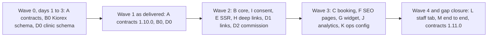

# KX-33 — Growth Engine Implementation Roadmap and Agent Handoff

Revision: Rev 2.8 · Growth Edition, updated 27 November 2026 (previous: Rev 2.7; status board and remaining-work checklist of 27 Nov 2026; environment work packages; promotion rule in the agent rules)

WHAT CHANGED IN REV 2.8: New closing section: the 27 Nov 2026 status board and remaining-work checklist (release gates, commission and money, real integrations, environment and URL work), the promotion rule for agents, and the deployment status (Clinic on AWS; everything else local).

Subtitle: Phases 1 to 4, the 13 Phase 1 work packages with owners, dependencies, acceptance and effort, the commercial and regulatory gates, and the rules a build agent must follow.

Tags: Roadmap · Work packages · Waves · Dependencies · Effort · Gates · Agent handoff · Next actions

> **Note** How to read this volume. The work packages are the plan; the detail of each package lives in `_docs/growth/GROWTH_PHASE1_WORK_PACKAGES.md` (sections 8 to 12 are the as-built records of the implementing agents). Rev 2.4 re-verified the status column against the repositories on 24 Nov 2026: unit suites re-run (contracts 276, Kiorex API 578, Clinic API 1,222, Passport 314, staff app 276, patient app 251, patient web 282, ops console 84, all passing) and the growth integration suites re-run on a local Postgres (Kiorex growth, consent, public-site, widget, deep-link and link-registry suites: 278 of 279 passing; Clinic growth and kiorex suites: 55 passing, 1 live-mode test skipped on purpose). Only Kiorly Clinic is deployed (AWS, since 24 Nov 2026) and nothing of this wave is pushed.

| Field | Value |
|---|---|
| DOCUMENT | KX-33 |
| REVISION | Rev 2.8 · Growth Edition (27 Nov 2026) |
| STATUS | Phase 1 built locally; Phases 2 to 4 built locally with every money, messaging and model feature launch-locked (section 05); wave 9 hardening and documentation (section 10); only the Clinic deployed (AWS); ADR-041 to ADR-057 Proposed; gates and production evidence open |
| OWNER ROLE | Chief Software Architect; delivery lead |
| AUDIENCE | Build agents, engineering leads, founders |
| RELATED | KX-22 (repo map and hand-off); KX-27 to KX-32; KX-17; KX-18 |

## Revision history
| Revision | Date | Change | Author |
|---|---|---|---|
| Rev 2.4 draft 1 | 24 Nov 2026 | First issue from the Phase 1 work packages report | Documentation agent |
| Rev 2.4 | 24 Nov 2026 | Status column re-verified against code and tests; Phase 1 packages relabelled; honest gaps listed per package; next actions rewritten | Documentation agent |
| Rev 2.7 | 25 Nov 2026 | Phases 2 to 4 as-built status (W5 to W8 and W9 documentation pass); ADR-049 to ADR-057 registered; statuses re-read from the as-built records and the wave 8 exit gate | Documentation agent (wave 9 lane A4) |
| Rev 2.7 (finishing pass) | 25 Nov 2026 | Wave 9 lanes A1 and A3 delivered and recorded: loyalty (P4-D), Pharmacy and Lab staff-app tabs (P4-B3), credit and promotion cards in the staff app, gap closure (GC-5); ADR numbering scheme A decided by the founder | Wave 9 finishing lane |
| Rev 2.8 | 27 Nov 2026 | Closing section: status board, remaining-work checklist, environment work packages, promotion rule | Documentation agent |

## What changed in Rev 2.7
Status of every Phase 2, 3 and 4 package re-read from the as-built records (W5 to W8, the W7 A2 follow-up and the wave 8 integration and exit gate) and shown in section 05 as built locally, built locked, or not built; new gates 21 to 33 in section 06; next actions rewritten; section 10 added with the evidence and the honest gaps. ADR-049 to ADR-057 are registered in KX-01 (all Proposed). Nothing in Phases 2 to 4 is deployed or production-verified.

## Contents
01 Summary · 02 Phases · 03 Waves and shared-file ownership · 04 Phase 1 work packages · 05 Phases 2 to 4 packages · 06 Commercial and regulatory gates · 07 Rules for build agents · 08 Recommended next actions · 09 Acceptance, KPIs, risks, dependencies, open decisions · 10 Rev 2.7 evidence and honest gaps

## Key numbers
<!-- kpis -->
- **84** engineer-days in Phase 1 (13 packages)
- **8 to 9 weeks** critical path with 5 to 6 parallel agents
- **5** waves (0 to 4) plus a gap-closure wave; single owners for every shared file
- **26** NEEDS_HUMAN items in the work packages report (section 7), plus the new human items of the pentest and edge-case reports (launch guide sections 11 and 12)
- **13 of 13** Phase 1 packages built and tested locally; **0** deployed, **0** production-verified
- **Phases 2 to 4:** every package of waves 5 to 8 built locally, mocked and launch-locked (section 05); wave 8 exit gate: 87 integration suites, 1,142 tests, three consecutive ordered runs
- **ADR-041 to ADR-057:** 17 growth decisions, all Proposed and unsigned

## Status legend (read first)
Every statement in this volume carries one of these labels, in a column, a prefix or a callout. Phase 1 is now built locally, so the labels separate what runs from what is only designed.

| Label | Meaning | Rule for readers |
|---|---|---|
| **As-built** | Exists in code with a passing test in the workspace, verified by reading the repositories and re-running the suites on 24 Nov 2026 (Rev 2.4). Local only: not deployed, not run against a real provider | Safe to rely on for behaviour in the local stack. A gap is named wherever one is known |
| **Approved target** | Accepted by the founder as an ADR or founder decision (FD) | Binding. No growth ADR (ADR-041 to ADR-057) has been accepted by the founder, so this label marks only rules inherited from existing Accepted ADRs |
| **Proposed** | Designed in the Growth reports of 24 Nov 2026 and written up here, not yet signed (ADR-041 to ADR-057) | Build only after sign-off, or inside a work package the founder released |
| **Roadmap** | Phase 2 to 4 capability, scoped coarsely | Do not build; estimates are ranges |
| **Open decision** | A founder or CEO choice with a stated default | Use the default, never decide silently |
| **Regulatory dependency** | Needs counsel, DPO, a regulator position or a partner approval (NEEDS_HUMAN) | Flag stays OFF in production until evidence is recorded; never mark a gate satisfied |

> **Warning** Nothing in this volume has run in production, against a real ad platform, search engine, WhatsApp number or payment provider. Messaging and provider integrations stay MOCKED until the pre-launch pass (FD-04). Numbers marked ASSUMPTION are starting hypotheses, not forecasts.

## 01 Summary
Phase 1 delivers the launch-critical set: provider links and QR, the attribution engine, commission integration, first-party analytics, SEO pages, widgets, deep links and bootstrap, consent and versioned configuration. It is built as modules in the two existing monoliths, with contracts 1.10.0 published first and 1.11.0 added in the gap-closure wave. **As-built (Rev 2.4):** all 13 packages exist in code with passing tests on the local stack (section 04 lists each gap). **Not yet true:** the Kiorex side is not deployed (only Kiorly Clinic is, on AWS); there is no Lighthouse lab score, no device Universal or App Link check, no real search-engine, PSP or WhatsApp run; consent wording, the PDPL opinion and the provider terms are open human items. No deploy, no push of the clinic `kiorex` branch without founder approval (FD-18), no real provider (FD-04).

## 02 Phases
| Phase | Theme | Capabilities | Effort | Label |
|---|---|---|---|---|
| 1 Launch-critical | Prove and enable | Links and QR; attribution v1; commission integration; first-party events and analytics overview; SEO-ready pages (SSR, sitemap, robots, hreflang, JSON-LD, slug history); widgets and SDK; deep links and bootstrap; consent and preference centre; Super Admin config v1 | 84 days planned | As-built locally (gaps in section 04) |
| 2 Conversion and retention | Convert and keep | Campaign engine; patient referral and rewards; two credit systems and sponsored promotions; provider Growth workspace v2; WhatsApp assistant; lifecycle messaging with caps; CAC, ROAS and cohorts; integration adapters | about 75 days planned | As-built locally, mocked, launch-locked (section 05) |
| 3 Optimisation | Learn | Experiments with guardrails; reporting attribution models; fraud scoring (shadow); marketing automation and AI-assisted recommendations; SEO automation; cohorts and LTV; international tooling | about 44 days planned | As-built locally; paid adapters are mock only |
| 4 Ecosystem | Expand | Pharmacy and Lab links and product ingest; cross-product journeys; corporate partnerships; loyalty; partner staff-app tabs | about 45 days planned | Links, ingest, cross-product and corporate built locally; loyalty and partner tabs in wave 9 (section 05) |

## 03 Waves and shared-file ownership
Figure 1 — Waves and parallel lanes.

| Shared file | Single owner | Rule for others |
|---|---|---|
| Kiorex `prisma/schema.prisma` and migrations | B0 (one migration `20261128100000_growth_core`) | Later schema needs go through B0's owner |
| Kiorex `app.module.ts` | B0 registers `GrowthModule`, `PublicSiteModule`, `WidgetModule` stubs | Others fill their own module folders |
| Ops `App.tsx` and nav | K registers all Growth routes up front with lazy imports | J and K create page files under `pages/growth/*` only |
| Patient web `App.tsx` | F mounts consent route and preference centre from I imports | I exports components |
| Kiorex i18n | Each package adds its namespaced file (`public.*` F, `consent.*` I, `growth.*` J and K, `widget.*` G) | Never reorder existing keys |
| Clinic `prisma/schema.prisma` | D0 (migration `20261128110000_growth_links_attribution`) | D1 and D2 add code only |
| Clinic `app.module.ts`, router, nav | D1 | D2 adds no routes |
| Contracts `events/index.json`, `flags/catalogue.json`, `openapi/*`, version | A | After A publishes 1.10.0 others consume the vendored tarball (FD-20) |
| Domain table `config/domains.json` and tests | H | |

<!-- kx-diagram: roadmap-waves -->

## 04 Phase 1 work packages
Repo short names: KP kiorex-platform, CM clinics-management (branch `kiorex`), KC kiorex-contracts, KA kiorex-account, KL kiorly. Effort is ideal engineer-days for one agent including tests and docs. Status column (Rev 2.4, verified 24 Nov 2026): **Done** means built, with the acceptance tests passing on the local stack; **Done with gaps** or **Partial** name the missing piece. No package is production-verified.

| ID | Package | Repo | Depends | Effort | Acceptance (summary) | Status |
|---|---|---|---|---|---|---|
| GRW-P1-A | Contracts 1.10.0: new events, additive fields, growth OpenAPI, flags, config JSON Schemas, changelog | KC | none | 3 | `npm test` green; additive proof against 1.9.0; each new flag has `whenOff` text and scope | Done. `@kiorex/contracts` 1.11.0, 276 tests pass; 1.10.0 additive, 1.11.0 adds optional SEO keys, optional `lt`, link registry lookup and `ReferralLinkCreated/Revoked` with organisation reference |
| GRW-P1-B0 | Kiorex growth schema and module stubs, immutability triggers, erase and purge functions | KP | A | 2 | Migration applies on the per-run test database; only two nullable `BookingIntent` columns added to existing models | Done. Migration `20261128100000_growth_core` plus four later additive growth migrations (below). Gap: production role separation for the maintenance functions (NEEDS_HUMAN) |
| GRW-P1-D0 | Clinic growth schema: links, widget config, commission decision, appointment columns, dispute reason enum | CM | A | 1 | Migration applies on `kiorly_test`; existing tests unchanged | Done. Migration `20261128110000_growth_links_attribution` plus `growth_link_tags` and `growth_widget_settings` |
| GRW-P1-B | Attribution and growth core services: decision function, touch and events endpoints, config service, slugs, consent gate, fraud rules, retention, erasure | KP | A, B0 | 9 | Deterministic pure decision; one decision per booking per policy version; p99 under 150 ms; at least 40 table cases plus replay property test | Done. Pure `decide.ts`, 65 table cases and a 1,000-scenario property test, p99 under 150 ms on 1,000 touches; `FIRST_TOUCH` is refused for commission and falls back to `PROVIDER_FIRST`. Gap: no daily replay job exists, only `replay` on demand |
| GRW-P1-C | Booking integration: decide, persist, send the `acquisition` block, `lt` handling | KP | A, B | 4 | Valid `lt` gives `PROVIDER_LED`; forged ignored; flag OFF identical to today | Done. Decision written once per booking and policy version before the clinic call; flag OFF identical to before. Gap: the mobile app never receives `lt` |
| GRW-P1-D1 | Provider links, QR, widget settings, Growth workspace UI | CM | A, D0 | 7 | Standalone org creates and prints links; no third-party QR; counters hold no patient data | Done. Links, QR (local library), A4/A5 AR/EN posters, widget settings, workspace UI. Gap: no server-side PDF (print from the browser) |
| GRW-P1-D2 | Commission intake: chargeability extension, decision rows, dispute reason, badges | CM | A, D0 | 6 | Absent block leaves tests unchanged; provider-led booking creates no charge but one decision row | Done. Append-only decision rows, `PROVIDER_LED_EVIDENCE` dispute, `CommissionAdjusted`, statement reconciliation, OpenAPI copy 1.4.0. Clinic unit 1,222 and growth integration 55 pass |
| GRW-P1-E | Public site SSR infrastructure, robots, sitemaps, well-known, legacy 301, CDN module | KP | A, B0 | 8 | View-source shows content and JSON-LD; every private route `noindex`; CWV lab budget met | Done with gaps. SSR role, robots, segmented sitemaps, legacy 301, headers, SPA fallback. Lighthouse (24 Nov 2026, v13.6, local, simulated slow 4G): all four categories 100 on home, specialty hub, city hub, doctor and clinic, mobile and desktop, Arabic and English; LCP 0.8 s mobile; budget `apps/web/lighthouserc.json`, CI job `site-audit`. Fixed on the way: CSP-blocked inline style on the rating bars, 404 for favicons / manifest on the API role, uncompressed responses. Gaps: lab is not field data (real-user Web Vitals need a deployed site); CDN purge is a mock |
| GRW-P1-F | SEO templates, slugs, structured data, thin-page guard | KP | B0, E | 7 | All page types in AR and EN with correct hreflang; below-guard pages `noindex,follow` and absent from sitemaps | Done with gaps. 14 page types AR and EN, slugs with history, guard, JSON-LD, Search Console adapter in mock. Gaps: pharmacy and lab pages are brand pages only; wording needs CMO review; real Search Console not connected |
| GRW-P1-G | Booking widget and JS SDK on the widget origin | KP | A, B, C, D1 | 8 | Widget booking is `CLINIC_LINK` with `lt`, `PROVIDER_LED`; non-allowlisted origin blocked; two widgets one slot gives one confirmation | Done with gaps. Widget host role, per-organisation CSP, SDK 1.46 KB gzip, 30 browser tests. The real Passport popup flow is exercised (24 Nov 2026, `e2e/scripts/widget-real.sh`: real Kiorex API, Clinic and Passport, only the host page synthetic; 8 tests). Gaps: no dark theme, CDN and DNS for the host not changed |
| GRW-P1-H | Deep links and bootstrap: domain table, app-link templates, mobile linking, deferred links | KA, KP | A, E | 5 | No URL-valued parameter followed; one live market gives no selector; production verification needs Team ID | Partial. KA domain table and templates, bootstrap, well-known files, fallback pages, app deep-link handlers and consent-gated deferred touch are built and unit tested. Open: no on-device Universal or App Link check, Team ID and SHA-256 missing, native rebuild required |
| GRW-P1-I | Consent management and preference centre, suppression, STOP handling | KP | B0 | 6 | No visitor key before consent; withdrawal within 60 s; wording keys are `TODO_NEEDS_HUMAN` placeholders | Done with gaps. Consent tables, gate, preference centre (web SPA), STOP handling, patient app preferences screen (built in the gap-closure wave, `preferences.test.tsx`). Gaps: no banner on SSR pages (they may not set storage), wording is `TODO_NEEDS_HUMAN` draft, the `kxv` cookie is locked behind the counsel gate |
| GRW-P1-J | Growth analytics v1: client batching, rollups, funnel, ops overview, k-masking | KP | B | 6 | Overview reconciles to bookings and charges on the seed; GBV never shown as revenue | Done with gaps. Rollups, funnel, channels, cohorts, unit economics, k = 10, CSV, ops pages, provider analytics endpoints. Gaps: revenue confirmation inferred at COMPLETED, spend is manual, no Lighthouse run for ops pages; one k-anonymity integration test fails when the whole growth set runs in one `--runInBand` pass (rollup unique-key error on leftover rows) and passes alone, 10 of 10: a test-isolation or rollup-key defect to fix |
| GRW-P1-K | Super Admin growth configuration: versions, maker-checker, evidence viewer, ops pages | KP | A, B0, B | 5 | Draft, approve, effective-date and rollback work; money kinds need 7 days notice | Done with gaps. Versions, maker-checker (also a database CHECK), guardrails, propagation, evidence viewer, console group with 22 sections. Gaps: an approved future-dated version cannot be withdrawn, landing pages read-only, Phase 2 sections show Planned only |
| GRW-P1-L | Staff app Growth tab (minimal) | KL | D1 | 3 | Copy and share link, last 30 days counts, AR/EN/RTL | Partial. Clinic and Nurse staff app Growth tab built (`kiorly` jest passes, simulator smoke on iPhone). Not built: Pharmacy and Lab Growth tabs, native Copy button, QR save, doctor creating a link from the phone |
| GRW-P1-M | End-to-end tests, docs, decision records | E2E, docs | all | 4 | Seven scenarios pass on the local stack; docs index lists new files | Done. e2e 25 to 28 (40 tests) pass on the local stack; the seven scenarios are covered; TEST_GUIDE and test-flow updated. Gap: consenting-visitor touch written by the harness (endpoint locked by the counsel gate) |

Total 84 engineer-days planned (actual effort was not recorded). Scenarios for M: (1) provider link to widget booking, no charge, decision `PROVIDER_LED`; (2) search booking, attended new patient, EGP 40 charge, decision `MARKETPLACE`; (3) patient with history not charged; (4) dispute with evidence auto-approves; (5) SEO source has JSON-LD and canonical, private routes `noindex`; (6) consent withdrawn stops the visitor key; (7) widget from a non-allowlisted origin blocked.

Scenarios 1 to 4 of M are run by `e2e/test/25` and `27`; scenarios 5 to 7 by `28` (SSR crawl and `noindex`, consent matrix, widget origin). Every package ends with: unit tests green, integration tests where listed, lint and typecheck green, OpenAPI regenerated where endpoints change, `Docs/` updated, requirement ids in commits, flag defaults documented, and no secret, `.env` or build output in git.

## 05 Phases 2 to 4 packages (status Rev 2.7)
The original coarse ids `GRW-P2-1` to `GRW-P4-4` of Rev 2.4 are replaced by the package ids of `_docs/growth/GROWTH_PHASE2_4_WORK_PACKAGES.md` (plan of 24 Nov 2026, Rev 2.5 and the Rev 2.6 credit amendment). Status labels: **As-built locally** means code plus a passing test in the workspace, mock providers only, not deployed, and every money, messaging, model, loyalty and corporate feature behind a launch-locked flag that only a human gate record can open (ADR-024). Repo short names as in section 04; PH Kiorly Pharmacy, LB Kiorly Lab.

| ID | Package | Repo | Status (Rev 2.7) | Not built or not proven |
|---|---|---|---|---|
| GRW-P2-X0 | Contracts 1.12.0: campaign, referral, reward, assistant, lifecycle, integration, product events; credit and sponsored-promotion contracts (Rev 2.6 amendment) | KC | As-built, published and vendored (375 tests at publish; 383 in the unreleased W8 set) | 1.12.1, 1.13.0 and 1.14.0 are NOT published: several kinds, flags and events are mirrored or validated locally (launch guide, contracts row) |
| GRW-P2-X1 | Phase 2 schema, stubs, ops route registration | KP | As-built (migrations `20261203090000` to `096000`) | Spare slot `099000` unused |
| GRW-P2-A | Campaign management engine (state machine, UTM builder, budgets, approvals, spend, report) | KP | As-built locally (e2e 29) | No campaign-level reward, no creative upload, landing editor is GC-5; no ad-platform spend by design (ADR-049) |
| GRW-P2-C | Provider marketing portal v2 (share cards, free-time cards, recommendations, verification updates, statements v2) and GC-2 marketplace contract gaps | CM, KL, KP | As-built locally (Clinic migration `20261203100000`) | No provider photo on cards, no statement e-mail, no web button for the poster PDF, evidence upload not built |
| GRW-P2-B1 | Patient referral engine and fraud safeguards | KP | As-built locally, flags launch-locked (integration 27) | Clinic staff-phone-match endpoint not built; payment-fingerprint and visit-duration signals have no live feed |
| GRW-P2-B2 | Patient rewards and credit ledger: coupon mode (default), credit mode, refund-as-credit option, checkout lines, family credit, goodwill, reconciliation RC-1 to RC-7 | KP | As-built locally, CREDIT mode launch-locked and counsel-gated (integration 31 and 24; e2e 31 and 50) | All reward amounts are 0 until a human sets them; `postToPayLedger` default false (finance decision) |
| GRW-P2-B3 | Patient referral and credit screens (web, app), invite landing, ops pages | KP, KA | As-built locally (Playwright 8 and 8) | No device or simulator run; referral terms are placeholders |
| GRW-P2-W | Provider credit integration: fee draw-down, dispute-win and waiver credit, connect bonus, promotion holds, usage bundle skeleton, statement section | CM | As-built locally (migration `20261217100000`, integration 17) | Amounts zero; staff-app credit card not built; usage bundles off |
| GRW-P2-E | Patient lifecycle CRM: four message classes, eight journeys, pure send gate, decisions, console | KP | As-built locally; marketing sends launch-locked (e2e 32) | No marketing template ships; copy review and the licence are human items |
| GRW-P2-D | WhatsApp AI booking assistant (mock model, closed tool registry, confirm by button, fallback to the deterministic machine) | KP | As-built locally, both flags launch-locked (e2e 33, red team 37) | No real model, no real WhatsApp buttons; CMO safety review is the gate (ADR-051) |
| GRW-P2-F | Integrations (ten kinds, mock, real adapters config-only) and advanced analytics (channel performance, CAC, ROAS, MER) | KP | As-built locally with mocks (integration 19) | Real adapters never run against a vendor; conversion upload not implemented |
| GRW-P2-S | Provider-sponsored promotions: Clinic budget and review, Kiorex projection, checkout line and Pay wiring | CM, KP | As-built locally, `growth.sponsored_promotions` launch-locked (e2e 51 and 52) | Clinic does not read `tender` yet; staff-app card not built; accounting treatment (H-25) open |
| GRW-P2-H | Phase 2 close: ADR copies, `Docs/GROWTH.md`, end-to-end suites | all | Delivered; suites 29 to 34, 36 to 39 and 50 to 55 exist on a real stack (35 does not) | Suite 35 `growth-attribution-cohorts` was not written; some suites ran on private stacks, not the shared one |
| GRW-P3-A | Experimentation and A/B testing with a never-experiment wall (ADR-053) | KP | As-built locally (e2e 34; SSR variant wired for two slots) | Needs the counsel-gated `growth.analytics_visitor`; CloudFront cache key for `kxe` is a human infra item |
| GRW-P3-B | Multi-touch reporting models (seven models, reporting only, ADR-054) | KP | As-built locally | `ATTRIBUTION_MODELS` config kind not published (code defaults) |
| GRW-P3-C | Cohort analytics and LTV estimates (group level, k >= 10) | KP | As-built locally | No per-person LTV; BG/NBD not built; no language cohort cut |
| GRW-P3-D | Fraud detection v2 (eleven rules, pure scorer, review queue, appeals), SHADOW by default | KP | As-built locally in shadow | Contracts kind `FRAUD_RULES` not published; DPO role and retention are human items |
| GRW-P3-E | Marketing automation (journey builder, dry run) and AI-assisted recommendations (aggregate only) | KP | As-built locally (e2e 55); `growth.ai_recommendations` launch-locked | Real model path untested against a vendor; no mobile surface |
| GRW-P3-F | Advanced SEO automation (quality gate, internal-link graph, vitals, indexation snapshots) | KP | As-built locally; automatic noindex OFF by default | Run on publish not wired (nightly and manual only); indexed count 'not measured' |
| GRW-P3-G | International market tooling: `MARKET_PROFILE`, onboarding wizard, synthetic market ZY (ADR-055) | KP | As-built locally (e2e 38) | Several consumers still answer for EG; no real second market; second data cell does not exist |
| GRW-P4-B1 | Pharmacy and Lab provider links, QR, public resolver, signed lookup, partner web pages | PH, LB | As-built locally | Short link is the API resolver URL until `kiorly.link` exists; shared flag catalogue lacks partner rows |
| GRW-P4-B2 | Kiorex product ingest and decision for Pharmacy, Lab and Nurse (ADR-056) | KP, PH, LB | As-built locally (e2e 53); commission link inert | Product funnel event names are a contracts request; Nurse call has no acquisition block |
| GRW-P4-A | Cross-product journeys (continuity cards, consent, funnel, `CARE_PLAN_BOOKING` call site) | KP | As-built locally, `growth.cross_product` launch-locked (e2e 39) | Parent visit inferred; real Clinic and care-plan flow not in e2e; Arabic copy unreviewed |
| GRW-P4-C | Corporate partnerships and enterprise acquisition (own ledger, two-person activation, HR lists, leads; Clinic 'Refer a company') (ADR-057) | KP, CM, KC, KL | As-built locally, `growth.corporate` launch-locked | Pay and checkout wiring built in the Pay lane (payments runbook section 10, suite 39b; `growth.corporate` stays locked); real-stack e2e and Playwright layout passes not run |
| GRW-P4-D | Additional loyalty and partnership programs (counsel gated) | KP, KC | As-built locally, `growth.loyalty` launch-locked, every amount 0 (separate append-only points ledger, FIFO 12-month expiry, tiers, conversion into LOYALTY reward lots, refund reversal, partnership programs with a database budget cap, patient `/loyalty` web and app entry, three ops pages; retention purge function; contracts set inside the 1.13.0 prep, not published) | Counsel, finance and founder rules (launch guide 11.130 to 11.138); loyalty-specific fraud rules not built; device run and Arabic review open |
| GRW-P4-B3 | Pharmacy and Lab staff-app tabs and partner web polish | KL, PH, LB | As-built locally (one shared screen for both products, share, QR, links, pause, offline and 403 states, Playwright at 320 and 1440 on the partner webs, iOS simulator for Pharmacy); the Clinic Growth tab gained the Kiorex credit and sponsored promotion cards and a QR image save for all three products | Lab tab not driven on a simulator, no Android or physical device, orders from your link stay zero until real orders are ingested, Android QR image save needs a media module (launch guide 11.128, 11.129, 11.145) |
| GRW-P3-H | Phase 3 and 4 end-to-end, performance and security regression | E2E | Run by a separate lane (A2); its record is not part of this pass: read its as-built section in `GROWTH_PHASE2_4_WORK_PACKAGES.md` and the security report |  |
| GRW-GC-4 / 4b | Red-team and security suites; market literals removal | KP, E2E | As-built locally (suites 30 block l, 36, 37, 52) | No ZAP run, no external penetration test (human) |
| GRW-GC-5 | Remaining gap closure and residual items | all | As-built locally for G-16, G-18 (API), G-19, G-20, G-21, G-22 (port, mock and CloudFront skeleton), G-24, G-25 (Kiorex and partner webs; Clinic web ratchet), G-26, G-27 (validated, not applied), G-28, G-29 (already at i18next 27.2.7) and G-38; G-17 skipped (founder decision) | Landing editor has no ops page; Clinic web keeps 40 lint warnings; CDN purge real sender, Android image save and TS 7 / Node 26 spike not done (launch guide 11.139 to 11.147) |
| GRW-P4-Z | Documentation and registers (this volume set) | docs | Delivered in Rev 2.7 (wave 9 lane A4); Rev 2.7 PDFs rebuilt, not uploaded |  |

**Counts that matter (Rev 2.7).** Waves 5 to 8 delivered every package above except those marked wave 9. The wave 8 exit gate (25 Nov 2026, local, isolated worktree and private database): Kiorex API integration in one ordered invocation three times on the final head, each 87 suites passed and 1 skipped, 1,142 tests passed; unit 1,573 of 1,573; `lint` (type check, module boundaries, static analysis) clean; ops vitest 283, patient web vitest 362, widget 13, patient app jest 319; Clinic unit 1,417 and integration 534 on a private database; contracts 383; staff app jest 307. Playwright and the e2e set against a real stack were not part of that exit run; the individual suites ran on private stacks (see each as-built record). The shared dev stack on :4000 and :3010 still runs older builds, so the suites that need the newest code ran on private instances.

**Contracts honesty.** Only contracts 1.12.0 is published and vendored. The unreleased set (1.12.1, 1.13.0, 1.14.0) carries flags, config kinds and events that the code already uses (for example `growth.corporate`, `CORPORATE_POLICY`, `FRAUD_RULES`, `SEO_AUTOMATION`, `LTV_POLICY`, `MARKET_PROFILE`, `ATTRIBUTION_MODELS`, `AUTOMATION_POLICY`); until one owner publishes them together the platform validates those kinds locally, mirrors the flags in its own catalogue and evaluates an unknown flag as ON. This is a deployment blocker for the maker-checker of those kinds, not a build gap (launch guide, contracts row).

## 06 Commercial and regulatory gates
| # | Gate | Owner | Blocks | Label |
|---|---|---|---|---|
| 1 | Counsel opinion on PDPL: analytics cookies and visitor keys, direct electronic marketing consent, the reported licence, withdrawal, retention, dependants | Counsel, DPO | `growth.analytics_visitor`, `growth.marketing_messaging` | Regulatory dependency |
| 2 | Consent and preference wording AR and EN, versioned, legal basis per purpose | Counsel, CMO | GRW-P1-I in production; all marketing | Regulatory dependency |
| 3 | Provider terms: attribution rules, provider-led protection, evidence, 7-day notice, dispute window, content licence | Counsel, CEO | D2 go-live, F | Regulatory dependency |
| 4 | `precedence` default (`PROVIDER_FIRST`) and windows (30, 30, 7 days): built as `PROPOSED_DEFAULT`, needs CEO sign-off before the first ACTIVE version | CEO | B, D2 | Open decision |
| 5 | EGP 40 for provider-led-then-marketplace cases: built as NO charge (evidence can only remove a fee) | CEO | D2 | Open decision |
| 6 | Hosts and DNS: `kiorex.com` patient host, `kiorly.link` (NH-008), widget host, staging hosts | Founder | E, D1, G, H | Open decision |
| 7 | Apple Team ID, Play signing SHA-256, store accounts | Founder | H in production | Regulatory dependency |
| 8 | Search Console and Business Profile ownership | Marketing | SEO measurement | Open decision |
| 9 | Review markup eligibility | SEO lead | `aggregateRating` | Regulatory dependency |
| 10 | Legal assessment of reward credits; CBE or regulator position | Counsel, finance | Phase 2 rewards | Regulatory dependency |
| 11 | Marketing licence, sender registration, Meta marketing templates and quality-rating policy | Counsel, ops | Phase 2 lifecycle | Regulatory dependency |
| 12 | Health-advertising and targeting policy as company policy | Counsel, CMO | Phase 3 paid adapters | Regulatory dependency |
| 13 | Data residency and cross-border view for aggregates; record of processing update | DPO | Phase 1 production | Regulatory dependency |
| 14 | Retention periods and subject-rights process for growth tables | DPO, counsel | B retention and erasure defaults | Regulatory dependency |
| 15 | WhatsApp assistant safety review and launch gate | CMO, clinical safety | `kiorex.whatsapp_ai_assistant` | Regulatory dependency |
| 16 | Real provider credentials and templates in the pre-launch pass | CEO, ops | Any real send | Open decision (FD-04) |
| 17 | District list in the Egypt market pack (NH-040, FD-14) | Ops | F, J | Open decision |
| 18 | ADR-041 to ADR-047 signature (the later ADR-048 to ADR-057 are gate 33). ADR-039 (telehealth) is accepted and exists in the Clinic repository, so the numbering question is closed | Founder | ADR signing | Open decision |
| 19 | Approve doc edits (KX-19 hosts, KX-24 scope, KX-13, KX-14, KX-03 KXMBK10, KX-15). Rev 2.4 applied the as-built facts; commercial wording stays for approval | Founder | This documentation set | Open decision |
| 20 | `kiorly.link` serves the page or redirects; SSR as a second App Runner service | Founder, CTO | D1, E | Open decision |
| 21 | Counsel on patient CREDIT mode, refund-as-credit and family credit (stored value, e-money, consumer protection, terms); maximum open balance | Counsel, CFO | `growth.patient_credit`, `growth.refund_as_credit`, `growth.family_credit` | Regulatory dependency |
| 22 | Accounting and VAT treatment of patient credit, sponsored discounts, `postToPayLedger` and corporate benefit invoicing | CFO, accountant | `postToPayLedger`, `growth.sponsored_promotions`, `growth.corporate` | Open decision |
| 23 | Counsel and accounting sign-off on provider-sponsored promotions, advertising rules and the review procedure | Counsel, CFO, CMO | `growth.sponsored_promotions` | Regulatory dependency |
| 24 | Reward, referral and fraud numbers (all amounts 0, fraud rules in shadow); decision to enforce rules one by one | Founder, CFO, risk lead | any issued reward, any enforced fraud rule | Open decision |
| 25 | WhatsApp assistant: CMO clinical-safety review, wording, AI-processing consent, real-model vendor and data processing agreement | CMO, counsel, founder | `kiorex.whatsapp_ai_assistant`, `growth.assistant_real_model` | Regulatory dependency |
| 26 | Marketing licence, sender registration, Meta marketing templates and the copy of the eight lifecycle templates | Counsel, CMO | `growth.marketing_messaging` (and every automation journey send) | Regulatory dependency |
| 27 | Cross-product continuity: consent wording, whether health data may seed a prompt, record of the gate | Counsel, founder | `growth.cross_product` | Regulatory dependency |
| 28 | Corporate programme: contract template, employee data terms, benefit tax treatment, funding mode, enterprise lead owner | Counsel, CFO, CEO | `growth.corporate` | Regulatory dependency |
| 29 | Loyalty and partnership programmes: legal form of points, partner contracts, co-promo budgets | Counsel, CFO | `growth.loyalty` | Regulatory dependency |
| 30 | New market: first real market, regulation, consent regime, data residency and cell | Founder, counsel | real expansion (ZY is synthetic) | Open decision |
| 31 | Experiment policy and variant copy procedure; the `kxe` cookie consent dependency; CloudFront cache key | CMO, counsel, CTO | `growth.experiments` in production | Open decision |
| 32 | Publish contracts 1.12.1, 1.13.0 and 1.14.0 together (one owner); remove local validators and flag mirrors | Dev (contracts owner) | maker-checker of the new kinds, flag parity | Open decision |
| 33 | Ratify ADR-048 to ADR-057 and the numbering scheme (ADR-051 for the assistant decision, scheme A) | Founder | binding of the Growth decisions | Open decision |

Full list: 26 items in the Phase 1 work packages report section 7, plus launch guide sections 11 (Growth) and 12 (Security). No gate is recorded as satisfied by this volume; gate evidence is entered only through the human super-admin route (ADR-024).

## 07 Rules for build agents
- Read `CLAUDE.md`, KX-22 section 11, this volume and KX-28 first. Work only inside your package's paths; do not edit shared files you do not own (section 03).
- Conventional Commits with requirement ids, for example `feat(growth): GRW-P1-B decision function`.
- AR and EN strings with RTL checked; no PHI in logs or analytics; mock-first adapters (`MODE=mock|real`, default `mock`); flags default per ADR-023.
- No deploy; `tofu validate` and `fmt` only; never push the clinic `kiorex` branch (FD-18); no `@aws-sdk/*` outside adapters (ADR-028); no tax-authority code (ADR-011).
- Stop and ask a human for prices, fees, legal and consent wording, gate evidence, production credentials and domains.
- Report, in the package's Docs page, exactly what exists and what is mocked; do not mark a gate satisfied.
- Tests are named like the neighbouring ones (`*.node.test.ts`, `*.integration.test.ts` in CM; `*.unit.spec.ts`, `test/*.int.spec.ts` in KP; vitest in KC and KA).

## 08 Recommended next actions
Rev 2.7 rewrote this list after the Phases 2 to 4 documentation pass. The single worklist grouped by owner is the launch preparation guide (`_docs/LAUNCH_PREPARATION_GUIDE.md`, section 11 renumbered); this list is the short version.
1. Founder: sign or amend ADR-041 to ADR-057 (all Proposed). The numbering is decided (25 Nov 2026, scheme A): the assistant decision is ADR-051 everywhere and ADR-058 is unused.
2. Founder and CEO: the money items of Phase 1 (precedence default, windows, no charge for provider-led-then-marketplace) and the interpretation of 50/25/15/10; then the credit design confirmations (order of use, refund-credit expiry, maximum open balance, goodwill limits, high-value thresholds).
3. Counsel and DPO: PDPL, marketing licence, consent wording, patient credit, sponsored promotions, continuity consent, corporate terms, fraud-case retention and the DPO role. They gate production, not development; every launch-locked flag stays locked.
4. Finance: `postToPayLedger`, accounting and VAT treatment of credit and sponsored discounts, reward and credit amounts (all zero today), corporate funding mode, KX-13 re-base per KX-32 section 08.
5. Engineering, before any deploy: publish contracts 1.12.1, 1.13.0 and 1.14.0 together (the loyalty and corporate sets are already inside the 1.13.0 prep on branch `contracts-1.13.0`; the platform cleanup after the publish is listed in launch guide 11.138); wire the corporate benefit into Pay and checkout (no deposit is reduced today); a real-stack run with the real Clinic and the care-plan flow; real WhatsApp interactive buttons in the Meta adapter; per-organisation partner credentials; the open items of the wave 9 gap closure (launch guide 11.139 to 11.147).
6. Infrastructure and operations: hosts and DNS, Team ID and SHA-256, WAF attachment, CloudFront cache key including `kxe`, Lighthouse and CrUX on the build agent, external penetration test, incident roster.
7. CMO: native-speaker review of every new Arabic string and template, the assistant red-team corpus and emergency lexicon, SEO content policy, experiment copy procedure.
8. A first-launch decision: which launch-locked features, if any, a human opens first. The build default is none.

## 09 Acceptance criteria, KPIs, risks, dependencies, open decisions
- Acceptance: Phase 1 exit list of KX-27 section 07 (re-checked in Rev 2.4, with the open items named there); contracts 1.10.0, 1.11.0 and 1.12.0 published and vendored; Phases 2 to 4 per section 05 and the wave exit gates of the work-packages file; documentation updated (Rev 2.7).
- KPIs: engineer-days burned versus 84 (not recorded); packages Done per wave; defects escaping to e2e; shared-file conflicts (target 0).
- Risks: shared-file bottleneck (single owners); contract change after consumers start (additive only, A first); scope creep into Phase 2 (flags and package boundaries); legal drift (gates); effort estimates by one author (ASSUMPTION).
- Dependencies: gates in section 06; vendored contracts (FD-20).
- Open decisions: see section 06 items 4 to 8, 18, 20 and 21 to 33.
- Cross-references: KX-22, KX-17, KX-18 (roadmap), `_docs/growth/GROWTH_PHASE1_WORK_PACKAGES.md`.

## 10 Rev 2.7 evidence, honest gaps and how to read the as-built records
- **Where the detail is.** `_docs/growth/GROWTH_PHASE2_4_WORK_PACKAGES.md` sections 15 onward hold one as-built record per lane and wave (W5 A1, A3, A4; W6 A1 to A4; W7 A1 to A4 and the A2 follow-up; W8 A1 to A4 and the integration record); each repository's `Docs/GROWTH.md` holds operator and developer detail; `_docs/test-flow/` holds the screenshots and test pages; `TEST_GUIDE.md` flows G12 to G23 and the Phase 3 and 4 flows G24 onward (and `_docs/test-flow/index.html`) hold the manual steps.
- **Not deployed, not production-verified.** Nothing in Phases 2 to 4 has run in production, against a real PSP, WhatsApp number, ad platform, search console, language model or partner system. Every adapter is a mock or config-only skeleton tested against faked HTTP.
- **The largest open engineering gaps.** Contracts 1.12.1 to 1.14.0 unpublished (and the additive `tender.corporateBenefitMinor`); the Clinic does not read `tender` from Kiorex yet; real WhatsApp interactive buttons; the real Clinic and care-plan flow are not in the cross-product e2e; suite 35 not written. The shared dev stack runs older builds than the private stacks used for several suites. Closed since the first Rev 2.7 text: corporate benefit is wired into Kiorex Pay and covered by suite 39b.
- **Housekeeping debt recorded by the W7 A2 follow-up (REWARD_RULES now closed).** Two sub-agent runs had hit the shared dev stack by mistake and left the shared Kiorex `REWARD_RULES` at version 14 (CREDIT mode, non-zero amounts) instead of the version 1 defaults (COUPON, amounts 0). On 25 Nov 2026 `REWARD_RULES` was **restored: version 15 is now in force**, activated through the two-person flow with the version 1 defaults. Not covered by that restoration and unchanged here: two GOODWILL provider-credit grants that sit in the append-only Clinic wallet ledger (append-only by design) and a demo clinic deposit amount that was cleared; a human or the next lane checks them. No production data is affected.
- **Findings fixed on the way (for the record).** Experiment salt leaked in admin responses; emergency lexicon gaps; Clinic promotion reserve could answer 500 under a 20-way race (now `503 PROMOTION_RESERVE_BUSY` with `Retry-After`); statement route 500 on a malformed period (now 400); a rewards list that exhausted the connection pool; a UTC-date flake and a TRUNCATE deadlock in the test harness.
- **Wave 9 finishing pass (25 Nov 2026, local, isolated worktrees and private databases; the record is `GROWTH_PHASE2_4_WORK_PACKAGES.md` W9 A3).** Kiorex API: unit 1,658 of 1,658 and one ordered full integration run on the finishing branch, 90 suites passed and 1 skipped, 1,204 tests passed (a single run, not the three consecutive runs of the wave 8 gate); type check, module boundaries and static analysis clean; patient web 379, ops 293, patient app 333, contracts 423 (branch `contracts-1.13.0`, not published); staff app jest 349 and nine Clinic Growth Expo web specs against the real Clinic API; Pharmacy and Lab web 68 each and auth unit tests; Playwright for the sponsored label 6. After merging the newest `main` a subset of 195 integration tests ran: one failure that is not from this pass, two classes both named `PolicyService` (`growth/policy` and `policy`) trip the OpenAPI class-name test. Not run: Playwright and e2e against a real stack, the three-run gate, Android and device runs, the whole Clinic suite on the final merged head.
- **Decided by the founder on 25 Nov 2026.** ADR numbering scheme A: the assistant decision is ADR-051 and ADR-058 is unused (the ADRs are still Proposed).
- **Final close-out gate (25 Nov 2026, lane A2 and the close-out lane; the record is `_docs/growth/W9_A2_P3H_HARDENING_EVIDENCE.md`).** Runs G2, G3 and G4 are three consecutive full ordered runs of suites 01 to 56 on one freshly cloned and built private stack (`w9`, ports 4710 to 4715, never the shared ports): 0 failed, 552 passed, 37 skipped by design and 2 todo in each, about 13 minutes per run. The first run of that stack (G1) failed once on a typo in the lane's own test change; the 30-security suite (31 tests) is skipped in these runs by design and is green on its own production-mode stack. Root causes were fixed instead of waited out: the marketplace daily cap, an undeliverable internal outbox event, an arbitrary tie order in a snapshot comparison, UTC dates in raw SQL fixtures, a corporate gate unlock path. Performance and the pentest addendum (KX-PT-16 to 18) are in `_docs/security/PHASE34_PERFORMANCE.md` and `PENTEST_2026-11_REPORT.md` section 8 and are not restated here.
- **Not verified in this volume.** Production behaviour of any kind; the legal position of any credit, promotion or corporate benefit; the real PSP, WhatsApp, ad, search-console, store and model vendors; Android and device runs. The numbers of the performance and security records are not copied into this volume.

## Rev 2.8 status board and remaining work (27 Nov 2026)

> **Status** Deployment, 27 Nov 2026. Only Kiorly Clinic is deployed, on AWS (account 990597228737, eu-central-1, environment kx-test): it was deployed on 24 and 25 Nov 2026 and the deploy of `main` succeeded on 27 Nov 2026. Kiorex, Passport, Pharmacy and Lab are not deployed. Where this volume says "nothing is deployed", it describes the date it was written and those four products.

> **Rule** Hard rules for every agent: no deploys, no `tofu apply`, no AWS access unless the founder says so in that moment; `[skip ci]` on any push to Clinic `main`; never touch ports 3000, 5173, 5175 or the founder's checkout; mock providers by default; never invent prices, fees or legal wording; no tax-authority integration; private databases and ports for tests.

> **Rule** Promotion rule: when the founder asks to move to the next environment, stop and ask whether to carry the previous one over or keep the two separate; record the answer in the launch guide and the handoff; never promote data without it.

### Release gates, in order

| # | Item | Owner | Status |
|---|---|---|---|
| A1 | Contracts 1.13.0 merged and tagged `v1.13.0`; registry publish failed (scope owner); founder: do nothing for now | Founder | Done, publish deferred |
| A2 | First AWS deploy of Clinic `main` | Founder | Done (24, 25 and 27 Nov 2026) |
| A3 | Rebuild and re-upload the PDFs after the docs settle | Engineering | In progress (this pass rebuilds them; upload is the founder's step) |

### Commission and money

| # | Item | Owner | Status |
|---|---|---|---|
| B1 | Counsel and CBE funds-flow sign-off per market (LG-COM-18) | Counsel | Open |
| B2 | Commission numbers per organisation type, any overrides (two super admins) | Founder, finance | Open (defaults shipped, editable) |
| B3 | AR and EN disclosure wording | Counsel | Open (draft only) |
| B4 | LG-COM-20 tender kinds and per-tender treatment | Founder | Done |
| B5 | LG-COM-7: does "higher of subscription or commission" coexist with Kiorex collection | Founder | Open |
| B6 | Real saved-method charging (LG-COM-4); Clinic clients send the query signature and hold per-tenant secrets | Engineering | Open |

### Real integrations and identity

| # | Item | Owner | Status |
|---|---|---|---|
| C1 | Payments: Paymob, Fawry, InstaPay, card gateway, bank IPN, wallets; sandbox credentials by reference | Founder, vendors | Open |
| C2 | Messaging: Meta WhatsApp Cloud (verification, templates), SES and SNS, SMS aggregator, push keys | Founder, vendors | Open |
| C3 | Production IdP choice, production OIDC clients, store registrations for `com.kiorly.app` | Founder | Open |
| C4 | Native Arabic review, external pentest, ZAP, privacy impact sign-offs | Founder, counsel | Open |

### Environment and URL work (ADR-059 Accepted)

| # | Item | Owner | Status |
|---|---|---|---|
| E1 | Generate `domains.json`, `idp.json` client URIs and app-link files from the registry; remove host literals (platform 23, Clinic 10, Passport 2, staff app 2) | Engineering | Open |
| E2 | `__Host-` cookies and a no-`Domain=` test; Clinic Nurse edition detection and CORS allow-list | Engineering | Open |
| E3 | Staff-app universal-link host to `app.<env>.kiorly.com` before the first store build | Engineering | Open |
| E4 | CI job `validate-registry.mjs --strict`; GitHub Environments test, pilot, prod | Engineering | Open |
| E5 | OpenTofu: state bucket, plan, apply for test; Huawei verification | Founder | Open (validated only) |
| E6 | NS records, certificates, alias on the live Clinic distribution | Founder | Open |
